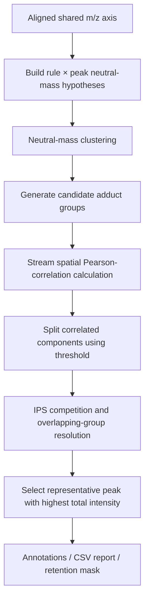

# Adduct Annotation and Filtering

This page introduces the adduct annotation and filtering module in MassFlow.

## Overview

Adduct filtering searches the aligned shared m/z axis for different ion forms that may originate from the same neutral molecule and uses spatial correlation of MSI pixel intensities to confirm candidate relationships. For each confirmed adduct group, the peak with the highest total intensity is retained as the representative peak, while the remaining unprotected peaks are removed.

This implementation is not a simple fixed m/z-difference filter:

1. Convert each observed m/z value into a neutral-mass hypothesis according to each adduct rule.
2. Cluster hypotheses with similar neutral masses.
3. Confirm candidate relationships using the Pearson correlation coefficient between pixel-intensity vectors.
4. Resolve overlapping candidate groups and determine representative peaks.
5. Generate auditable annotations, reports, and the final shared-m/z retention mask.

The input must satisfy the following requirements:

- continuous data, i.e. `continuous=True`;
- a shared m/z axis;
- peak alignment (`peak_align`) has already been performed;
- isotope filtering is recommended before peak alignment.

## Function Description

### Preprocessor.filter_peaks_by_adducts
```python
massflow.preprocess.api.PreprocessorAPI.filter_peaks_by_adducts(
    *,
    polarity: Literal["positive", "negative"] = "positive",
    ppm: float = 5.0,
    mzabs: float = 0.015,
    require_quasi: bool = True,
    min_spatial_correlation: float = 0.7,
    output_path: str | None = None,
    report_path: str | None = None,
) -> Self
```

- Function: finds and filters adduct peaks that may originate from the same compound. In each confirmed adduct group, the program retains one representative peak and removes other unprotected duplicate peaks.
- Parameters:
  - `polarity`: positive-ion or negative-ion rule table. This parameter must match the ionization mode used during experimental acquisition. An incorrect polarity setting causes the wrong adduct rules to be used.
  - `ppm`: relative tolerance component for neutral-mass clustering, default `5.0`. The input must be positive.
  - `mzabs`: absolute tolerance component for neutral-mass clustering, default `0.015`. The input must be non-negative.
  - `ppm` and `mzabs` jointly control the neutral-mass clustering width. Increasing them produces more candidate relationships but may also increase false candidates.
  - `require_quasi`: whether each candidate component must contain at least one major quasi-molecular rule, i.e. a rule with `quasi=True`. This prevents components composed only of non-quasi-molecular rules from entering the deletion stage.
  - `min_spatial_correlation`: minimum Pearson correlation coefficient between the pixel-intensity vectors of candidate peaks. The input must be in `[-1, 1]`. Higher values require more similar spatial distributions and make filtering more conservative.
  - `output_path`: imZML output path for this filtering stage.
  - `report_path`: output path for the CSV report. If no suffix is given, `.csv` is added automatically.
- Output:
  - the filtered `.imzML` file and its matching `.ibd` file;
  - CSV report.

Example:

```python
from massflow.data_manager import MSDataManagerImzML
from massflow.preprocess import Preprocessor

dm = MSDataManagerImzML(filepath="data/example.imzML")
dm.load_head_data()

filtered = (
    Preprocessor(
        dm,
        batch_size=512,
        temp_dir="temp/preprocess",
        output_path="data/adduct_filtered.imzML",
    )
    .peak_pick()
    .filter_peaks_by_isotopes()
    .peak_align()
    .filter_peaks_by_adducts(
        polarity="positive",
        ppm=5.0,
        mzabs=0.015,
        min_spatial_correlation=0.7,
        report_path="reports/adduct_filter.csv",
    )
    .start()
)

filtered.close()
dm.close()
```

This example performs the following steps:

1. Read the imZML data.
2. Perform peak picking.
3. Filter isotope peaks.
4. Complete peak alignment.
5. Perform adduct annotation and filtering.
6. Save the filtered imZML data and CSV report.

Example adduct-filtering result: 

### plot_adduct_filter

```python
from massflow.tools.plot_adduct_filter import plot_adduct_filter

# Peak alignment must be completed before using this function

result = plot_adduct_filter(
    aligned_dm,
    polarity="positive",
    min_spatial_correlation=0.7,
    batch_size=512,
    output_path="figures/adduct_filter_preview.png",
    report_path="reports/adduct_filter.csv",
    show=False,
)
```

- Function:
  calculates possible adduct relationships and generates a preview figure and CSV report. This function does not immediately delete peaks and is suitable when processing a new dataset for the first time.
- Parameters:
  - `polarity`: positive-ion or negative-ion rule table. This must match the ionization mode used during experimental acquisition.
  - `min_spatial_correlation`: minimum Pearson correlation coefficient between candidate peak pixel-intensity vectors.
  - `batch_size`: number of spectra read and processed in each batch.
- Output:
  - adduct-filter preview figure;
  - CSV report.

Adduct-filter preview:


The left side of the preview shows peaks that may be removed and their *m/z* differences from representative peaks. The right side shows the distribution of spatial correlation coefficients for candidate peak pairs. During inspection, focus on the number of peaks marked for removal, whether the correlation coefficients are concentrated above the threshold, and whether the candidate relationships are consistent with the current ionization mode.

### apply_adduct_annotations

```python
from massflow.preprocess.helper.adduct_filter_helper import (
    apply_adduct_annotations,
)

filtered_dm = apply_adduct_annotations(
    aligned_dm,
    result,
    output_path="data/adduct_filtered.imzML",
)
```

- Function:
  applies reviewed adduct-annotation results to the original data and generates a filtered imZML file.
- Output:
  - the filtered `.imzML` file;
  - its matching `.ibd` file.


## Recommended Preview-Then-Apply Workflow

If you use  `filter_peaks_by_adducts()` directly in the preprocessing workflow, the peak removal results will be applied immediately. It is recommended to first generate a preview and CSV report, verifying the adduct relationships, and then applying the filter.

example:

```python
from massflow.preprocess.helper.adduct_filter_helper import apply_adduct_annotations
from massflow.tools.plot_adduct_filter import plot_adduct_filter

# Peak alignment must be completed before this step

result = plot_adduct_filter(
    aligned_dm,
    polarity="positive",
    min_spatial_correlation=0.7,
    batch_size=512,
    output_path="figures/adduct_filter_preview.png",
    report_path="reports/adduct_filter.csv",
    show=False,
)

filtered_dm = apply_adduct_annotations(
    aligned_dm,
    result,
    output_path="data/adduct_filtered.imzML",
)
```

This process has two steps:

1. `plot_adduct_filter` calculates adduct relationships and generates a preview figure and CSV report without modifying the data immediately.
2. `apply_adduct_annotations` applies the reviewed annotation result to the original data and generates the filtered imZML file.


## Overall Workflow



## Default Adduct Rule Table

The current default rule set supports only rules with a single neutral molecule (`nmol=1`) and a single charge (`abs(charge)=1`).

### Positive-Ion Mode

| Rule | massdiff | quasi | IPS |
|------|---------:|:-----:|----:|
| `[M+H]+` | 1.007276 | Yes | 1.0 |
| `[M+Na]+` | 22.989218 | Yes | 1.0 |
| `[M+K]+` | 38.963158 | Yes | 1.0 |
| `[M+NH4]+` | 18.033823 | Yes | 1.0 |

### Negative-Ion Mode

| Rule | massdiff | quasi | IPS |
|------|---------:|:-----:|----:|
| `[M-H]-` | -1.007276 | Yes | 1.0 |
| `[M-2H+Na]-` | 20.974666 | No | 0.5 |
| `[M-2H+K]-` | 36.948606 | No | 0.5 |
| `[M+Cl]-` | 34.969402 | Yes | 1.0 |

Where:

- `massdiff` is the mass change of the adduct relative to the neutral molecule;
- `quasi` indicates whether the rule is treated as a quasi-molecular rule;
- `IPS` is used as a competition score when candidate groups overlap.

For an observed m/z and a `rule`, neutral mass is calculated as:

$$
\mathrm{neutral\_mass}
=
\frac{|\mathrm{charge}|\times m/z-\mathrm{massdiff}}
{\mathrm{nmol}}
$$

The current implementation rejects custom rules with `nmol != 1`, `abs(charge) != 1`, or a charge sign inconsistent with the selected polarity.

Therefore, the default rules contain only common adduct forms supported by the current version and should not be treated as a complete adduct library.

## How Candidate Relationships Are Evaluated

### Neutral-Mass Tolerance

The allowed neutral-mass difference is:

$$
tolerance
=
2 \times \mathrm{ppm} \times 10^{-6}
\times{neutral\_mass}
+
mzabs
$$

where:

- `ppm` controls the relative error associated with molecular mass;
- `mzabs` controls the fixed absolute error.

Similar neutral masses are only a candidate condition and do not directly cause peaks to be removed.

### Spatial Correlation

If two ion peaks originate from the same compound, they often show similar spatial distributions within the tissue.

The algorithm accumulates the sufficient statistics required for Pearson correlation in batches and does not load the complete pixel-by-feature matrix into memory at once. Only peak pairs satisfying:

```text
correlation >= min_spatial_correlation
```

are considered sufficiently correlated in space. A candidate neutral-mass group may be split into several independent spatial components.

### Representative Peaks and Protection Rules

- Each confirmed component selects the peak with the highest total intensity across all spectra as its representative peak.
- If intensities are same, the peak with the smaller index is selected.
- If a peak is the representative peak of any confirmed group, it is globally protected and will not be deleted because it appears in another group.
- Overlapping groups compete according to the total IPS score of their rules; lower-scoring groups are discarded.

## CSV Report

Each row in the report represents one piece of evidence supporting a deletion and includes:

- indices, m/z values, and adduct-rule names for the representative peak, removed peak, and supporting peak;
- neutral mass, neutral-mass span, and m/z difference;
- spatial correlation coefficient and its threshold;
- number of candidate relationships, number of relationships passing the threshold, and number of unique removed peaks;
- polarity, `ppm`, `mzabs`, `require_quasi`, and `batch_size`.

The same removed peak may have multiple supporting pieces of evidence. `summary_evidence` indicates whether a row is the main evidence for the current deletion result.


## Error Handling

- A `ValueError` is raised when the data are not aligned or do not have a shared m/z axis. If this occurs, run `peak_align` before adduct filtering.
- `batch_size` must be a positive integer. It specifies the number of spectra read and processed per batch.
- The report path must either have no suffix or use the `.csv` suffix.
- Rule names must be unique, and charge signs must match the selected polarity.

## Implementation and Provenance Scope

The algorithmic foundation of the current module is based on the primary additive rules, neutral mass assumption, candidate clustering, excimer/IPS competition, and maximum-intensity representative peak logic from CAMERA 1.68.0. The spatial-correlation components is MassFlow's adaptation for MSI data.

This implementation does not claim to cover CAMERA's complete dynamic rule table, isotope charge inference, or generalized OID causal processing. Whether the default rules and thresholds are suitable for a particular instrument and ionization condition should be evaluated by the user using the preview and report.

## References

- [`preprocess/helper/adduct_filter_helper.py`](https://github.com/NeoNexusX/MassFlow/blob/main/src/massflow/preprocess/helper/adduct_filter_helper.py): rules, candidate groups, correlations, reports, and public API
- [`preprocess/numba/adduct_filter_numba.py`](https://github.com/NeoNexusX/MassFlow/blob/main/src/massflow/preprocess/numba/adduct_filter_numba.py): streaming kernel for spatial-correlation statistics
- [`tools/plot_adduct_filter.py`](https://github.com/NeoNexusX/MassFlow/blob/main/src/massflow/tools/plot_adduct_filter.py): auditable preview figure
- [`preprocess/helper/stat_filter_helper.py`](https://github.com/NeoNexusX/MassFlow/blob/main/src/massflow/preprocess/helper/stat_filter_helper.py): shared-mask write-back
- [`preprocess/api.py`](https://github.com/NeoNexusX/MassFlow/blob/main/src/massflow/preprocess/api.py): `PreprocessorAPI.filter_peaks_by_adducts`, API entry point for adduct filtering
- [`preprocess/pipeline/planner.py`](https://github.com/NeoNexusX/MassFlow/blob/main/src/massflow/preprocess/pipeline/planner.py): dataset-level task order and output routing


Authors: Leqiang Dong, Jingwei Dong
