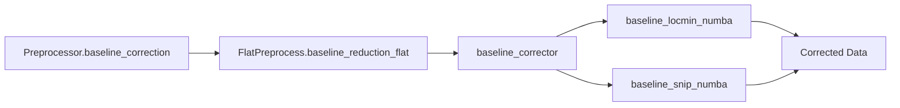

# MassFlow

This document introduces the baseline correction module in MassFlow, focusing on:
- Pipeline-level entry point `Preprocessor.baseline_correction`
- Core functions in `preprocess/helper/baseline_correction_helper.py`

## Overview

- Input and Output
  - Input is in flat array form (`mz_data`, `intensity`, `lengths`), representing m/z and intensity data for a batch of spectra.
  - Output is a baseline-corrected flat array; m/z and coordinates remain unchanged, intensity is the corrected result.
- Methods
  - LocMin Numba (`locmin_numba`): Estimates baseline via local extremum anchor interpolation, accelerated with Numba.
  - SNIP Numba (`snip_numba`): Multi-scale iterative clipping baseline estimation, accelerated with Numba, suitable for peak shape preservation.
- Baseline Scaling
  - `baseline_scale` scales the estimated baseline by a factor in `(0, 1]` (default `1.0`) to avoid over-subtraction.
  - The actual subtraction uses the "scaled baseline"; setting `baseline_scale=1.0` preserves the native algorithm behavior.

### Function Relationship Diagram



## Core API

### Preprocessor.baseline_correction (Pipeline Level)

```python
massflow.preprocess.api.PreprocessorAPI.baseline_correction(
    *,
    method: str = "locmin_numba",
    smooth: str = "none",
    span: float = 0.1,
    upper: bool = False,
    width: int = 5,
    niter: int = 15,
    baseline_scale: float = 1.0,
    m: int | None = None,
    decreasing: bool = True,
) -> Self
```

- Description: Pipeline-level baseline correction entry point. Performs baseline correction on all spectra in batches via `Preprocessor` chainable calls.
- Input: Bind a data manager via `Preprocessor(dm)`.
- Output: After calling `.start()`, returns a new `MSDataManagerImzML` whose spectral intensities are baseline-corrected.
- Supported methods: `"locmin_numba"`, `"snip_numba"`.
- Parameters:
  - `method`: Baseline correction method, default `"locmin_numba"`.
  - `smooth`: LocMin smoothing mode, `"none" | "loess" | "spline"`, default `"none"`.
  - `span`: Loess smoothing span ratio (0 < span ≤ 1), default 0.1.
  - `upper`: When `True`, uses local maxima as anchors (upper envelope), default `False`.
  - `width`: Neighborhood width for local extremum detection, default 5.
  - `niter`: Number of iterations for LocMin, default 15.
  - `baseline_scale`: Baseline scaling factor in `(0, 1]`, default 1.0.
  - `m`: SNIP half-window size; auto-selected if `None`.
  - `decreasing`: SNIP iteration direction, `True` for large-to-small windows.

Example:

```python
from massflow.data_manager import MSDataManagerImzML
from massflow.preprocess import Preprocessor
from massflow.tools.plot import plot_spectrum

FILE_PATH = "data/example.imzML"
dm = MSDataManagerImzML(filepath=FILE_PATH)
dm.load_head_data()

corrected = (
    Preprocessor(dm)
    .baseline_correction(method="locmin_numba", width=5, baseline_scale=1)
    .start()
)

plot_spectrum(
    base=dm.ms[0],
    target=corrected.ms[0],
    mz_range=(400.0, 450.0),
    intensity_range=(0.0, 500),
    metrics_box=True,
)

corrected.close()
dm.close()
```

### baseline_corrector (Helper Function Level)

```python
preprocess.helper.baseline_correction_helper.baseline_corrector(
    intensity: np.ndarray,
    method: str = "locmin_numba",
    smooth: str = "none",
    span: float = 0.1,
    upper: bool = False,
    width: int = 5,
    niter: int = 15,
    baseline_scale: float = 1.0,
    m: int | None = None,
    decreasing: bool = True,
    lengths: np.ndarray | None = None,
) -> tuple[np.ndarray, np.ndarray]
```

- Description: Flat-array baseline correction dispatcher. Calls the corresponding Numba backend based on `method`.
- Parameters:
  - `intensity`: One-dimensional flat intensity array.
  - `lengths`: Spectrum length array, used to split processing per-spectrum within Numba.
  - Other parameters are consistent with the pipeline-level API.
- Returns: `(corrected, scaled_baseline)` — the corrected intensity and the scaled baseline.
- Supported methods are limited to `"locmin_numba"` and `"snip_numba"`.
- Exceptions:
  - `ValueError`: Unsupported method; invalid `baseline_scale`.
  - `TypeError`: intensity is not a numpy array.

### FlatPreprocess.baseline_reduction_flat (Flat Batch Level)

```python
massflow.preprocess.flat_pre_fun.FlatPreprocess.baseline_reduction_flat(
    mz_data: np.ndarray,
    intensity: np.ndarray,
    lengths: np.ndarray,
    method: str = "locmin_numba",
    smooth: str = "none",
    span: float = 0.1,
    upper: bool = False,
    width: int = 5,
    niter: int = 15,
    baseline_scale: float = 1.0,
    m: int | None = None,
    decreasing: bool = True,
) -> FlatBatchResult
```

- Description: The underlying implementation of `Preprocessor.baseline_correction`. Returns a `FlatBatchResult` containing mz_data, corrected intensity, and lengths.

## Parameter and Tuning Recommendations

- General
  - `baseline_scale` (`(0,1]`): Smaller values reduce the risk of over-subtraction; `1.0` preserves native algorithm behavior.
- LocMin Numba
  - `width`: Larger windows produce sparser anchors; suggested starting range is 5–9. Must be an integer ≥ 3.
  - `upper`: Set to `True` for upper envelope; generally keep `False` for baseline.
  - `smooth`: `"none"` for raw interpolation; `"loess"` for local smoothing; `"spline"` for global smoothing.
  - `span`: Loess span can be 0.05–0.3; larger values produce smoother results.
- SNIP Numba
  - `m` (half-window): Auto-selected as `min(100, max(10, n//10))` by default; excessively large windows may cause over-subtraction.
  - `decreasing`: `True` (coarse-to-fine) is generally more robust; `False` (fine-to-coarse) emphasizes local priority.

## References

- `preprocess/helper/baseline_correction_helper.py`: Baseline correction dispatcher (baseline_corrector)
- `preprocess/numba/baseline_correction_numba.py`: Numba-accelerated implementation (baseline_locmin_numba, baseline_snip_numba)
- `preprocess/flat_pre_fun.py`: Flat preprocessing entry point (FlatPreprocess.baseline_reduction_flat)
- `preprocess/api.py`: Chainable API (PreprocessorAPI.baseline_correction)

## Error Handling and Logging

- Input validation: intensity must be a non-empty 1D numpy array, otherwise `TypeError` / `ValueError` is raised.
- Baseline scaling: `baseline_scale` must be finite and in `(0,1]`; otherwise `ValueError` is raised.
- Method validation: Only `"locmin_numba"` and `"snip_numba"` are supported; otherwise `ValueError` is raised.
