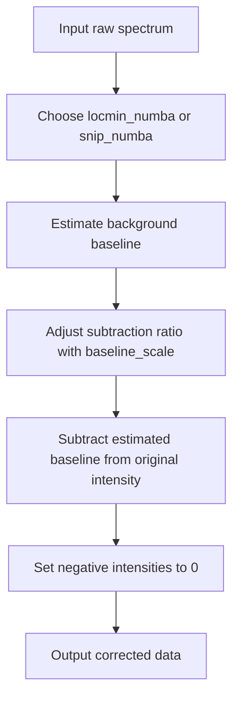

# Baseline Correction

This page introduces the baseline correction module in MassFlow.


If you  want to try MSI data processing online or search for MSI datasets of interest, visit https://sxo.bionet.pro and register for free.


## Overview

The baseline in a mass spectrum is a background signal that changes slowly with *m/z*. When the baseline is too high, it may affect peak-intensity comparison, normalization, and peak picking.

Baseline correction first estimates the background curve and then subtracts it from the original intensities, making true peaks easier to distinguish from the background. MassFlow sets corrected intensities below 0 to 0 while keeping the *m/z* values and spatial coordinates unchanged.

- Input and output
  - The input is the mass-spectrometry data to be processed. Users only need to provide the data-file path; MassFlow automatically reads the *m/z* values and signal intensities for each pixel.
  - The output is baseline-corrected mass-spectrometry data. The *m/z* positions and pixel coordinates remain unchanged, while the intensities are replaced by the corrected values.

- Methods:

  - LocMin (`locmin_numba`): estimates the background trend from locally low-intensity positions in a spectrum. It is suitable for routine baseline correction.

  - SNIP (`snip_numba`): estimates the background progressively through repeated iterations. It is generally more suitable for data with dense peaks or obvious background variation, while preserving peak shapes well.

## Check Whether Baseline Correction Is Needed First

Baseline correction is not required for every dataset.

Before processing, check the original profile spectrum:

- If the background between peaks is already close to a stable level, with no obvious overall elevation or slow drift, baseline correction is unnecessary.
- If the background between peaks is clearly above the zero level and changes slowly with *m/z*, then baseline correction should be considered.


## Function Description

### Preprocessor.baseline_correction

```python
massflow.preprocess.api.PreprocessorAPI.baseline_correction(
    *,
    method: str = "locmin_numba",
    smooth: str = "none",
    span: float = 0.1,
    upper: bool = False,
    width: int = 5,
    niter: int = 15,
    baseline_scale: float = 1.0,
    m: int | None = None,
    decreasing: bool = True,
) -> Self
```

- Function: performs baseline correction on all spectra in batches.

- Parameters:
  - `method`: baseline correction method. The default is `"locmin_numba"`. Available methods are `"locmin_numba"` and `"snip_numba"`.
  - `baseline_scale`: baseline scaling factor in the range `(0, 1]`, default `1.0`. Smaller values make over-subtraction less likely; `1.0` preserves the original algorithm behavior.
  - Parameters used with the LocMin Numba method:
    - `smooth`: LocMin smoothing method. `"none"` uses the original interpolation and `"loess"` uses local smoothing. Default: `"none"`..
    - `span`: Loess smoothing span ratio (`0 < span <= 1`), default `0.1`. Larger values produce stronger smoothing.
    - `upper`: when `True`, local maxima are used as anchors to form an upper envelope. Default: `False`. Set it to `True` only when an upper envelope is needed; for ordinary baseline correction, keep it `False`.
    - `width`: neighborhood width for local-extrema detection, default `5`. Larger windows produce sparser anchors. A starting range of 5–9 is recommended. It must be an integer and `>= 3`.
    - `niter`: number of LocMin iterations, default `15`.
  
  - Parameters used with the SNIP Numba method:
    - `m`: SNIP window half-width. If `None`, it is selected automatically. The default automatic value is `min(100, max(10, n//10))`; an excessively large window may cause over-subtraction.
    - `decreasing`: SNIP iteration direction. `True` means from large to small. `True` (coarse to fine) is usually more robust, while `False` (fine to coarse) gives higher priority to local structure.
  

Example:

```python
from massflow.data_manager import MSDataManagerImzML
from massflow.preprocess import Preprocessor
from massflow.tools.plot import plot_spectrum
from massflow.tools.imzml_monkey_patch import risky_imzml_loader

with risky_imzml_loader():
    dm = MSDataManagerImzML(filepath="data/example.imzML")
    dm.load_head_data()

corrected = (
    Preprocessor(dm)
    .baseline_correction(method="locmin_numba", width=5, baseline_scale=1)
    .start()
)

plot_spectrum(
    base=dm.ms[0],
    target=corrected.ms[0],
    mz_range=(400.0, 450.0),
    intensity_range=(0.0, 50),
    metrics_box=True,
)

corrected.close()
dm.close()
```

This example performs the following steps:

1. Read the imZML data.
2. Estimate the baseline of each spectrum using the LocMin method.
3. Subtract the baseline from the original intensities.
4. Set corrected intensities below 0 to 0.
5. Display a comparison of the spectra before and after processing.

Example output:


## Overall Processing Workflow



## Error Handling and Logging

- The input data must be a non-empty one-dimensional NumPy array; otherwise, a `TypeError` or `ValueError` is raised.
- `baseline_scale` must be a finite value in `(0, 1]`; otherwise, a `ValueError` is raised.
- Only `"locmin_numba"` and `"snip_numba"` are supported. Any other method raises a `ValueError`.

## References

- [`preprocess/helper/baseline_correction_helper.py`](https://github.com/NeoNexusX/MassFlow/blob/main/src/massflow/preprocess/helper/baseline_correction_helper.py): baseline correction dispatcher (`baseline_corrector`)
- [`preprocess/numba/baseline_correction_numba.py`](https://github.com/NeoNexusX/MassFlow/blob/main/src/massflow/preprocess/numba/baseline_correction_numba.py): Numba-accelerated implementation (`baseline_locmin_numba`, `baseline_snip_numba`)
- [`preprocess/flat_pre_fun.py`](https://github.com/NeoNexusX/MassFlow/blob/main/src/massflow/preprocess/flat_pre_fun.py): `FlatPreprocess.baseline_reduction_flat`, preprocessing entry point for flat data arrays
- [`preprocess/api.py`](https://github.com/NeoNexusX/MassFlow/blob/main/src/massflow/preprocess/api.py): `PreprocessorAPI.baseline_correction`, API entry point for baseline correction


Authors: Leqiang Dong, Jingwei Dong
