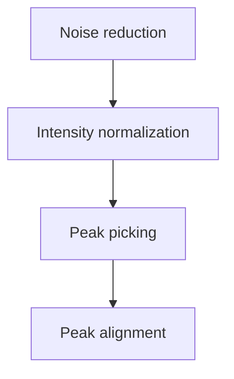
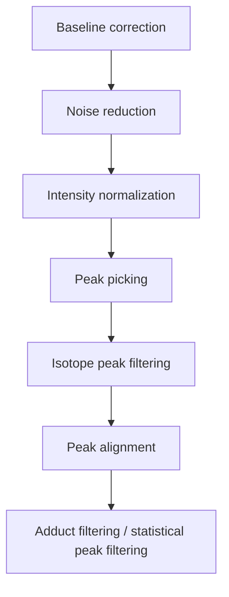

# Getting Started

MassFlow is a modular computing framework for mass spectrometry imaging (MSI) and mass spectrometry (MS) data. It provides efficient data loading, preprocessing, and data-management functions.


If you want to try MSI data processing online or search for MSI datasets of interest, visit https://sxo.bionet.pro and register for free.


## Overview

MSI datasets usually contain large numbers of pixels and mass-spectrometry measurements. Direct analysis can be affected by background signals, noise, peak-position shifts, and low-quality peaks.

MassFlow integrates commonly used MSI preprocessing steps into a single workflow. Users only need to provide the data files and select the processing steps they want to run to generate a new MSI dataset.

It is suitable for:

- MSI, metabolomics, and mass-spectrometry researchers who want to preprocess imZML data;
- users who want to perform peak picking, peak alignment, isotope filtering, adduct filtering, or statistical filtering;
- users who want to further inspect ion images or perform UMAP/KMeans-based tissue-region analysis.

## What MassFlow Can Do

- **Read MSI data** — Directly read `.imzML` and `.ibd` files for subsequent processing.
- **Baseline correction** — Remove background signals that change slowly with *m/z*.
- **Noise reduction** — Reduce random fluctuations in spectra so that true peaks become clearer.
- **Intensity normalization** — Reduce differences in overall signal intensity between pixels.
- **Peak picking** — Identify major ion peaks from profile spectra.
- **Peak alignment** — Map nearby peaks from different pixels to common *m/z* positions.
- **Peak filtering** — Remove selected duplicate or low-quality peaks based on isotope relationships, adduct relationships, or statistical characteristics.
- **Spatial analysis** — View ion images and use UMAP/KMeans to help inspect different tissue regions.

## Quick Start
### 1. Prepare the Data

Prepare a matching pair of `.imzML` and `.ibd` files and place them in the same folder, for example:

```text
data/
├── example.imzML
└── example.ibd
```

The `.imzML` file stores experimental metadata and mass-spectrometry structure information, while the `.ibd` file stores the actual mass-spectrometry data. They must be used together.

### 2. Set Up the Python Environment for MassFlow

If you are currently in a Conda environment, you can exit it first:

```
conda deactivate
```


Then install `uv`. Two methods are provided.

Method 1:

- **Windows:**

  ```
  powershell -ExecutionPolicy ByPass -c "irm https://astral.sh/uv/install.ps1 | iex"
  ```


- **Linux/macOS:**

  ```
  curl -LsSf https://astral.sh/uv/install.sh | sh
  ```


Method 2:

- Open a terminal (PowerShell) and enter:

```text
pip install uv
```


After installing `uv`, enter:

```
uv --version
```

This checks whether `uv` was installed successfully. If the installation is successful, the currently installed `uv` version will be displayed.


After installation, run the following command in the MassFlow project directory:

```
uv sync
```

`uv sync` automatically creates a virtual environment and installs the dependencies required by MassFlow according to the project's `pyproject.toml` and `uv.lock` files.

Install the optional R-backend dependencies:

```
uv sync --extra r
```


Finally, run `main.py` to verify that the environment has been configured successfully:

```text
uv run python main.py
```


### 3. Run Your First Processing Workflow

Create a new Python file, for example:

```text
run_massflow.py
```

Copy the following code:

```python
from massflow.data_manager import MSDataManagerImzML
from massflow.preprocess import Preprocessor


dm = MSDataManagerImzML(
    filepath="data/example.imzML"
)
dm.load_head_data()

processed = (
    Preprocessor(
        dm,
        output_path="data/processed.imzML",
    )
    .noise_reduction()
    .normalization()
    .peak_pick()
    .peak_align()
    .start()
)

processed.close()
dm.close() # Close dm after all workflows that use it are complete.
```

After processing, the following new files will be generated:

```text
processed.imzML
processed.ibd
```

The original data will not be modified.

This code performs the following steps in sequence:



This is a basic workflow intended for getting started quickly. It does not mean that every dataset must use exactly the same sequence. Before formal analysis, choose functions based on your data type and the observed processing results.

### 4. Add Peak Filtering When Needed

If you want to further remove isotope peaks, possible adduct peaks, or low-frequency peaks, you can add the corresponding processing steps.

For example:

```python
processed = (
    Preprocessor(
        dm,
        output_path="data/processed.imzML",
    )
    .baseline_correction()
    .noise_reduction()
    .normalization()
    .peak_pick()
    .filter_peaks_by_isotopes()
    .peak_align()
    .filter_peaks_by_adducts(
        polarity="positive",
    )
    .start()
)
```

Peak filtering actually removes some peaks. Therefore, when processing a new dataset for the first time, it is recommended to review the corresponding function page and confirm the parameters and results before applying the filter.

For adduct filtering in particular, it is recommended to inspect the preview results and CSV report before deciding whether to remove peaks formally.


## Recommended Processing Order

A commonly used preprocessing order in MassFlow is:



Not every dataset needs every step.

For example:

- Data without baseline drift do not require baseline correction.
- Data that are already in centroid form do not need peak picking again.
- If isotope peaks do not need to be removed, isotope filtering can be skipped.
- If adduct relationships are not part of the analysis, adduct filtering can be skipped.
- Whether statistical peak filtering is needed depends on the downstream analysis goal.

## Next Steps

After your first successful run, continue with the pages that are relevant to your analysis:

- [Baseline Correction](./baseline_correction.md): remove the background baseline from mass spectra;
- [Noise Reduction](./noise_reduction.md): reduce random fluctuations in spectra;
- [Intensity Normalization](./normalization.md): reduce overall intensity differences between pixels;
- [Peak Picking](./peak_pick.md): identify ion peaks from profile spectra;
- [Isotope Peak Filtering](./isotope_filter.md): remove confirmed higher-order isotope peaks;
- [Peak Alignment](./peak_alignment.md): establish a common reference *m/z* axis;
- [Adduct Annotation and Filtering](./adduct_filter.md): identify and inspect possible adduct relationships;
- [Statistical Peak Filtering](./stat_filter.md): further filter peaks based on occurrence frequency and intensity;
- [Ion Image Loading and Plotting](./ion_image_visualization.md): inspect spatial distributions after processing;
- [UMAP Dimensionality Reduction and Visualization](./umap.md): inspect overall spectral differences between pixels;
- [KMeans Tissue Region Segmentation](./segmentation.md): inspect segmentation results and generate region masks.

Each function page further explains parameter meanings, usage, and how to handle common errors.


Authors: Leqiang Dong, Jingwei Dong
