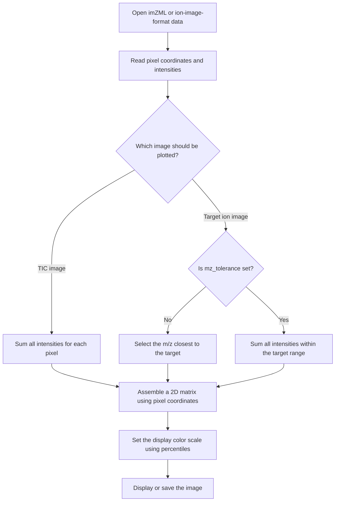

# Loading and Plotting Ion Images

This page introduces the functions for loading and plotting ion images and total ion current (TIC) images in MassFlow.


Authors: Leqiang Dong, Jingwei Dong

**Feedback:** If you find any problems while using MassFlow or reading the documentation, you can submit feedback through [GitHub Issues](https://github.com/NeoNexusX/MassFlow/issues), or contact us by email at 707244007@qq.com.

## Overview

An ion image is used to inspect the spatial distribution of a particular *m/z* signal in a tissue section. Each position in the image corresponds to an acquisition pixel, and the color represents the signal intensity near the target *m/z* value at that pixel.

A total ion current image (TIC image) sums all intensities in each pixel spectrum. It can be used to quickly inspect:

- the approximate outline of the tissue;
- whether blank regions, unusually bright spots, or scan gaps are present;
- whether the data coordinates are broadly consistent with the actual tissue-section orientation;
- whether the spatial data provide a usable basis for subsequent tissue-region segmentation.

This module can directly read:

- imZML data: `MSDataManagerImzML`;
- MassFlow Binary ion-image data: `IonImageDataManagerBinary`;
- MassFlow H5 ion-image data: `IonImageDataManagerH5`;
- MassFlow ion-image Zarr data: `IonImageDataManagerZarr`.

For imZML data, all pixels may share the same *m/z* array, or each pixel may store its own peak list. The latter is commonly referred to as `processed` data in file metadata. For this type of data, the program searches for the target *m/z* separately in each spectrum.


## Function Description

### read_ion_image (Use When You Need the Numerical Matrix)

```python
massflow.tools.plot_ion_image.read_ion_image(
    data_manager,
    *,
    mz: float | None = None,
    batch_size: int = 256,
    max_threads: int = 2,
    mz_tolerance: float | None = None,
) -> numpy.ndarray
```

- Function: loads the ion image for a target *m/z* and returns a two-dimensional intensity matrix.
- Feature: it only reads the data; it does not display or automatically save an image.
- Parameters:
  - `data_manager`: the opened dataset.
  - `mz`: target *m/z*; this parameter is required.
  - `batch_size`: number of spectra read per imZML batch, default `256`. Increasing it may improve reading speed but also increases memory usage.
  - `max_threads`: maximum number of threads used for imZML reading, default `2`.
  - `mz_tolerance`: absolute range on each side of the target *m/z*. When set as `None`, only the single position closest to the target value is read. When a value is provided, all intensities within the range are summed. This parameter must be non-negative.
- Output:
  - a two-dimensional matrix with shape “image height × image width”;
  - unacquired positions are usually `0`.

### plot_ion_image

```python
massflow.tools.plot_ion_image.plot_ion_image(
    data_manager,
    *,
    mz: float | None = None,
    batch_size: int = 256,
    max_threads: int = 2,
    mz_tolerance: float | None = None,
    output_path: str | Path | None = None,
    show: bool = True,
    dpi: int = 300,
    figsize: tuple[float, float] = (20, 5),
    title: str | None = None,
    structure_only: bool = False,
    cmap: str = "viridis",
    percentiles: tuple[float, float] = (0, 95),
    scale_factor: float = 1,
) -> None
```

- Function: reads the target *m/z* and plots an ion image.
- Parameters:
  - `mz`, `batch_size`, `max_threads`, `mz_tolerance`: same as in `read_ion_image`.
  - `output_path`: image output path. When specified, the parent directory is created automatically and the image is saved.
  - `show`: whether to display the image. For batch scripts, `False` is recommended. When `show=True`, the image is displayed after the code finishes running.
  - `dpi`: image resolution, default `300`.
  - `figsize`: canvas size for an image that includes axes.
  - `title`: image title.
  - `structure_only`: when `True`, only the actually acquired region is retained and the background is transparent. Axes, color bar, and title are not displayed. To read the intensity range represented by the colors, use `structure_only=False`.
  - `cmap`: color map, default `"viridis"`.
  - `percentiles`: displayed color range, default `percentiles=(0, 95)`. Lowering the upper percentile can make weak signals more visible, but may also saturate high-intensity regions.
  - `scale_factor`: overall image scaling factor; it must be greater than `0`.
- Output: the generated ion image.

Example:

```python
from massflow.data_manager import MSDataManagerImzML
from massflow.tools.plot_ion_image import plot_ion_image


dm = MSDataManagerImzML(filepath="data/example.imzML")
dm.load_head_data()

plot_ion_image(
    dm,
    mz=500.2000,
    mz_tolerance=0.01,
    output_path="figures/ion_500_2000.png",
    title="m/z 500.2000",
    structure_only=False,
    percentiles=(0, 95),
    show=False,
)

dm.close()
```

Example ion-image output:


### read_tic_image (Use When You Need the Numerical Matrix)

```python
massflow.tools.plot_ion_image.read_tic_image(
    data_manager,
    *,
    batch_size: int = 256,
    max_threads: int = 2,
) -> numpy.ndarray
```

- Function: sums all intensities in each pixel spectrum and returns a two-dimensional TIC matrix.
- Output: a two-dimensional matrix with shape “image height × image width.”
- Feature: it does not save an image or modify the data.

### plot_tic_image

```python
massflow.tools.plot_ion_image.plot_tic_image(
    data_manager,
    *,
    batch_size: int = 256,
    max_threads: int = 2,
    output_path: str | Path = "./tic_image_output/tic_image.png",
    save_image: bool = True,
    save_matrix: bool = False,
    show: bool = False,
    dpi: int = 300,
    figsize: tuple[float, float] = (20, 5),
    title: str | None = None,
    structure_only: bool = True,
    cmap: str = "viridis",
    percentiles: tuple[float, float] = (0, 95),
    scale_factor: float = 1,
) -> bool
```

- Function: generates and saves a TIC image.
- Parameters:
  - `save_image`: whether to save the image, default `True`.
  - `save_matrix`: whether to also save the numerical TIC matrix, default `False`.
  - `structure_only`: default `True`, which outputs a tissue-outline image on a transparent background. Axes, color bar, and title are not displayed in this mode. To read the intensity range represented by the colors, use `structure_only=False`.
  - Other plotting parameters are the same as in `plot_ion_image`.
- Output:
  - by default, the TIC image is saved as `tic_image.png`;
  - when `save_matrix=True`, a `tic_result.zarr` file is generated in the same folder as the image, with an array named `tic_matrix`.

Example:

```python
from massflow.data_manager import MSDataManagerImzML
from massflow.tools.plot_ion_image import plot_tic_image


dm = MSDataManagerImzML(filepath="data/example.imzML")
dm.load_head_data()

plot_tic_image(
    dm,
    output_path="figures/tic_image.png",
    save_image=True,
    save_matrix=True,
    structure_only=True,
    show=False,
)

dm.close()
```

Example TIC output:


### Reading MassFlow Ion-Image Formats

When data have already been saved as Binary, H5, or ion-image Zarr, there is no need to call `load_head_data()`.

```python
from massflow.data_manager import IonImageDataManagerZarr
from massflow.tools.plot_ion_image import plot_ion_image


dm = IonImageDataManagerZarr(
    filepath="data/example_ion_image.zarr",
    mode="r",
)

```

For Binary and H5, only the data manager needs to be changed:

```python
from massflow.data_manager import (
    IonImageDataManagerBinary,
    IonImageDataManagerH5,
)

binary_dm = IonImageDataManagerBinary(filepath="data/example.iib", mode="r")
h5_dm = IonImageDataManagerH5(filepath="data/example.h5", mode="r")
```


## Overall Workflow



## How *m/z* Is Selected

### Without `mz_tolerance`

```python
mz_tolerance=None
```

The program selects the *m/z* position closest to the target value:

- for data with a shared *m/z* axis, the same nearest position is used for the entire dataset;
- for processed imZML data, each spectrum searches independently for its own nearest position;
- even if the nearest position is far from the target value, the program does not reject it automatically. Users should check the actual *m/z* axis and the instrument mass error first.

### With `mz_tolerance`

```python
mz=500.0
mz_tolerance=0.01
```

The program sums intensities in the following range:

```text
499.99 <= m/z <= 500.01
```

The boundaries are included. If multiple *m/z* positions fall inside the range, their intensities are summed. If no positions fall inside the range, the result is `0`.

`mz_tolerance` uses absolute *m/z* units. The current function does not provide a ppm option. If your experimental method uses ppm, convert it to an absolute range around the target *m/z* first.

### How to Choose the Tolerance

- A tolerance that is too small may miss a target peak with slight drift.
- A tolerance that is too large may also sum neighboring compounds, isotope peaks, or other interfering peaks.
- For processed data, peak positions may differ between pixels, so the range should be selected according to the instrument's mass accuracy.
- For peak-aligned data, a smaller range can usually be used, or the nearest *m/z* position can be selected directly.

## Error Handling

- Error `"'mz' is required"`: no `mz` value was provided when calling an ion-image function.
- No pixels are read: check the file contents, `target_locs`, and whether the data were opened successfully.
- The image is almost entirely black: try lowering the upper `percentiles` value and check whether the target *m/z* exists.
- Large regions are saturated: increase the upper `percentiles` value or check for extremely high-intensity pixels.

## References

- [`tools/plot_ion_image.py`](https://github.com/NeoNexusX/MassFlow/blob/main/src/massflow/tools/plot_ion_image.py): public functions for ion-image and TIC loading and plotting
- [`data_manager/ms_data_manager_imzml.py`](https://github.com/NeoNexusX/MassFlow/blob/main/src/massflow/data_manager/ms_data_manager_imzml.py): imZML data loading
- [`data_manager/ion_image_data_manager_binary.py`](https://github.com/NeoNexusX/MassFlow/blob/main/src/massflow/data_manager/ion_image_data_manager_binary.py): Binary ion-image data
- [`data_manager/ion_image_data_manager_h5.py`](https://github.com/NeoNexusX/MassFlow/blob/main/src/massflow/data_manager/ion_image_data_manager_h5.py): H5 ion-image data
- [`data_manager/ion_image_data_manager_zarr.py`](https://github.com/NeoNexusX/MassFlow/blob/main/src/massflow/data_manager/ion_image_data_manager_zarr.py): ion-image Zarr data
