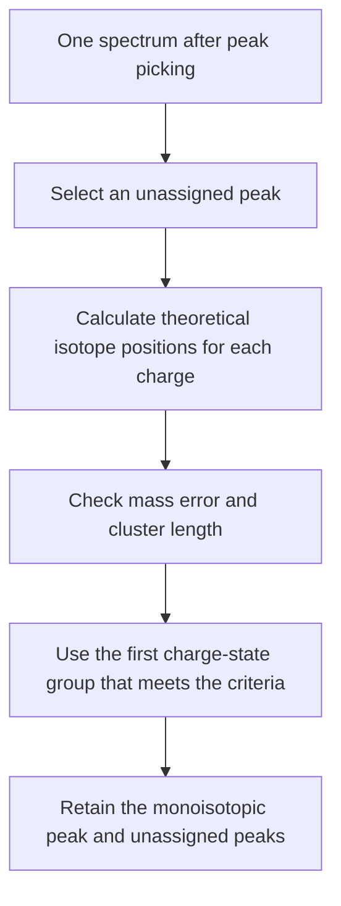

# Isotope Peak Filtering

This page introduces the isotope peak filtering module in MassFlow.


Authors: Leqiang Dong, Jingwei Dong

**Feedback:** If you find any problems while using MassFlow or reading the documentation, you can submit feedback through [GitHub Issues](https://github.com/NeoNexusX/MassFlow/issues), or contact us by email at 707244007@qq.com.

## Overview

Because naturally occurring isotopes are present, the same compound often produces a group of neighboring peaks in a mass spectrum. Isotope peak filtering is used after peak picking to identify later isotope peaks within the same isotope cluster, while retaining only the starting peak with the lowest *m/z* value and peaks that are not assigned to an isotope cluster.

- The input must already have been processed and centroided: each spectrum has its own peak *m/z* array.
- The program checks each pixel's spectrum separately and does not mix peaks from different pixels when making assignments.
- Data points identified as later isotope peaks are actually removed.
- The recommended order is  `peak_pick → filter_peaks_by_isotopes → peak_align`.

## Function Description

### Preprocessor.filter_peaks_by_isotopes

```python
massflow.preprocess.api.PreprocessorAPI.filter_peaks_by_isotopes(
    *,
    mz_tolerance: float = 10.0,
    units: Literal["da", "ppm"] = "ppm",
    min_charge: int = 1,
    max_charge: int = 3,
    min_isotope_count: int = 3,
    max_isotope_count: int = 10,
    use_decreasing_model: bool = True,
    start_intensity_check: int = 2,
) -> Self
```

- Function: identifies isotope clusters in each centroided spectrum and removes every peak in a cluster except the starting peak with the lowest *m/z* value.
- Parameters:
  - `mz_tolerance`: isotope-peak matching tolerance, default `10.0`. The input value must be finite and positive.
  - `units`: tolerance unit, `"ppm"` or `"da"`, default `"ppm"`. The `ppm` tolerance cannot exceed `100 ppm`, and the `da` tolerance cannot exceed `0.1 Da`.
  - The default `mz_tolerance=10.0` is intended to work with the default `units=“ppm”`. If you change the units to `“da”`, you must also adjust `mz_tolerance` to a value appropriate for Da units.
  - `min_charge`, `max_charge`: charge range to search. Charges are tested from `max_charge` down to `min_charge`. The range must satisfy `1 <= min_charge <= max_charge`.
  - `min_isotope_count`: minimum number of peaks required for a candidate cluster to be accepted, including the starting peak.
  - `max_isotope_count`: maximum number of peaks checked for a candidate cluster, including the starting peak.
  - The isotope-count settings must satisfy `2 <= min_isotope_count <= max_isotope_count`.
  - `use_decreasing_model`: whether to apply a decreasing-intensity constraint to later isotope peaks.
  - `start_intensity_check`: isotope index from which the decreasing-intensity check begins, default `2`. The input must be a non-negative integer.

Example:

```python
from massflow.data_manager import MSDataManagerImzML
from massflow.preprocess import Preprocessor

dm = MSDataManagerImzML(filepath="data/example.imzML")
dm.load_head_data()

filtered = (
    Preprocessor(
        dm,
        batch_size=512,
        output_path="data/isotope_filtered.imzML",
    )
    .peak_pick(method="mad", snr=2.0)
    .filter_peaks_by_isotopes(
        mz_tolerance=10.0,
        units="ppm",
        min_charge=1,
        max_charge=3,
        min_isotope_count=3,
    )
    .start()
)

filtered.close()
dm.close()
```

This example performs the following steps:

1. Read the imZML data.
2. Convert each profile spectrum into its own centroid peak list.
3. Search for isotope groups in charge states from 1 to 3.
4. Retain the starting peak of each group and remove the later peaks.
5. Save the filtered peak lists.


### Workflow




## Algorithm Description

The current implementation uses a fixed carbon-isotope mass difference:

```text
ISOTOPE_MASS_DIFFERENCE = 1.003354838 Da
```

For a starting peak `M` and charge `z`, the expected position of the `k`-th candidate isotope peak is:

$$
(m/z)_{\mathrm{expected}}
=
M
+
\frac{k \times 1.003354838}{z}
$$

Each spectrum is processed as follows:

1. Start from the lowest *m/z* unassigned peak.
2. Test charge states in the order `max_charge → min_charge`.
3. For each expected *m/z* value, select the peak with the smallest error inside the tolerance window.
4. Stop extending the cluster if a peak is missing, has already been assigned, or does not satisfy the intensity model.
5. If the cluster size reaches `min_isotope_count`, retain the starting peak and remove the remaining isotope peaks.
6. Peaks that do not form a valid isotope cluster remain unchanged.

### Decreasing-Intensity Model

With the default `start_intensity_check=2`, the algorithm does not require M+1 to be lower than the starting peak. Instead, it begins comparing intensities from M+2 onward: each current candidate peak must not be higher than the previous peak already found. If the true isotope distribution does not follow this simplified condition, the algorithm may not confirm the group. If `start_intensity_check` is set to a value greater than or equal to `max_isotope_count`, the loop never reaches the intensity-check starting point. In that case, although `use_decreasing_model=True` remains set, the decreasing-intensity check is effectively not performed. The current API does not prevent this parameter combination.

## Usage Notes

- Do not use this algorithm after `peak_align`. A shared *m/z* axis is recognized as continuous-form data and triggers a `ValueError`.
- The current implementation uses only isotope mass spacing and an optional intensity trend. It does not use molecular formulas, theoretical isotope abundances, or spatial correlation.
- Larger `max_charge` and `max_isotope_count` values increase the search work required for each starting peak.
- A tolerance that is too wide may group nearby non-isotope peaks into a cluster; a tolerance that is too narrow may miss true isotope peaks.

## References

- [`preprocess/helper/isotope_filter_helper.py`](https://github.com/NeoNexusX/MassFlow/blob/main/src/massflow/preprocess/helper/isotope_filter_helper.py): input validation and array-compaction entry point
- [`preprocess/numba/isotope_filter_numba.py`](https://github.com/NeoNexusX/MassFlow/blob/main/src/massflow/preprocess/numba/isotope_filter_numba.py): per-spectrum retention mask and Numba parallel implementation
- [`preprocess/flat_pre_fun.py`](https://github.com/NeoNexusX/MassFlow/blob/main/src/massflow/preprocess/flat_pre_fun.py): `FlatPreprocess.isotope_filter_flat`, preprocessing entry point for flat data arrays
- [`preprocess/api.py`](https://github.com/NeoNexusX/MassFlow/blob/main/src/massflow/preprocess/api.py): `PreprocessorAPI.filter_peaks_by_isotopes`, API entry point for isotope filtering
- [`preprocess/pipeline/planner.py`](https://github.com/NeoNexusX/MassFlow/blob/main/src/massflow/preprocess/pipeline/planner.py): execution order for peak picking, isotope filtering, reference-axis construction, and peak alignment
