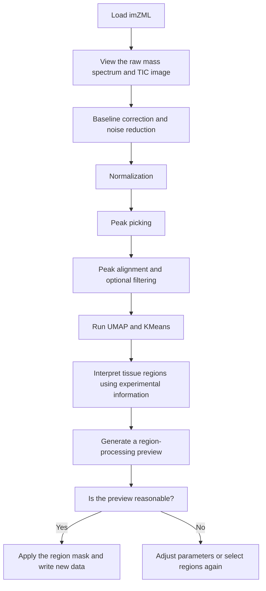

# Best Practices

This page explains how to load imZML data in Jupyter Notebook, perform preprocessing step by step, and use `SegmentationPipeline` for UMAP, KMeans, region selection, and writing a new imZML dataset.


Authors: Leqiang Dong, Jingwei Dong

**Feedback:** If you find any problems while using MassFlow or reading the documentation, you can submit feedback through [GitHub Issues](https://github.com/NeoNexusX/MassFlow/issues), or contact us by email at 707244007@qq.com.

## 1. Workflow

Jupyter Notebook allows a complete data-processing workflow to be divided into multiple code cells and run step by step. After each step, you can check the result and then decide whether to adjust the parameters or continue to the next step. The example code on this page should be run from top to bottom. Later code cells use results created by earlier cells, so when using this page for the first time, do not skip the previous steps.

This page uses the following workflow as an example:



All algorithms in this page use their default parameters to demonstrate the complete workflow. The default parameters may not be suitable for every dataset. For better results, adjust the parameters according to your data and refer to the corresponding documentation.

## 2. Prepare Jupyter Notebook

Before starting, make sure that MassFlow and Jupyter are installed in the current Python environment.

If Jupyter is not yet installed in the current MassFlow environment, install it in a terminal opened in the MassFlow project directory:

```
pip install jupyter
```

After installation, run:

```
jupyter notebook
```

If you use Jupyter Lab, you can run:

```
jupyter lab
```

After Jupyter starts successfully, the Jupyter page will open in your web browser.

As shown below:


## 3. Prepare the Working Directory

Start Jupyter in your own data-analysis folder and create a new Python Notebook, for example: `imzml_workflow.ipynb`

The following folder structure is recommended:

```
my_msi_analysis/
├── data/
│   ├── example.imzML
│   └── example.ibd
├── processed_data/          # Preprocessed and region-processed imzML data
├── segmentation_results/   # UMAP, KMeans, and region previews
├── tic_image/              # TIC images
└── imzml_workflow.ipynb
```

The folders are used as follows:

- `data/`: stores the original `.imzML` and `.ibd` files;
- `processed_data/`: stores preprocessed and region-processed data;
- `segmentation_results/`: stores UMAP, KMeans, and region-preview results;
- `tic_image/`: stores TIC images;
- `imzml_workflow.ipynb`: stores the analysis workflow in this Notebook.

The `.imzML` file and its corresponding `.ibd` file must use the same file name and be placed in the same folder.

In the code, you only need to provide the path to the `.imzML` file. All relative paths used later in this page are based on the working directory `my_msi_analysis`.

The steps for creating a Python Notebook are shown below:


## 4. Load imzML Data

### 4.1 Create a Data Manager

Create the first code cell:

```
from massflow.data_manager import MSDataManagerImzML
from massflow.preprocess import Preprocessor
from massflow.segmentation import SegmentationPipeline
from massflow.tools.plot import plot_spectrum
from massflow.tools.plot_ion_image import plot_tic_image

dm = MSDataManagerImzML(filepath="./data/example.imzML")
dm.load_head_data()
```

After running the cell, the variable `dm` will be created in the current Notebook.

### 4.2 View a Raw Mass Spectrum

You can view any mass spectrum and the *m/z* range you want to inspect:

```
plot_spectrum(dm.ms[1], mz_range=(400, 600))
```

Here, `mz_range=(400, 600)` means that only the *m/z* range from 400 to 600 is displayed. You can change this range according to your data.


### 4.3 View the Raw TIC Image

```
plot_tic_image(
    dm,
    output_path="./tic_image/tic_image.png",
    save_image=True,
    show=True
)
```

The TIC image can be used to inspect the tissue outline, blank regions, unusually strong signals, and scan gaps.


## 5. Perform Preprocessing Step by Step

### 5.1 Baseline Correction and Noise Reduction

Baseline correction is not required for every dataset. It is recommended to add `baseline_correction()` only when the baseline is clearly elevated or shows a slow drift.

Noise reduction is used to reduce rapid, small fluctuations in a continuous mass spectrum.

The current example performs both baseline correction and noise reduction:

```
bc_and_nr_dm = (
    Preprocessor(
        dm,
        output_path="./processed_data/bc_and_nr.imzML",
    )
    .baseline_correction()  # Use when the baseline is clearly elevated or slowly drifting
    .noise_reduction()
    .start()
)
```

View the processed result:

```
plot_spectrum(bc_and_nr_dm.ms[1], mz_range=(400, 600))
```


### 5.2 Normalization

Normalization is used to reduce differences in overall signal intensity between pixels.

After confirming that the previous processing step is reasonable, then perform normalization:

```
normalized_dm = (
    Preprocessor(
        bc_and_nr_dm,  # Variable created after baseline correction and noise reduction in Stage 1
        output_path="./processed_data/normalized.imzML",
    )
    .normalization()
    .start()
)
```

View the TIC image after normalization:

```
plot_tic_image(
    normalized_dm,
    output_path="./tic_image/tic_image_normalized.png",
    save_image=True,
    show=True
)
```


After normalization, focus on whether the overall intensity differences between different regions are more suitable for comparison. Do not judge whether the processing is reasonable based only on the TIC image. The result should also be considered together with target ions and the experimental purpose.

### 5.3 Peak Picking

Peak picking converts a profile mass spectrum into a centroid mass spectrum that retains only peak positions and peak intensities:

```
picked_dm = (
    Preprocessor(
        normalized_dm,  # Variable created after normalization in Stage 2
        output_path="./processed_data/peak_picked.imzML",
    )
    .peak_pick()
    .start()
)
```

View the results before and after peak picking:

```
plot_spectrum(
    base=normalized_dm.ms[1],
    target=picked_dm.ms[1],
    mz_range=(400, 420),
    plot_mode=["line", "stem"],
    metrics_box=False,
)
```

Comparison between the continuous profile mass spectrum before peak picking and the stem plot after peak picking:


Here:

- the continuous line represents the profile mass spectrum before peak picking;
- the stem plot represents the centroid mass spectrum after peak picking.

Check whether the main peaks are retained correctly and whether there are obvious missing peaks or a large number of meaningless small peaks.

### 5.4 Optional: Isotope Peak Filtering

Isotope peak filtering is not required for every dataset. If you want to reduce subsequent isotope peaks produced by the same compound, you can apply this filter after peak picking and before peak alignment.

When using this workflow for the first time, if you are not sure whether isotope peak filtering is needed, you can skip this section and continue directly to peak alignment.

```
isotope_filtered_dm = (
    Preprocessor(
        picked_dm,
        output_path="./processed_data/isotope_filtered.imzML",
    )
    .filter_peaks_by_isotopes()
    .start()
)
```

If isotope peak filtering is performed, use `isotope_filtered_dm` for the next peak-alignment step. If it is not performed, continue to use `picked_dm`.

Example result after isotope peak filtering:


### 5.5 Peak Alignment

Peak alignment matches peaks at nearby positions across different pixels to a shared *m/z* axis. Data used for tissue-region segmentation should first complete peak alignment.

```
aligned_dm = (
    Preprocessor(
        picked_dm,  # Variable created after peak picking in Stage 3
        output_path="./processed_data/aligned.imzML",
    )
    .peak_align()
    .start()
)
```

View the results before and after peak picking:

```
plot_spectrum(
    base=picked_dm.ms[1],
    target=aligned_dm.ms[1],
    mz_range=(400, 410),
    plot_mode=["stem"],
    metrics_box=False,
)
```


### 5.6 Optional Peak Filtering After Peak Alignment

Neither of the following two peak-filtering steps is required. Choose them according to your experimental purpose; you do not need to run both in sequence.

#### 1. Statistical Peak Filtering

Statistical peak filtering can further screen peaks according to how often they occur across pixels and their overall intensity. For example, this function can be used when you want to reduce peaks that occur in only a very small number of pixels or have low overall intensity. Peak alignment must be completed before using this function.

```
stat_filtered_dm = (
    Preprocessor(
        aligned_dm,
        output_path="./processed_data/stat_filtered.imzML",
    )
    .filter_peaks_by_stats()
    .start()
)
```

The result of statistical peak filtering depends on the threshold settings. When processing a new dataset for the first time, it is recommended to first check the parameter descriptions and preview method on the corresponding function page before deciding whether to apply the filter. For details, see [Statistical Peak Filtering](./stat_filter.md).

Statistical peak filtering result: 


#### 2. Adduct Filtering

If you want to identify and reduce different adduct ions that may come from the same compound, adduct filtering can be performed after peak alignment.

The following example uses positive ion mode:

```
adduct_filtered_dm = (
    Preprocessor(
        aligned_dm,
        output_path="./processed_data/adduct_filtered.imzML",
    )
    .filter_peaks_by_adducts(
    )
    .start()
)
```

The adduct-filtering result should be evaluated together with ion mode, candidate relationships, and spatial distribution. For details, see [Adduct Annotation and Filtering](./adduct_filter.md).

Adduct filtering result: 


### 5.7 Combine Preprocessing Steps According to Your Needs

Common processing steps and their recommended positions are shown below:

| Processing step       | `Preprocessor` method         | Recommended position                         |
| --------------------- | ----------------------------- | -------------------------------------------- |
| Baseline correction   | `.baseline_correction()`      | Before noise reduction                       |
| Noise reduction       | `.noise_reduction()`          | Before peak picking                          |
| Normalization         | `.normalization()`            | Before peak picking                          |
| Peak picking          | `.peak_pick()`                | Before peak alignment                        |
| Isotope filtering     | `.filter_peaks_by_isotopes()` | After peak picking and before peak alignment |
| Peak alignment        | `.peak_align()`               | After peak picking                           |
| Statistical filtering | `.filter_peaks_by_stats()`    | After peak alignment                         |
| Adduct filtering      | `.filter_peaks_by_adducts()`  | After peak alignment                         |

Not every dataset needs processing every step. When processing a new dataset for the first time, it is recommended to run the steps separately, as shown on this page, and check the result after each step. After the parameters have been confirmed, adjacent steps that have already been validated can be combined into the same processing chain.

## 6. Use KMeans for Tissue-Region Analysis

UMAP and KMeans have different roles in this workflow.

- **UMAP**: converts the high-dimensional mass spectrometry features of each pixel into a lower-dimensional representation, helping you observe overall differenc
- es between pixels;
- **KMeans**: groups pixels into different classes based on these features and maps the classes back to the tissue space.

### 6.1 Create a Region-Analysis Object

`aligned_dm` represents imZML data that has already completed peak alignment. Peak alignment should be completed before this step.

```
seg = SegmentationPipeline(
    aligned_dm,
    output_dir="./segmentation_results",
)
```

### 6.2 Run UMAP and KMeans

When using this function for the first time, you can start with the default parameters:

```
result = seg.run_umap_kmeans(
)
```

After the run is complete, you can view the mapping between class labels  and the colors shown in the figure:

```
result.print_label_colors()
```

When you later specify the class labels to remove or keep, choose them according to these labels, the spatial positions shown in the KMeans image, and the actual tissue information.

The following files will be generated:

```
./segmentation_results/umap_kmeans/umap_image.png
./segmentation_results/umap_kmeans/kmeans_image.png
```

KMeans clustering result:


Corresponding UMAP image:


When reviewing the results:

- the UMAP image is mainly used to observe overall differences and spatial changes;
- the KMeans image is used to inspect the spatial distribution of different classes in the tissue;
- class labels themselves do not have fixed biological meanings.

If the clustering is too coarse or too fragmented, you can adjust the parameters according to the instructions in [UMAP for Dimension Reduction and Visualizatio](./umap.md)  and [KMeans Tissue Region Segmentation](./segmentation.md) 

### 6.3 Select Tissue Regions to Keep or Remove

Do not decide which regions to remove based only on the KMeans class labels. Interpret the meaning of each class together with the KMeans image, TIC image, ion images, and the actual tissue location at first.

The following three methods are different ways to select regions. In most cases, choose one method according to your data. You do not need to run all three in sequence.

#### Method 1: Remove Clearly Unwanted Classes

If you have confirmed that certain complete classes belong to the background or other irrelevant regions, for example classes `0`, you can remove them with the following code:

```
LABELS_TO_REMOVE = [0]

seg.remove_clusters(LABELS_TO_REMOVE)
```

Here, `[0]` is only an example. It must be changed according to your own KMeans result and the preview you want to obtain.

#### Method 2: Automatically Remove Background from the Image Periphery

If the background is mainly located around the outer edge of the tissue, run:

```
seg.remove_background(
    remove_num=1)
```

The function will generate regions to remove based on the outer area. By default, one background layer is removed. To remove more layers, adjust `remove_num`.

If the real tissue itself touches the image boundary, the automatic procedure may remove real tissue by mistake, so the preview must be checked carefully.

#### Method 3: Keep Selected Classes and Their Enclosed Regions

If you have already identified which classes belong to the target tissue and want to keep selected classes, run:

```
LABELS_TO_KEEP = [4]

seg.keep_clusters(LABELS_TO_KEEP)
```

`keep_clusters()` does not simply keep these classes. It also keeps internal regions that are spatially enclosed by the selected classes.

Therefore, the region preview should also be checked after running this method.

### 6.4 Check the Region Preview

After running any one of the region-selection methods, transparent-background preview images will be generated:

```
./segmentation_results/cluster_segmentation/kmeans_image.png
./segmentation_results/cluster_segmentation/umap_image.png
```

If the preview is not reasonable, return to the previous step and select the classes again, or adjust the UMAP/KMeans parameters.

Preview results for the three methods:

Method 1: Remove clearly unwanted classes


Method 2: Automatically remove background from the image periphery


Method 3: Keep selected classes and their enclosed regions


### 6.5 Apply the Mask and Write a New imZML Dataset

After confirming that the preview is correct, run:

```python
masked_dm = seg.apply_region_mask(
    output_path="./processed_data/segmentation_masked.imzML",
)
```

This step generates:

```
./processed_data/segmentation_masked.imzML
./processed_data/segmentation_masked.ibd
```

The original files and the files generated during preprocessing will not be modified.

## Common Issues

Later code cells in Jupyter usually depend on results created by earlier cells. Therefore, when using this page for the first time, run the cells from top to bottom.

Variables created in the Notebook are stored only in the current running session. If Jupyter is closed or the Kernel is restarted, these variables will be cleared. Even if the code is still visible on the page, the previous code cells need to be run again.

If you encounter the following problem:


Possible reasons include:

- the code cell that creates the variable has not been run;
- the Jupyter Kernel has been restarted.

In this case, start again from the earlier data-loading steps and rerun the required cells.

## Related Functions

If you want to learn more about the purpose of each processing step, see the following pages:

- [Baseline Correction](./baseline_correction.md): removes the background baseline from a mass spectrum;
- [Noise Reduction](./noise_reduction.md): reduces random fluctuations in a mass spectrum;
- [Intensity Normalization](./normalization.md): reduces overall intensity differences between pixels;
- [Peak Picking](./peak_pick.md): identifies ion peaks from a profile mass spectrum;
- [Isotope Peak Filtering](./isotope_filter.md): removes confirmed subsequent isotope peaks;
- [Peak Alignment](./peak_alignment.md): establishes a shared reference *m/z* axis;
- [Adduct Annotation and Filtering](./adduct_filter.md): identifies and checks possible adduct relationships;
- [Statistical Peak Filtering](./stat_filter.md): further screens peaks according to occurrence frequency and intensity;
- [Spectrum Visualization](./spectrum_visualization.md): View the spectrum 
- [Ion Image Reading and Visualization](./ion_image_visualization.md): views the spatial distribution after processing;
- [UMAP Dimensionality Reduction and Visualization](./umap.md): views overall mass-spectrometry differences between pixels;
- [KMeans Tissue-Region Segmentation](./segmentation.md): views segmentation results and generates a region mask.

Each function page provides more details about parameter meanings, usage, and how to handle possible errors.
