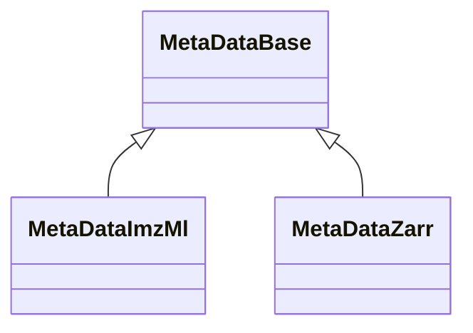

# MassFlow Metadata

Metadata describes the dataset independently of spectrum arrays. Spectrum managers attach it to `dm.ms.meta`; ion-image managers expose `dm.meta`.

## Current classes

| Class | Module | Role |
| --- | --- | --- |
| `MetaDataBase` | `massflow.module.ms_meta_data` | Shared fields, descriptors, validation, and dictionary access |
| `MetaDataImzMl` | `massflow.module.ms_meta_data_imzml` | imzML fields populated from the manager's parser |
| `MetaDataZarr` | `massflow.module.ms_meta_data_zarr` | Metadata loaded from and written to Zarr |



The parser belongs to `MSDataManagerImzML`; the metadata object stores extracted values. Construct a data manager to read a file rather than passing a file path to a metadata constructor.

## Fields and printed labels

| Python field | Meaning |
| --- | --- |
| `name`, `version` | Dataset name and numeric metadata version |
| `max_count_of_pixels_x`, `max_count_of_pixels_y` | Image width and height |
| `pixel_size_x`, `pixel_size_y` | Physical pixel dimensions, when available |
| `mask` | Two-dimensional occupancy mask |
| `continuous`, `processed` | m/z encoding flags |
| `profile_spectrum`, `centroid_spectrum` | Spectrum type flags |
| `scan_type`, `scan_direction`, `line_scan_direction`, `scan_pattern` | Acquisition layout fields |
| `spectrum_count_num`, `instrument_model` | Backend metadata fields |
| `absolute_position_offset_x`, `absolute_position_offset_y` | Spatial offsets |
| `ms1_spectrum`, `msn_spectrum` | MS-level flags |

The last three table rows include fields defined by `MetaDataImzMl` and `MetaDataZarr`. Access fields without a `meta_` prefix, for example `dm.ms.meta.pixel_size_x`. Printed labels use names such as `meta_pixel_size_x`.

Standard spectrum-type flags use `True` for the active type and `None` for the other type. Encoding flags use the same convention. `str(meta)` omits `None` values and prints an array's shape instead of all its contents. An omitted field does not mean it is `False`.

## Reading metadata

```python
from massflow.data_manager import MSDataManagerImzML

with MSDataManagerImzML(filepath="data/example.imzML") as dm:
    dm.load_head_data()
    meta = dm.ms.meta
    print(meta)
    print(meta.pixel_size_x, meta.pixel_size_y)
    print(meta.to_dict())
```

For spectra Zarr, use `MSDataManagerZarr(filepath="data/example.zarr")` with the same `load_head_data()` and `dm.ms.meta` access pattern. The file must already exist in read mode.

## Creating and copying metadata

```python
from massflow.module.ms_meta_data_imzml import MetaDataImzMl

meta = MetaDataImzMl(
    name="example",
    version=1.0,
    max_count_of_pixels_x=227,
    max_count_of_pixels_y=93,
    pixel_size_x=100.0,
    pixel_size_y=100.0,
)
meta.profile_spectrum = True
meta.centroid_spectrum = None
meta.continuous = True
meta.processed = None
```

Descriptors and properties synchronize standard values into `_meta`. Read values with `get()`, `keys()`, `items()`, `values()`, or `to_dict()`; these are Python field names, not printed labels.

Use `target_dm.copy_meta(source_dm)` when preparing an output manager. Backend copy methods retain compatible descriptive fields while excluding fields such as mask, spectrum count, encoding, and spectrum type; output processing must set or rebuild those fields. Copying metadata does not copy spectrum arrays.

`MetaDataZarr.to_zarr(root)` stores scalar values as group attributes and the optional mask as an array. `MetaDataZarr.from_zarr(root)` reads them back; the Zarr reader/writer normally handles this for users. See [Zarr schema](./zarr_schema.md).

imzML metadata copying in memory does not guarantee every field is serialized by the imzML writer: the current exporter does not write pixel-size or polarity terms. Zarr supports the metadata fields described by its schema.
