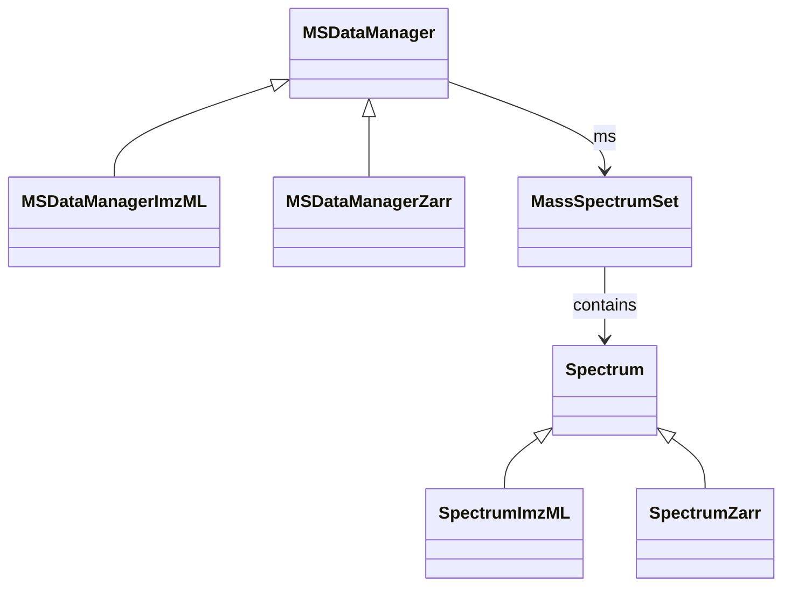

# Mass Spectrometry Data Structures

MassFlow separates spectrum objects, the in-memory spectrum collection, and file-backed data managers. Metadata is described in [Metadata](./metadata.md).

## Types and import paths

| Type | Module | Responsibility |
| --- | --- | --- |
| `Spectrum` | `massflow.module.spectrum` | m/z, intensity, and coordinates for one spectrum |
| `SpectrumImzML` | `massflow.module.spectrum_imzml` | Lazy spectrum backed by imzML/ibd |
| `SpectrumZarr` | `massflow.module.spectrum_zarr` | Lazy spectrum backed by a Zarr reader |
| `MassSpectrumSet` | `massflow.module.mass_spectrum_set` | Sequential and coordinate-based access to spectrum objects |
| `MSDataManager` | `massflow.data_manager.ms_data_manager` | Abstract spectrum-manager interface |
| `MSDataManagerImzML` | `massflow.data_manager.ms_data_manager_imzml` | imzML metadata, lazy spectra, batch reads, and export |
| `MSDataManagerZarr` | `massflow.data_manager.ms_data_manager_zarr` | Pixel-major spectra Zarr reads and writes |

Concrete managers are re-exported from `massflow.data_manager`.



## Spectrum objects

```python
import numpy as np
from massflow.module.spectrum import Spectrum

spectrum = Spectrum(
    mz_list=np.array([100.0, 200.0]),
    intensity=np.array([1.0, 3.0], dtype=np.float32),
    coordinate=(1, 1, 1),
)
print(spectrum.mz_list, spectrum.intensity)
print(spectrum.get_coordinates())
```

`Spectrum` accepts `mz_list`, `intensity`, `coordinate`, `sort_by_mz=True`, and `shared_mz_list=None`. `sort_by_mz` records the sortedness state at construction; provide arrays in the intended order.

The lazy subclasses are normally constructed by their data managers. Accessing unloaded intensities causes the corresponding reader to load the spectrum. Continuous data may reuse a shared m/z axis. Copy shared axes before modifying them. `clear_data()` releases loaded spectrum values according to the subclass's loading behavior.

## MassSpectrumSet

`MassSpectrumSet(meta=None)` holds spectrum objects and metadata in `ms.meta`; continuous data can expose the common axis through `ms.shared_mz_list`.

- `ms.add_spectrum(spectrum)` adds a spectrum. An existing identical `(x, y, z)` is replaced while retaining its queue position.
- `ms[index]` accesses a sequential spectrum; `ms[start:end]` returns a list slice.
- `ms[x, y, z]` accesses a coordinate explicitly. Prefer three coordinates when the z-plane matters.
- `len(ms)` and iteration use the sequential queue.
- `ms.coordinate_index` exposes the coordinate lookup structure.

This container behavior does not imply file-level deduplication: pixel-major Zarr writing preserves input rows, whereas ion-major Zarr writing keeps the last duplicate pixel when finalizing.

## Reading with a manager

```python
from massflow.data_manager import MSDataManagerImzML

with MSDataManagerImzML(filepath="data/example.imzML") as dm:
    dm.load_head_data()
    print(dm.ms.meta)
    print(len(dm.ms))
    spectrum = dm.ms[0]
    print(spectrum.mz_list, spectrum.intensity)
```

`load_head_data()` loads metadata and creates lazy placeholders within `target_locs`; spectrum checks performed during loading may read a sample spectrum. An imzML path requires its matching `.ibd` file. Use a fresh manager for a new loading operation rather than repeatedly populating the same collection.

For spectra Zarr, construct `MSDataManagerZarr(filepath="data/example.zarr")` and use the same `load_head_data()` / `dm.ms` pattern. A combined Zarr store can supply the required pixel-major `/spectra` view; an ion-only store cannot.

## Batch access

`flat_generator(batch_size=256, include_mz=True)` yields:

```python
mz_data, intensity_flat, lengths, coordinates
```

- `intensity_flat` is a one-dimensional concatenation of spectrum intensities.
- `lengths` gives the number of points in each spectrum.
- `coordinates` contains the corresponding pixel rows.
- Continuous batches use one shared m/z axis; processed batches use concatenated per-spectrum m/z values when requested.

`matrix_generator()` supplies padded matrices for processed spectra or a matrix with the shared axis for continuous spectra. For variable-length or empty spectra, the flat interface expresses lengths directly without padding.

## Writing and preprocessing

Use explicit output paths and call `finalize()` before closing Zarr writers. The preprocessing pipeline handles finalization for its outputs.

```python
from massflow.data_manager import MSDataManagerImzML
from massflow.preprocess import Preprocessor

with MSDataManagerImzML(filepath="data/example.imzML") as dm:
    dm.load_head_data()
    output = (
        Preprocessor(dm, output_format="spectra_zarr",
                     output_path="output/aligned.zarr")
        .peak_pick().peak_align().start()
    )
    output.close()
```

The ion-image managers (`IonImageDataManagerBinary`, `IonImageDataManagerH5`, `IonImageDataManagerZarr`) expose ion-major access through `get_ion_vector()`, `get_ion_block()`, and `get_ion_image()`. They are separate from the spectrum-manager interface. See [Ion Image Visualization](./ion_image_visualization.md) and [Zarr schema](./zarr_schema.md) for their layouts.
