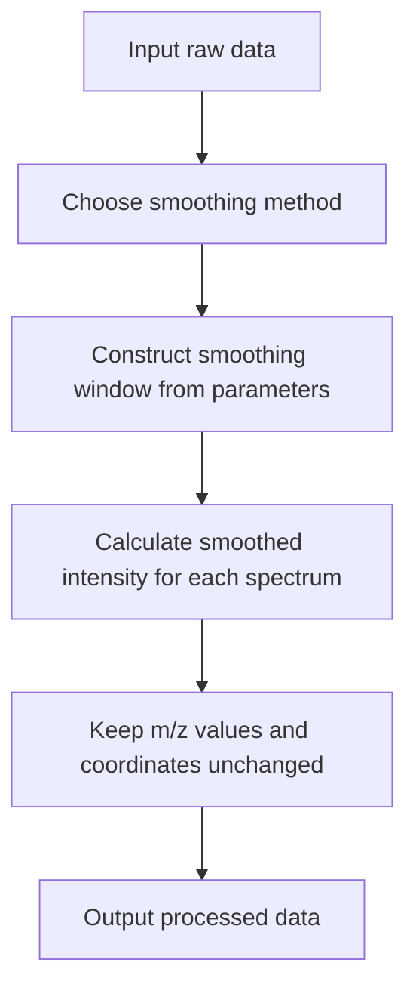

# Noise Reduction and Smoothing

This page introduces the noise reduction and smoothing module in MassFlow.


Authors: Leqiang Dong, Jingwei Dong

**Feedback:** If you find any problems while using MassFlow or reading the documentation, you can submit feedback through [GitHub Issues](https://github.com/NeoNexusX/MassFlow/issues), or contact us by email at 707244007@qq.com.

## Overview

Mass-spectrometry signals often contain continuous, rapid, small-amplitude fluctuations. These fluctuations usually do not represent true ion peaks, but they may be mistaken for peaks during subsequent peak picking. Noise reduction recalculates intensities using neighboring data points, making the spectrum smoother and reducing false peaks during peak picking.

MassFlow provides the following three smoothing methods:

- Moving-average smoothing (`ma_numba`): replaces the current intensity with the average intensity of neighboring data points. The method is simple and produces clear smoothing, but an excessively large window may broaden or lower narrow peaks.
- Gaussian smoothing (`gaussian_numba`): data points closer to the current position have a greater influence on the result. Compared with a simple moving average, it generally produces smoother and more natural results.
- Savitzky–Golay smoothing (`savgol_numba`): fits the local variation of the spectrum within a small region. It generally preserves peak shapes better, but the window size and polynomial order need to be selected appropriately.

Input and output

- The input is the mass-spectrometry data to be processed. Users only need to provide the data-file path; MassFlow automatically reads the *m/z* values and signal intensities for each pixel.
- The output is smoothed mass-spectrometry data. The *m/z* positions and pixel coordinates remain unchanged, while the intensities are replaced by the denoised values.


## Function Description

### Preprocessor.noise_reduction

```python
massflow.preprocess.api.PreprocessorAPI.noise_reduction(
    *,
    method: str = "gaussian_numba",
    window: int = 5,
    sd: float | None = None,
    polyorder: int = 3,
    deriv: int = 0,
    delta: float = 1.0,
    backend: Literal["python", "cardinal"] = "python",
) -> Self
```

- Function: performs smoothing and noise reduction on all spectra in batches.
- Parameters:
  - `method`: smoothing method, default `"gaussian_numba"`. Three methods are available: `"ma_numba"`, `"gaussian_numba"`, and `"savgol_numba"`.
    - `"ma_numba"`: a general-purpose and fast method.
    - `"gaussian_numba"`: Gaussian smoothing; produces gentler smoothing and has a theoretical basis for Gaussian noise.
    - `"savgol_numba"`: Savitzky–Golay smoothing; preserves peak shapes well and is suitable when peak-area measurements are needed later.
  - `window`: window length (positive integer), default `5`.
    - The input must be a positive integer. Even values are automatically adjusted to odd values to maintain centered alignment.
    - Recommended range: 5–15. Adjust it according to peak width and noise level. Larger windows produce stronger smoothing but may blur narrow peaks.
  - `sd`: standard deviation of the Gaussian kernel, used only for Gaussian smoothing. Default: `window / 4.0`. Larger values produce stronger smoothing.
  - `polyorder`: Savitzky–Golay polynomial order. It must be smaller than `window`; default `3`. Lower orders (for example, 1) produce smoother results, while higher orders (for example, 3) preserve peaks better.
  - `deriv`: derivative order, used only for Savitzky–Golay smoothing. Default `0`. Keep it at `0` for ordinary smoothing; values greater than `0` return derivatives rather than the original intensity signal.The input must be a non-negative integer.
  - `delta`: sampling interval, used only for Savitzky–Golay smoothing when derivatives are calculated. Default `1.0`.

  - `backend`: `"python"` (default) or `"cardinal"`.

Example:

```python
from massflow.data_manager import MSDataManagerImzML
from massflow.preprocess.preprocessor import Preprocessor
from massflow.tools.plot import plot_spectrum

FILE_PATH = "data/example.imzML"
dm = MSDataManagerImzML(filepath=FILE_PATH)
dm.load_head_data()

denoised = (
    Preprocessor(dm)
    .noise_reduction(method="gaussian_numba", window=5)
    .start()
)

plot_spectrum(
    base=dm.ms[100],
    target=denoised.ms[100],
    mz_range=(400.0, 420.0),
    metrics_box=True,
)

denoised.close()
dm.close()
```

This example performs the following steps:

1. Read the imZML data.
2. Apply noise reduction.
3. Display a comparison before and after processing.


## Overall Workflow




## Method Details

### Moving Average (`ma_numba`)

The moving-average method recalculates the intensity at the current position using the average intensity of several nearby data points. It is simple and fast. The  `window` controls the amount of smoothing, but an excessively large window may broaden or reduce narrow peaks. Even window values are automatically increased by 1.

### Gaussian Smoothing (`gaussian_numba`)

Gaussian smoothing gives greater weight to data points closer to the current position and lower weight to points farther away. Compared with a simple moving average, it generally produces a more natural smoothing result. `sd` controls the smoothing strength and defaults to `sd = window / 4.0`. Larger `sd` values produce stronger smoothing.

### Savitzky–Golay Smoothing (`savgol_numba`)

The Savitzky–Golay method fits the local trend of a spectrum within a small region and generally preserves peak shapes better. It requires both a window size and a polynomial order, so it is more suitable for users who already have some experience adjusting parameters. `polyorder` controls the polynomial order (usually 1–3), and `window` must be an odd-sized window. Make sure `polyorder` is smaller than the actual window size.

The following figures show the results of the three methods on the same spectrum:

Moving average (`ma_numba`): 

Gaussian smoothing (`gaussian_numba`): 

Savitzky–Golay smoothing (`savgol_numba`): 


## Error Handling

- Input validation: `intensity` must be a non-empty one-dimensional NumPy array; otherwise, a `TypeError` is raised.
- `window` validation: it must be a positive integer; otherwise, a `ValueError` is raised.
- `sd` validation: it must be positive; otherwise, a `ValueError` is raised.
- `method` validation: only `"ma_numba"`, `"gaussian_numba"`, and `"savgol_numba"` are supported; otherwise, a `ValueError` is raised.

## References

- [`preprocess/helper/noise_reduction_helper.py`](https://github.com/NeoNexusX/MassFlow/blob/main/src/massflow/preprocess/helper/noise_reduction_helper.py): smoothing dispatcher (`smoother`)
- [`preprocess/numba/noise_reduction_numba.py`](https://github.com/NeoNexusX/MassFlow/blob/main/src/massflow/preprocess/numba/noise_reduction_numba.py): Numba-accelerated implementations (`smooth_signal_ma_numba`, `smooth_signal_gaussian_numba`, `smooth_signal_savgol_numba`)
- [`preprocess/flat_pre_fun.py`](https://github.com/NeoNexusX/MassFlow/blob/main/src/massflow/preprocess/flat_pre_fun.py): `FlatPreprocess.noise_reduction_flat`, preprocessing entry point for flat data arrays
- [`preprocess/api.py`](https://github.com/NeoNexusX/MassFlow/blob/main/src/massflow/preprocess/api.py): `PreprocessorAPI.noise_reduction`, API entry point for noise reduction and smoothing
