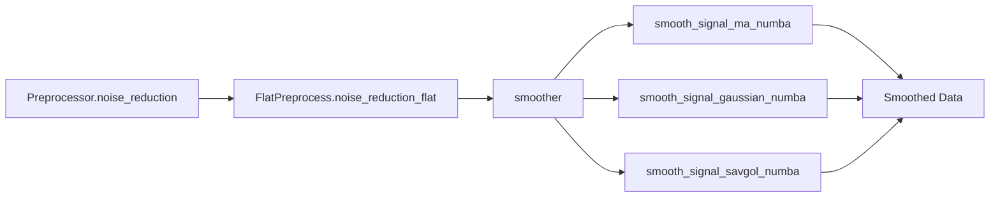

# MassFlow

This document introduces the noise reduction and smoothing module in MassFlow, focusing on:
- Pipeline-level entry point `Preprocessor.noise_reduction`
- Smoothing functions in `preprocess/helper/noise_reduction_helper.py`

## Overview

- Input and Output
  - Input is in flat array form (`mz_data`, `intensity`, `lengths`), representing m/z and intensity data for a batch of spectra.
  - Output is a smoothed flat array; m/z and coordinates remain unchanged, intensity is the denoised result.
- Methods
  - Moving Average (`ma_numba`): Uniform convolution smoothing over a window, Numba-accelerated.
  - Gaussian Smoothing (`gaussian_numba`): Discrete Gaussian kernel convolution smoothing, Numba-accelerated.
  - Savitzky-Golay Smoothing (`savgol_numba`): Polynomial fitting smoothing, Numba-accelerated.
- All methods execute batch processing within Numba JIT kernels, leveraging `prange` parallel loops for performance.

### Function Relationship Diagram



## Core API

### Preprocessor.noise_reduction (Pipeline Level)

```python
massflow.preprocess.api.PreprocessorAPI.noise_reduction(
    *,
    method: str = "ma_numba",
    window: int = 5,
    sd: float | None = None,
    polyorder: int = 3,
    deriv: int = 0,
    delta: float = 1.0,
) -> Self
```

- Description: Pipeline-level noise reduction entry point. Performs smoothing and denoising on all spectra in batches via `Preprocessor` chainable calls.
- Input: Bind a data manager via `Preprocessor(dm)`.
- Output: After calling `.start()`, returns a new `MSDataManagerImzML` whose spectral intensities are smoothed.
- Supported methods: `"ma_numba"`, `"gaussian_numba"`, `"savgol_numba"`.
- Parameters:
  - `method`: Smoothing method, default `"ma_numba"`.
  - `window`: Window length (positive integer), default 5. Even values are automatically adjusted to odd for centered alignment.
  - `sd`: Gaussian kernel standard deviation, default `window / 4.0`.
  - `polyorder`: Savitzky-Golay polynomial order, must be < `window`, default 3.
  - `deriv`: Derivative order (SG parameter), default 0.
  - `delta`: Sampling interval (SG parameter), default 1.0.

Example:

```python
from massflow.data_manager import MSDataManagerImzML
from massflow.preprocess.preprocessor import Preprocessor
from massflow.tools.plot import plot_spectrum

FILE_PATH = "data/example.imzML"
dm = MSDataManagerImzML(filepath=FILE_PATH)
dm.load_head_data()

denoised = (
    Preprocessor(dm)
    .noise_reduction(method="gaussian_numba", window=5)
    .start()
)

plot_spectrum(
    base=dm.ms[100],
    target=denoised.ms[100],
    mz_range=(400.0, 420.0),
    metrics_box=True,
)

denoised.close()
dm.close()
```


### smoother (Helper Function Level)

```python
preprocess.helper.noise_reduction_helper.smoother(
    intensity: np.ndarray | None = None,
    *,
    method: str = "ma_numba",
    window: int = 5,
    sd: float | None = None,
    polyorder: int = 2,
    deriv: int = 0,
    delta: float = 1.0,
    lengths: np.ndarray | None = None,
) -> np.ndarray
```

- Description: Flat-array smoothing dispatcher. Calls the corresponding Numba backend based on `method`.
- Parameters:
  - `intensity`: One-dimensional flat intensity array.
  - `lengths`: Spectrum length array, used to split processing per-spectrum within Numba.
  - Other parameters are consistent with the pipeline API.
- Returns: Smoothed one-dimensional intensity array.
- Supported methods are limited to `"ma_numba"`, `"gaussian_numba"`, and `"savgol_numba"`.

### FlatPreprocess.noise_reduction_flat (Flat Batch Level)

```python
massflow.preprocess.flat_pre_fun.FlatPreprocess.noise_reduction_flat(
    mz_data: np.ndarray,
    intensity: np.ndarray,
    lengths: np.ndarray,
    method: str = "ma_numba",
    window: int = 5,
    sd: float | None = None,
    polyorder: int = 3,
    deriv: int = 0,
    delta: float = 1.0,
) -> FlatBatchResult
```

- Description: The underlying implementation of `Preprocessor.noise_reduction`. Returns a `FlatBatchResult` containing mz_data, smoothed intensity, and lengths.

## Method Details

### Moving Average (ma_numba)

Computes the arithmetic mean of data points within a window. Implemented using `uniform_filter1d`-style one-dimensional convolution, with `window` controlling the degree of smoothing. Even windows are automatically incremented by 1.

### Gaussian Smoothing (gaussian_numba)

Performs weighted convolution using a discrete Gaussian kernel. `sd` controls the degree of smoothing, defaulting to `sd = window / 4.0`. Larger `sd` produces stronger smoothing.

### Savitzky-Golay Smoothing (savgol_numba)

Uses a sliding window with least-squares polynomial fitting. `polyorder` determines the polynomial order (typically 1–3), and `window` is an odd-sized window. Behavior is consistent with `scipy.signal.savgol_filter`.

## Parameter and Tuning Recommendations

- `window`: Common to all methods.
  - Must be a positive integer. Even values are automatically adjusted to odd.
  - Suggested range: 5–15, adjustable based on peak width and noise intensity.
  - Larger windows produce smoother results but may blur narrow peaks.
- `sd` (Gaussian kernel standard deviation)
  - Defaults to `window / 4.0`; larger values produce stronger smoothing.
- `polyorder` (SG polynomial order)
  - Must be less than `window`; recommended 1–3.
  - Lower orders (e.g., 1) produce smoother results; higher orders (e.g., 3) preserve peaks better.
- Method Selection Recommendations
  - `"ma_numba"`: General-purpose, fastest.
  - `"gaussian_numba"`: Gentler smoothing, theoretically supported for Gaussian noise.
  - `"savgol_numba"`: Strong peak preservation, suitable for scenarios requiring subsequent peak area calculation.

## References

- `preprocess/helper/noise_reduction_helper.py`: Smoothing dispatcher (smoother)
- `preprocess/numba/noise_reduction_numba.py`: Numba-accelerated implementation (smooth_signal_ma_numba, smooth_signal_gaussian_numba, smooth_signal_savgol_numba)
- `preprocess/flat_pre_fun.py`: Flat preprocessing entry point (FlatPreprocess.noise_reduction_flat)
- `preprocess/api.py`: Chainable API (PreprocessorAPI.noise_reduction)

## Error Handling and Logging

- Input validation: intensity must be a non-empty 1D numpy array, otherwise `TypeError` is raised.
- window validation: Must be a positive integer, otherwise `ValueError` is raised.
- sd validation: Must be positive, otherwise `ValueError` is raised.
- method validation: Only `"ma_numba"`, `"gaussian_numba"`, `"savgol_numba"` are supported; otherwise `ValueError` is raised.
