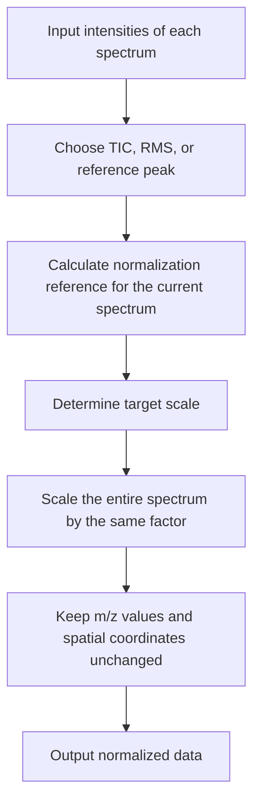

# Normalization

This page introduces the normalization module in MassFlow.


If you  want to try MSI data processing online or search for MSI datasets of interest, visit https://sxo.bionet.pro and register for free.


## Overview

The overall signal intensity of different pixels may be affected by tissue thickness, sample amount, ionization efficiency, and changes in instrument response. Intensity normalization adjusts each spectrum to a comparable scale, reducing the effect of a spectrum being globally stronger or weaker on ion images and downstream statistical analysis.

- Input and output
  - The input is the mass-spectrometry data to be processed. Users only need to provide the data-file path; MassFlow automatically reads the *m/z* values and signal intensities for each pixel.
  - The output is normalized mass-spectrometry data. The *m/z* positions and pixel coordinates remain unchanged, while the intensities are replaced by normalized values.
- Methods
  - TIC (Total Ion Current) normalization (`tic_numba`): scales each spectrum so that the sum of all intensities equals a specified value.
  - RMS (Root Mean Square) normalization (`rms_numba`): scales each spectrum so that its RMS equals a specified value.
  - Reference-peak normalization (`ref_numba`): scales each spectrum so that the signal near a specified m/z value is normalized to a target value.

## Function Description

### Preprocessor.normalization

```python
massflow.preprocess.api.PreprocessorAPI.normalization(
    *,
    method: str = "tic_numba",
    scale: float | None = None,
    ref: float | None = None,
    ref_tolerance: float = 0.1,
) -> Self
```

- Function: performs normalization on all spectra in batches.

- Parameters:

  - `method`: normalization method, default `"tic_numba"`. Three methods are available: `"tic_numba"`, `"rms_numba"`, and `"ref_numba"`.

    - Choose `"tic_numba"` first choice when total intensity needs to be comparable between pixels.
    - Choose `"rms_numba"` when an RMS-based scale is appropriate; because intensities are squared, strong peaks have greater influence.
    - Choose `"ref_numba"` when a known internal-standard peak is available.

  - `scale`: optional scaling factor applied after normalization. The value must be finite and non-negative. If supplied, normalized intensities are multiplied by this value. A common use is to set TIC-normalized data to 1,000 or 10,000 for easier numerical display.

  - `ref`: target internal-standard *m/z* value. When `method="ref_numba"` and `ref` is `None`, a value is selected automatically.

  - `ref_tolerance`: matching tolerance for the reference peak, used by `ref_numba`. Default: `0.1 Da`. The value must be finite and non-negative.

    

Example:

```python
from massflow.data_manager import MSDataManagerImzML
from massflow.preprocess.preprocessor import Preprocessor
from massflow.tools.plot import plot_spectrum

FILE_PATH = "data/example.imzML"
dm = MSDataManagerImzML(filepath=FILE_PATH)
dm.load_head_data()

normalized = (
    Preprocessor(dm)
    .noise_reduction(method="gaussian_numba", window=7)
    .normalization(method="tic_numba")
    .start()
)

plot_spectrum(
    base=dm.ms[100],
    target=normalized.ms[100],
    mz_range=(400.0, 420.0),
    metrics_box=True,
)
normalized.close()
dm.close()
```

This example performs the following steps:

1. Read the imZML data.
2. Calculate the total ion current of each spectrum.
3. Divide every signal intensity in each spectrum by that spectrum's total intensity, so that the normalized total intensity equals 1.


### Overall Workflow




## Method Details

### TIC Normalization (`tic_numba`)

The entire spectrum is scaled according to the sum of all signal intensities in that spectrum. After normalization, the sum of all signal intensities in one spectrum is 1. If `scale` is set, the normalized result is multiplied by `scale`, and the total signal intensity is then approximately equal to `scale`.

Use case: suitable for reducing differences in total signal amount between pixels so that spectra from different pixels can be compared more easily.

### RMS Normalization (`rms_numba`)

All peaks are scaled according to the root mean square intensity of the spectrum,
$RMS=\sqrt{\frac{1}{n}\sum_{i=1}^{n}x_i^2}$. After normalization, the RMS of the spectrum is 1. If `scale` is set, the normalized result is multiplied by `scale`, and the RMS is then approximately equal to `scale`.

Use case: less sensitive to strong peaks and more stable for data with a high dynamic range.

### Reference-Peak Normalization (`ref_numba`)

Reference-peak normalization uses a predefined ion peak as a reference and scales the other peaks in each spectrum according to the intensity of that reference peak. If `scale` is set, the normalized result is multiplied by `scale`.

It is recommended to explicitly set the target internal-standard *m/z* value with `ref` and choose an appropriate reference-peak matching tolerance with `ref_tolerance`. If `method="ref_numba"` is used without set  `ref`, the program automatically selects the middle position of the currently supplied *m/z* data as a temporary reference value. In actual analysis, set `ref` according to the internal standard used in the experiment or a known stable ion peak rather than relying on the automatically selected value.


The following figures show ion images produced after the three normalization methods:

TIC normalization (`tic_numba`):


RMS normalization (`rms_numba`):


Reference-peak normalization (`ref_numba`) with `ref=500`:


## Error Handling and Logging

- Input validation: the input data must be a non-empty one-dimensional NumPy array; otherwise, a `TypeError` is raised.

- `method` validation: only `"tic_numba"`, `"rms_numba"`, and `"ref_numba"` are supported.

  

## References

- [`preprocess/helper/normalizer_helper.py`](https://github.com/NeoNexusX/MassFlow/blob/main/src/massflow/preprocess/helper/normalizer_helper.py): normalization dispatcher (`normalizer`)

- [`preprocess/numba/normalization_numba.py`](https://github.com/NeoNexusX/MassFlow/blob/main/src/massflow/preprocess/numba/normalization_numba.py): Numba-accelerated implementation (`normalizer_numba`)

- [`preprocess/flat_pre_fun.py`](https://github.com/NeoNexusX/MassFlow/blob/main/src/massflow/preprocess/flat_pre_fun.py): `FlatPreprocess.normalization_flat`, preprocessing entry point for flat data arrays

- [`preprocess/api.py`](https://github.com/NeoNexusX/MassFlow/blob/main/src/massflow/preprocess/api.py): `PreprocessorAPI.normalization`, API entry point for normalization

  

  

Authors: Leqiang Dong, Jingwei Dong
