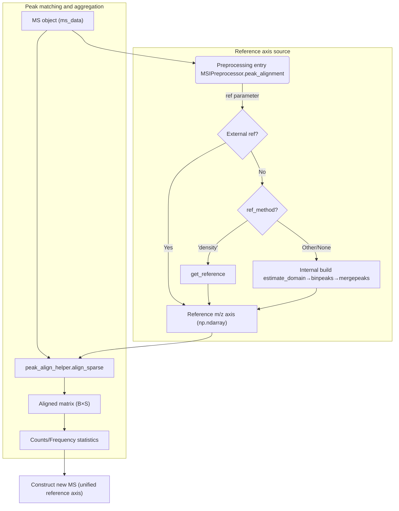

# MassFlow Peak Alignment

This document systematically describes the peak alignment workflow and implementation in MassFlow, focusing on building the reference m/z axis, per-spectrum peak matching and aggregation, tolerance estimation, and a unified external API. The core implementation resides in:

- `preprocess/peak_align_helper.py`
- `preprocess/ms_preprocess.py`

The goal is to present implementation-centric details, including function signatures, parameter semantics, data shapes and flow, and reproducible usage examples.

## Overview

Layering of "reference axis construction" and "peak matching & aggregation":

- Reference domain and reference peaks
  - Automatically estimate shared reference domain and resolution step: `estimate_domain`
  - Aggregate per-spectrum peaks into the domain by tolerance and average: `binpeaks`
  - Merge adjacent reference peaks within the tolerance neighborhood: `mergepeaks`
- Reference peaks via density method
  - Density method: when `ref_method='density'`, merge m/z from all spectra and call `get_reference(mz_all, ref_mzres, ref_mzmaxshift, ref_mzunits)` to compute the reference axis
- Sparse matrix alignment
  - On the unified reference axis, select nearest hits per spectrum and fill intensities: `align_sparse`
  - Automatic tolerance estimation and unit normalization: `_estimate_tolerance`, `_normalize_units`
- Unified entry point
  - `MSIPreprocessor.peak_alignment` collects data, selects the reference axis source (external or internal), calls `peak_align`, and constructs a new `MS` set

### Pipeline




## Core Functions

### MSIPreprocessor.peak_alignment method

```python
def preprocess.ms_preprocess.MSIPreprocessor.peak_alignment(
    ms_data, ref=None, units='ppm', tolerance=None,
    binfun='min', binratio=2,
    ref_method=None, ref_mzres=None, ref_mzmaxshift=None, ref_mzunits=None
) -> MS
```

- Behavior
  - Collect per-spectrum `mz_list` and `intensity`, validate equal lengths and non-empty
  - Reference axis source:
    - If `ref` is provided, use it directly
    - If `ref_method=='density'`, merge m/z from all spectra and call `get_reference(mz_all, ref_mzres, ref_mzmaxshift, ref_mzunits)` to compute the reference axis
    - Otherwise, internally estimate the reference domain and generate reference peaks within the underlying alignment logic
  - Call `peak_align` to obtain `AlignResult` (matrix, ref axis, counts, frequency, tolerance and units)
  - Build a new `MS`, unify all spectra m/z to `res.ref`, and use the corresponding intensity columns
- Parameters
  - `ms_data` — unaligned `MS` collection
  - `ref` — external reference axis; `None` means automatic estimation or computation based on `ref_method`
  - `units` — tolerance unit, `'ppm'` or `'mz'/'absolute'`
  - `tolerance` — tolerance half-window; `None` means auto-estimation
  - `binfun` — resolution aggregation strategy, `'median'|'min'|'max'|'mean'`
  - `binratio` — tolerance scaling factor, default 2
  - `ref_method` — selects reference axis source; `'density'` uses the kernel density histogram method `get_reference`
  - `ref_mzres` — reference axis histogram resolution; defaults map to ppm→`100.0`, Da→`0.01`
  - `ref_mzmaxshift` — minimum spacing for peak detection (gap for `__findpeaks`); defaults map to ppm→`100.0`, `Da`→`0.05`
  - `ref_mzunits` — units for reference axis computation; defaults mapped from `units` (ppm→`'ppm'`; mz/absolute→`'Da'`)
- Returns
  - A new `MS` object in which all spectra share the same reference m/z axis
- Code reference
  - `preprocess/ms_preprocess.py:159`

#### Examples

- **Example 1: Use the default reference axis construction**

```python
>>> from preprocess.ms_preprocess import MSIPreprocessor
>>> ms_ali = MSIPreprocessor.peak_alignment(ms_data=ms,tolerance=10,units='ppm')
output:
INFO:     25-11-17 05:02 197 ms_preprocess - peak_alignment: ref=None, units=ppm, tolerance=10, binfun=min, binratio=2, spectra=17176, ref_method=None
INFO:     25-11-17 05:02 657 peak_alignment - peak_align: start, spectra=17176, ref=None, units=ppm, tolerance=10, binfun=min, binratio=2
INFO:     25-11-17 05:02 663 peak_alignment - peak_align: domain estimated, bins=114537, by=8e-06
INFO:     25-11-17 05:02 675 peak_alignment - peak_align: tolerance resolved to 9.999999999999999e-06 (units=relative)
INFO:     25-11-17 05:46 700 peak_alignment - peak_align: done, B=53061, S=17176, tol=9.999999999999999e-06, units=relative
INFO:     25-11-17 05:46 239 ms_preprocess - peak_alignment: ref_len=53061, tolerance=9.999999999999999e-06, units=relative, spectra=17176
INFO:     25-11-17 05:46 249 ms_preprocess - ms_aligned built: B=53061, S=17176
>>> spectrum = ms_ali[0]
>>> plot_spectrum(spectrum,
            mz_range=[420,430],
            intensity_range=[0,5],
            plot_mode="stem")
output:
```


- **Example 2: Compare with Cardinal using the same parameters**

```R
>>> from preprocess.ms_preprocess import MSIPreprocessor
>>> ms_peakalign <- peakAlign(ms_peakpick_realize,tolerance=10,units="ppm")
output:
ms_peakalign <- peakAlign(ms_peakpick_realize,tolerance=10,units="ppm")
detected ~5616.3 peaks per spectrum
using bin ratio of 2 to create peak bins (per tolerance half-window)
using peak bins with relative resolution of 5e-06
binning peaks to create shared reference
# processing chunk 1/20 (859 items | 38.32 MB)
# processing chunk 2/20 (859 items | 39.3 MB)
# processing chunk 3/20 (859 items | 37.61 MB)
# processing chunk 4/20 (859 items | 38.93 MB)
# processing chunk 5/20 (858 items | 40.93 MB)
# processing chunk 6/20 (859 items | 39.4 MB)
# processing chunk 7/20 (859 items | 38.69 MB)
# processing chunk 8/20 (859 items | 35.85 MB)
# processing chunk 9/20 (858 items | 38.6 MB)
# processing chunk 10/20 (859 items | 39.05 MB)
# processing chunk 11/20 (859 items | 38.79 MB)
# processing chunk 12/20 (859 items | 39.55 MB)
# processing chunk 13/20 (858 items | 39.29 MB)
# processing chunk 14/20 (859 items | 36.37 MB)
# processing chunk 15/20 (859 items | 37.66 MB)
# processing chunk 16/20 (859 items | 39.32 MB)
# processing chunk 17/20 (858 items | 38.65 MB)
# processing chunk 18/20 (859 items | 39.49 MB)
# processing chunk 19/20 (859 items | 38.93 MB)
# processing chunk 20/20 (859 items | 37.93 MB)
# collecting 17176 results from 20 chunks
merging peak bins with relative centroid differences <= 1e-05
aligned to 60979 reference peaks with relative tolerance 1e-05 (10 ppm)
>>> plot(ms_peakalign,pixel=1,xlim=c(400,406),ylim=c(0,5),type="h")
output:
```


- **Example 3: Use the density method to build the reference axis**

```python
>>> from preprocess.ms_preprocess import MSIPreprocessor
>>> ms_aligned = MSIPreprocessor.peak_alignment(
...     ms_data=ms,
...     ref_method='density',      # use kernel density histogram method
...     ref_mzres=3,               # histogram resolution
...     ref_mzmaxshift=3,          # minimum peak detection spacing
...     units='ppm',               # tolerance units
...     tolerance=None,            # auto-estimate tolerance
... )
output:
INFO:     25-11-17 20:55 198 ms_preprocess - peak_alignment: ref=None, units=ppm, tolerance=None, binfun=min, binratio=2, spectra=17176, ref_method=density
INFO:     25-11-17 20:55 806 peak_alignment - get_reference: start, n=5828712, mzunits=ppm, mzres=3, mzmaxshift=3
INFO:     25-11-17 20:55 829 peak_alignment - get_reference: histogram range=(5983275.970265, 6900122.553712), nbins=305617
DEBUG:    25-11-17 20:55 855 peak_alignment - get_reference: iconst=3, histint_len=916851
INFO:     25-11-17 20:55 891 peak_alignment - get_reference: done, peaks=19523
INFO:     25-11-17 20:55 229 ms_preprocess - peak_alignment: density ref computed len=19523, ref_units=ppm, mzres=3, maxshift=3, fused_from_tolerance=False
INFO:     25-11-17 20:55 630 peak_alignment - peak_align: start, spectra=17176, ref=provided, units=ppm, tolerance=None, binfun=min, binratio=2
INFO:     25-11-17 20:55 636 peak_alignment - peak_align: domain estimated, bins=57269, by=1.6e-05
INFO:     25-11-17 20:55 648 peak_alignment - peak_align: tolerance resolved to 3.2e-05 (units=relative)
INFO:     25-11-17 20:55 673 peak_alignment - peak_align: done, B=19523, S=17176, tol=3.2e-05, units=relative
INFO:     25-11-17 20:55 240 ms_preprocess - peak_alignment: ref_len=19523, tolerance=3.2e-05, units=relative, spectra=17176
INFO:     25-11-17 20:55 250 ms_preprocess - ms_aligned built: B=19523, S=17176
```

### peak_align function

```python
def preprocess.peak_align_helper.peak_align(
    index_list, data_list, ref=None,
    spectra='intensity', index='mz',
    binfun='min', binratio=2,
    tolerance=None, units='ppm'
) -> AlignResult
```

- Functionality
  - Unit normalization (`'ppm'/'relative'`→`'relative'`, `'mz'/'absolute'`→`'absolute'`)
  - Reference domain estimation and reference peak construction (when `ref` is missing: `estimate_domain`→`binpeaks`→`mergepeaks`)
  - Automatic tolerance estimation (when `tolerance` is missing): `_estimate_tolerance`
  - Sparse matrix alignment: `align_sparse` (including a fast path and two branches)
  - Output counts and frequency statistics
- Parameters
  - `index_list`/`data_list` — per-spectrum peak index and intensity lists
  - `ref` — external reference peak vector; `None` means internal construction
  - `binfun`/`binratio`/`tolerance`/`units` — aligned with the Cardinal interface
- Returns
  - `AlignResult`: matrix, reference axis, counts, frequency, tolerance, and units
- Code reference
  - `preprocess/peak_align_helper.py:602`

### AlignResult data class

```python
class preprocess.peak_align_helper.AlignResult(matrix, ref, count, freq, tolerance, units, binfun, binratio)
```

- Fields
  - `matrix` — an aligned matrix of shape `(len(ref), nspec)` (rows aligned to reference axis, columns are spectra)
  - `ref` — the reference peak vector (ascending)
  - `count` — hit count per reference peak
  - `freq` — hit frequency (`count/nspec`)
  - `tolerance/units/binfun/binratio` — echo of runtime parameters
- Code reference
  - `preprocess/peak_align_helper.py:32`

### estimate_domain function

```python
def preprocess.peak_align_helper.estimate_domain(xlist, width='median', units='relative') -> (domain, by)
```

- Functionality
  - Estimate resolution and range for each spectrum's peak indices, and aggregate resolution by `width`
  - Generate an ascending reference domain (relative sequence or linear sequence) based on units, applying a minimum resolution threshold
- Returns
  - `(domain, by)`: reference domain and resolution step size
- Code reference
  - `preprocess/peak_align_helper.py:241`

### binpeaks function

```python
def preprocess.peak_align_helper.binpeaks(peaklist, domain=None, xlist=None, tol=None, tol_ref='abs', merge=False, na_drop=True) -> PeakBins
```

- Functionality
  - Initial mapping: for each spectrum, map peak indices to `domain` bins using `bsearch(nearest=False)`
  - Conflict deduplication: when the same spectrum hits the same bin, keep the closest to the bin center by relative/absolute difference, mark others as misses
  - Aggregate hits per bin by averaging peak position and intensity, and record counts
- Returns
  - `PeakBins`: `peaks/values/counts/tolerance/domain`
- Code reference
  - `preprocess/peak_align_helper.py:298`

### mergepeaks function

```python
def preprocess.peak_align_helper.mergepeaks(peaks, n, x, tol=None, tol_ref='abs', na_drop=True) -> PeakBins
```

- Functionality
  - Within a tolerance half-window, expand left and right to find the neighborhood peak set `[i..j]`, compute count-weighted average position and intensity, update to the middle index, and clear the rest
  - Expansion count gating: once counts rise again after passing the mode side, treat it as a new peak and stop expansion immediately
- Code reference
  - `preprocess/peak_align_helper.py:418`

### align_sparse function

```python
def preprocess.peak_align_helper.align_sparse(index_list, data_list, ref, tol, tol_ref) -> np.ndarray
```

- Functionality
  - fast path: when a spectrum’s m/z grid matches the reference axis point-wise within tolerance, copy the entire column of intensities directly
  - downsample: when `len(ref) <= 2*len(idx)` or the reference domain is not strictly ascending, search for nearest hits in the sorted peak indices according to the reference axis
  - upsample: otherwise, center on spectrum peaks, locate a starting point on the reference axis, then expand left and right, filling the first unprocessed bin within the tolerance window
- Returns
  - Aligned 2D matrix (rows aligned to `ref`, columns are spectra)
- Code reference
  - `preprocess/peak_align_helper.py:494`

### bsearch function

```python
def preprocess.peak_align_helper.bsearch(x, table, tol=0.0, tol_ref='abs', nomatch=-1, nearest=False) -> np.ndarray
```

- Functionality
  - In the sorted `table`, find left and right neighbors for each `x[i]` and compare relative/absolute differences; within tolerance, return the closer one (tie breaks to the left)
- Code reference
  - `preprocess/peak_align_helper.py:97`

### reldiff function

```python
def preprocess.peak_align_helper.reldiff(x, y=None, ref='y') -> np.ndarray
```

- Functionality
  - Compute relative/absolute differences; when `y` is not provided, compute differences between adjacent elements of `x`
- Code reference
  - `preprocess/peak_align_helper.py:53`

### estres function

```python
def preprocess.peak_align_helper.estres(x, tol=None, ref=None) -> float
```

- Functionality
  - Choose a reference based on the robustness (MAD) of adjacent absolute vs relative differences, and return the minimum difference as resolution
  - Optional tolerance threshold for grid consistency checking
- Code reference
  - `preprocess/peak_align_helper.py:191`

### get_reference function (density method)

```python
def preprocess.peak_align_helper.get_reference(mz, mzres, mzmaxshift, mzunits) -> np.ndarray
```

- Functionality
  - Based on kernel density estimation, find high-frequency peak positions in histogram space and return an ascending consensus m/z reference axis
  - Includes smoothing (tri-cubic weights), PCHIP interpolation, MAD thresholding, tie-breaking, and local extrema detection
- Parameters
  - `mz` — merged m/z array (1D)
  - `mzres` — histogram resolution (bin width)
  - `mzmaxshift` — minimum spacing for peak detection (as `gap`)
  - `mzunits` — `'Da'` or `'ppm'` (in ppm mode, operate in ppm space and finally write back to m/z)
- Code reference
  - `preprocess/peak_align_helper.py:793`


## Parameter and Unit Conventions

- Unit normalization:
  - `'ppm'/'relative'` normalized to relative units; `'mz'/'absolute'` normalized to absolute units
  - Difference reference choice in alignment and search: relative→`tol_ref='x'`; absolute→`tol_ref='abs'`
- Tolerance estimation:
  - When `tolerance=None`, first estimate resolution `estres`, then multiply by `binratio`
  - Rounding rules: relative uses 6-digit half-step (`round(2*res, 6)/2`), absolute uses 4 digits
- Reference axis construction:
  - When external `ref` is provided, skip internal construction
  - `'density'` method requires passing or auto-mapping `ref_mzres/ref_mzmaxshift/ref_mzunits`


## Data Flow Summary

1. Collect `mz_list` and `intensity` for all spectra
2. Choose the reference axis source (external `ref`, `'density'` method, or internal domain and peak estimation)
3. Normalize units and parse/estimate tolerance
4. Align on the reference axis using sparse matrices to obtain the `(B, S)` alignment matrix
5. Build a new `MS` collection, unify the m/z axis, and fill intensities


## Extensibility Notes

- External grid alignment: if you already have a high-quality external grid (e.g., from third-party tools), you can directly pass it as `ref` to skip reference domain construction
- Tolerance strategy: `binratio` can be tuned based on instrument drift and resolution; tolerance can also be specified manually
- Scale optimization: for sparse peak-list scenarios, prefer absolute units and a shorter reference axis to reduce search and expansion cost


## Glossary

- Reference axis: row index of the alignment matrix, ascending m/z list
- Relative tolerance (ppm): half-window proportional to m/z
- Absolute tolerance (Da): fixed m/z half-window
- downsample/upsample: two alignment strategies for shorter/longer reference axes
- Count-weighted average: aggregation strategy using hit counts as weights