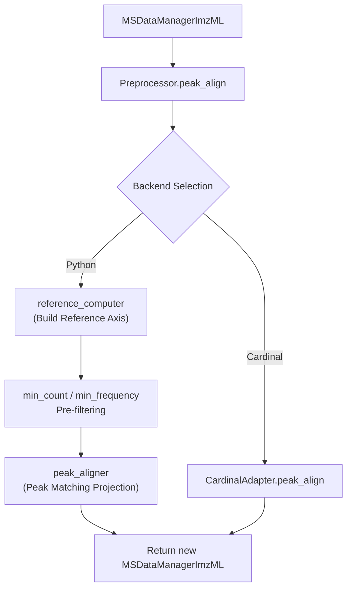

# MassFlow

This document introduces the peak alignment module in MassFlow, focusing on:
- Pipeline-level entry point `Preprocessor.peak_align`
- Reference axis construction function `reference_computer`
- Flat-array alignment function `peak_aligner`
- Reference peak pre-filtering (`min_count`, `min_frequency`) functionality

Core implementations are located in:
- `src/massflow/preprocess/helper/peak_align_helper.py`
- `src/massflow/preprocess/numba/peak_align_numba.py`

## Overview

The peak alignment workflow consists of two main stages:

- **Reference Axis Construction Stage**
  - Automatically estimate the shared m/z domain range and resolution step: `estimate_domain_parallel`
  - Assign each spectrum's peaks to the domain grid by tolerance: `bin_peaks_parallel`
  - Merge adjacent reference peaks within the tolerance window: `merge_peaks`
  - Top-level entry function: `reference_computer`
  - Optional pre-filtering: Shorten the reference axis during construction via `min_count` and `min_frequency`

- **Peak Matching and Alignment Stage**
  - Project each spectrum's peaks onto the shared reference axis: `peak_aligner`
  - Based on nearest-neighbor matching and tolerance judgment, assign original peak intensities to reference axis positions
  - Aligned data is written to disk, returning a new `MSDataManagerImzML`

- **Unified Entry Point**
  - `Preprocessor.peak_align`: Receives data, selects backend (Python or Cardinal), and calls the corresponding alignment logic

### Flow Diagram



## Core API

### Preprocessor.peak_align (Pipeline Level)

```python
massflow.preprocess.api.PreprocessorAPI.peak_align(
    *,
    reference: np.ndarray | None = None,
    tolerance: float | None = None,
    units: str = "ppm",
    binfun: str = "median",
    binratio: float = 2.0,
    min_count: int | None = None,
    min_frequency: float | None = None,
    backend: Literal["python", "cardinal"] = "python",
) -> Self
```

- Description: Pipeline-level peak alignment unified entry point. Aligns all spectra to a shared reference m/z axis via `Preprocessor` chainable calls.
- Input: Bind a data manager via `Preprocessor(dm)`.
- Output: After calling `.start()`, returns a new `MSDataManagerImzML` where all spectra share the same m/z axis (continuous data mode).
- Parameters:
  - `reference`: External reference m/z axis; auto-computed when `None`.
  - `tolerance`: Tolerance half-window; auto-estimated from data resolution when `None`.
  - `units`: Tolerance units, `"ppm"` (relative) or `"Da"` (absolute), default `"ppm"`.
  - `binfun`: Resolution aggregation strategy, `"median" | "min" | "max"`, default `"median"`.
  - `binratio`: Tolerance scaling factor, default 2.0.
  - `min_count`: Minimum supporting spectrum count for reference peaks (Python backend only).
    - Reference peaks with merged count ≥ min_count are retained.
    - Used for pre-filtering low-support noise peaks to shorten the reference axis.
  - `min_frequency`: Minimum occurrence frequency for reference peaks, range [0, 1] (Python backend only).
    - Frequency = min(count, n_spectra) / n_spectra.
    - When set together with `min_count`, AND semantics apply.
  - `backend`: Backend method, `"python"` (default) or `"cardinal"`.

Example (default reference axis construction):

```python
from massflow.data_manager import MSDataManagerImzML
from massflow.preprocess.preprocessor import Preprocessor

FILE_PATH = "data/example.imzML"
dm = MSDataManagerImzML(filepath=FILE_PATH)
dm.load_head_data()

picked = (
    Preprocessor(dm)
    .peak_pick()
    .start()
)

aligned = (
    Preprocessor(picked)
    .peak_align(units="ppm", binfun="median", binratio=2.0)
    .start()
)

plot_spectrum(
    base=picked.ms[0],
    target=aligned.ms[0],
    mz_range=(400, 410),
    intensity_range=(0.0, 20),
    plot_mode="stem",
    metrics_box=True,
)

aligned.close()
dm.close()
```


Example (with pre-filtering to shorten reference axis):

```python
aligned_filter = (
    Preprocessor(dm)
    .peak_align(
        units="ppm",
        binfun="median",
        binratio=2.0,
        min_count=2,
        min_frequency=0.01,
    )
    .start()
)

plot_spectrum(
    base=picked.ms[0],
    target=aligned_filter.ms[0],
    mz_range=(400, 410),
    intensity_range=(0.0, 20),
    plot_mode="stem",
    metrics_box=True,
)
```


### reference_computer (Reference Axis Construction)

```python
preprocess.helper.peak_align_helper.reference_computer(
    data_manager: MSDataManager,
    reference: Optional[NDArray] = None,
    binfun: str = "median",
    binratio: float = 2.0,
    tolerance: Optional[float] = None,
    units: str = "ppm",
    batch_size: int = 256,
    max_threads: int = 2,
    min_count: Optional[int] = None,
    min_frequency: Optional[float] = None,
) -> tuple[NDArray, float]
```

- Description: Constructs the shared reference m/z axis and estimates tolerance. Workflow:
  1. `estimate_domain_parallel`: Iterates through all spectra to estimate m/z range and resolution step.
  2. `bin_peaks_parallel`: Maps each spectrum's peaks to the domain grid, accumulating counts.
  3. `merge_peaks`: Merges adjacent peaks; m/z is count-weighted averaged, counts are summed.
  4. `_filter_reference_by_counts` (optional): Applies `min_count` / `min_frequency` filtering.
- Returns: `(reference, tolerance)`.
- Note: If an external `reference` is provided, the reference axis construction stage is skipped, and `min_count` / `min_frequency` parameters are ignored.

### peak_aligner (Flat Alignment)

```python
preprocess.helper.peak_align_helper.peak_aligner(
    mz_data: NDArray[np.float64],
    intensity: NDArray[np.float64],
    lengths: NDArray[np.int32],
    reference: NDArray[np.float64],
    tolerance: float,
    units: str = "ppm",
) -> NDArray[np.float64]
```

- Description: Projects each spectrum in a batch onto the reference m/z axis, returning a 2D aligned intensity matrix of shape `(n_spectra, n_reference)`.
- Parameters:
  - `mz_data`, `intensity`, `lengths`: Input spectra in flat array form.
  - `reference`: Reference m/z axis (must be sorted).
  - `tolerance`: Tolerance half-window.
  - `units`: `"ppm"` or `"Da"`.
- Matching Rules:
  - For each peak in each spectrum, search for the nearest neighbor within the tolerance window on the reference axis.
  - If a match is found, assign the peak intensity to the corresponding reference position.
  - When multiple peaks in the same spectrum match to the same reference position, the peak with the highest intensity is retained.
- Implementation: Internally calls the Numba JIT-compiled `align_spectra_flat_parallel_jit` kernel.

### FlatPreprocess.peak_align_flat (Flat Batch Level)

```python
massflow.preprocess.flat_pre_fun.FlatPreprocess.peak_align_flat(
    mz_data: np.ndarray,
    intensity: np.ndarray,
    lengths: np.ndarray,
    reference: Optional[np.ndarray] = None,
    tolerance: Optional[float] = None,
    units: str = "ppm",
) -> FlatBatchResult
```

- Description: The per-batch underlying call within `Preprocessor.peak_align` (Python backend). Requires `reference` and `tolerance` to be pre-computed.
- Returns: `FlatBatchResult`, where `intensity` is the flattened 2D aligned matrix and all `lengths` entries equal the reference axis length.

## Reference Peak Pre-Filtering

### Filtering Parameter Semantics

- `min_count`: A reference peak must be supported by at least `min_count` spectra (counts accumulated during bin and merge stages). Value must be a positive integer.
- `min_frequency`: A reference peak's occurrence frequency must be ≥ `min_frequency`. Range [0, 1]. In frequency calculation, counts are capped at `n_spectra` to prevent overestimation from summation during the merge stage.

### Filtering Timing

Filtering occurs inside `reference_computer`, after `merge_peaks` and before formal alignment. The filtered reference is passed directly to `peak_aligner`, so the alignment stage uses a reduced number of matrix columns.

### Important Notes

- Currently, filtering parameters are only supported by the Python backend. Passing `min_count` or `min_frequency` to the Cardinal backend raises `ValueError`.
- The counts semantic of the reference axis is "construction-stage support", which may differ from the actual match hit count during the alignment stage (since the alignment stage has independent nearest matching rules).
- By default, no filtering is enabled to maintain compatibility with previous behavior.

## Backend Comparison

| Feature | Python Backend | Cardinal Backend |
|---------|---------------|------------------|
| Implementation | Numba JIT compiled | R Cardinal package |
| Reference peak pre-filtering | Supported | Not supported |
| Performance | Multi-core parallel | Single-machine R runtime |
| Output format | MSDataManagerImzML | MSDataManagerImzML |

## Parameter and Tuning Recommendations

- `units`: Recommend `"ppm"` (relative tolerance) for better adaptability to m/z range variations.
- `binfun`: Resolution aggregation strategy.
  - `"median"`: Median, robust (recommended default).
  - `"min"`: Finest resolution, larger reference axis.
  - `"max"`: Coarsest resolution, smaller reference axis.
- `binratio`: Tolerance = step × binratio. Increasing `binratio` allows more matches but may introduce false matches.
- `tolerance`: When explicitly specified, `binratio` and automatic resolution estimation are ignored.
- `min_count`: Suggest starting from 2 for tuning. Lower values retain more peaks; higher values shorten the reference axis more significantly.
- `min_frequency`: Suggested range 0.005–0.05. A frequency of 0.01 means each reference peak must appear in at least 1% of spectra.

## Data Flow Summary

1. **Collect Information**: Iterate through spectra to collect m/z range and resolution information.
2. **Construct Reference Axis**:
   - `estimate_domain_parallel` → Generate initial grid.
   - `bin_peaks_parallel` → Map peaks to grid, accumulate counts.
   - `merge_peaks` → Merge adjacent peaks.
   - `_filter_reference_by_counts` → Pre-filter (optional).
3. **Execute Alignment**:
   - Call `peak_aligner` in batches to project each spectrum onto the reference axis.
   - Results are written to disk in real time, freeing memory.
4. **Return Results**: Return an `MSDataManagerImzML` containing the aligned data.

## References

- `preprocess/helper/peak_align_helper.py`: Reference axis construction and peak alignment core functions
- `preprocess/numba/peak_align_numba.py`: Numba-accelerated search and alignment kernels
- `preprocess/flat_pre_fun.py`: Flat preprocessing entry point (FlatPreprocess.peak_align_flat)
- `preprocess/api.py`: Chainable API (PreprocessorAPI.peak_align)
- `preprocess/preprocessor.py`: Pipeline executor (_prepare_peak_align_task)

## Error Handling and Logging

- `units` validation: `"ppm"` / `"relative"` normalizes to relative units; others normalize to absolute units.
- `min_count` validation: Must be a positive integer, otherwise `ValueError` is raised.
- `min_frequency` validation: Must be in [0, 1], otherwise `ValueError` is raised.
- Missing `reference` + `tolerance`: In `peak_align_flat`, if both are not provided, `ValueError` is raised.
- Cardinal backend + min_count/min_frequency: `ValueError` is raised.
