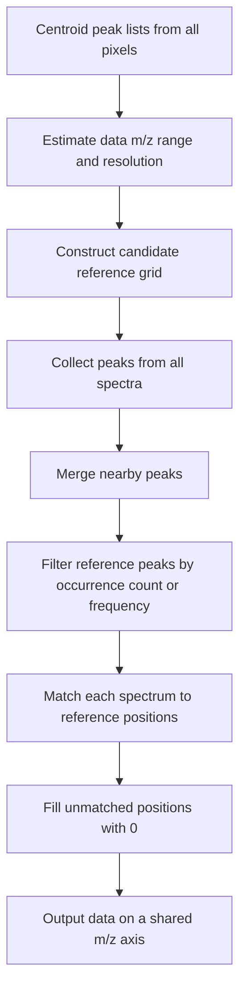

# Peak Alignment

This page introduces the peak-alignment module in MassFlow.


Authors: Leqiang Dong, Jingwei Dong

**Feedback:** If you find any problems while using MassFlow or reading the documentation, you can submit feedback through [GitHub Issues](https://github.com/NeoNexusX/MassFlow/issues), or contact us by email at 707244007@qq.com.

## Overview

The same ion may appear at slightly different *m/z* positions in different pixels because of mass-measurement error. Peak alignment builds a shared reference *m/z* axis and matches the peaks in each centroid spectrum to that axis, allowing downstream ion imaging, adduct filtering, and statistical filtering to compare all pixels column by column.

Peak alignment mainly includes two steps:

- Build the reference *m/z* axis: MassFlow combines the peaks detected across all pixels, groups peaks whose positions are very close, and determines one common reference *m/z* value for each group.
- Match each spectrum to the reference axis: the program checks the peaks in each spectrum and matches each one to the nearest reference *m/z* position that satisfies the mass-error requirement, then outputs newly aligned mass-spectrometry data.

After peak alignment:

- the same ion from different pixels appears at the same *m/z* position;
- every pixel uses the same peak positions for comparison;
- ion images can be plotted more conveniently;
- adduct filtering and statistical filtering can be performed afterward.

## Function Description

### Preprocessor.peak_align

```python
massflow.preprocess.api.PreprocessorAPI.peak_align(
    *,
    reference: np.ndarray | None = None,
    tolerance: float | None = None,
    units: str = "ppm",
    binfun: str = "median",
    binratio: float = 2.0,
    min_count: int | None = None,
    min_frequency: float | None = None,
    backend: Literal["python", "cardinal"] = "python",
) -> Self
```

- Function: builds or accepts a reference *m/z* axis and aligns all spectra to that axis.
- Parameters:
  - `reference`: external reference *m/z* axis. If `None`, it is calculated automatically.Once a ready-made `reference` is provided, the program will not recreate the reference axes, and `min_count` and `min_frequency` will no longer be used in the selection of reference axes.
  - `tolerance`: half-width of the matching tolerance window. If `None`, it is estimated automatically from the data resolution.
  - `units`: tolerance unit, `"ppm"` (relative) or `"Da"` (absolute). The default is `"ppm"`, which adapts better across changing *m/z* ranges.
  - `binfun`: resolution aggregation strategy: `"median"`, `"min"`, or `"max"`.
    - `"median"`: median resolution, robust and recommended by default.
    - `"min"`: finest resolution, resulting in a larger reference axis.
    - `"max"`: coarsest resolution, resulting in a smaller reference axis.
  - `binratio`: tolerance scaling factor, default `2.0`. Tolerance = step size × `binratio`. Increasing `binratio` allows more matches but may introduce incorrect matches.
  - `min_count`: minimum number of spectra supporting a reference peak (Python backend only).
    - A merged reference peak is retained when `count >= min_count`.
    - This can prefilter low-support noise peaks and shorten the reference axis.
    - A value of 2 is a reasonable starting point. Lower values retain more peaks; higher values shorten the reference axis more aggressively.
  - `min_frequency`: minimum occurrence frequency of a reference peak, in the range `[0, 1]` (Python backend only).
    - Frequency = `min(count, n_spectra) / n_spectra`.
    - When set together with `min_count`, the two conditions are combined using logical AND semantics.
    - A frequency of `0.01` requires each reference peak to appear in at least 1% of the spectra.
  - `backend`: backend method, `"python"` (default) or `"cardinal"`.

Example using the default reference-axis construction:

```python
from massflow.data_manager import MSDataManagerImzML
from massflow.preprocess.preprocessor import Preprocessor
from massflow.tools.plot import plot_spectrum

FILE_PATH = "data/example.imzML"
dm = MSDataManagerImzML(filepath=FILE_PATH)
dm.load_head_data()
aligned = (
    Preprocessor(
        dm,
        output_path="data/peak_aligned.imzML")
    .peak_pick()
    .peak_align(units="ppm", binfun="median", binratio=2.0)
    .start()
)

picked = (
    Preprocessor(dm)
    .peak_pick()
    .start()
)

plot_spectrum(
    base=picked.ms[0],
    target=aligned.ms[0],
    mz_range=(400, 410),
    intensity_range=(0.0, 20),
    plot_mode="stem",
    metrics_box=True,
)

picked.close()
aligned.close()
dm.close()  # Keep dm open until the second example has finished; close it afterward.
```


Example with prefiltering to shorten the reference axis:

```python
aligned_filter = (
    Preprocessor(
        dm,
        output_path="data/peak_aligned_filter.imzML")
    .peak_pick()
    .peak_align(
        units="ppm",
        binfun="median",
        binratio=2.0,
        min_count=2,
        min_frequency=0.01,
    )
    .start()
)
picked = (
    Preprocessor(dm)
    .peak_pick()
    .start()
)

plot_spectrum(
    base=picked.ms[0],
    target=aligned_filter.ms[0],
    mz_range=(400, 410),
    intensity_range=(0.0, 20),
    plot_mode="stem",
    metrics_box=True,
)
```


### reference_computer (Optional Reference-Axis Construction)

```python
preprocess.helper.peak_align_helper.reference_computer(
    data_manager: MSDataManager,
    reference: Optional[NDArray] = None,
    binfun: str = "median",
    binratio: float = 2.0,
    tolerance: Optional[float] = None,
    units: str = "ppm",
    batch_size: int = 256,
    min_count: Optional[int] = None,
    min_frequency: Optional[float] = None,
) -> tuple[NDArray, float]
```

- Function: calculates only the reference *m/z* axis and the matching tolerance used internally; it does not write aligned data.
- Workflow:
  1. Collect the peaks detected in all pixels.
  2. Group peaks with very similar *m/z* values into the same group.
  3. Determine one common reference *m/z* value for each group.
  4. Optionally remove reference peaks that appear in only a small number of pixels.
- The function returns two values:
  - `reference`: the constructed shared reference *m/z* axis.
  - `tolerance`: the tolerance used for subsequent peak matching.
- If an existing `reference` is provided, the program uses it directly and does not rebuild the reference axis. In this case, `min_count` and `min_frequency` are not used to filter the reference axis.
- `reference_computer` is particularly useful when:
  - you want to inspect the reference *m/z* axis before alignment;
  - you want to compare how different parameters affect the reference axis.

## Overall Workflow



## Reference Peak Prefiltering

When building the shared reference *m/z* axis, MassFlow can first remove reference peaks that appear in only a small number of pixels. This reduces the number of peaks in the final reference axis, allowing for more focused peak alignment and statistical analysis.

### Filtering Parameters

The two main parameters are:

- `min_count` specifies the minimum number of spectra that must support a reference peak. A larger value keeps fewer reference peaks and applies stricter filtering; a smaller value keeps more low-frequency peaks. If research includes locally specific ions that appear in only a small number of pixels, do not set `min_count` too high.
- `min_frequency` specifies the minimum proportion of spectra in which a reference peak must appear. A smaller value retains more low-frequency peaks and increases the reference-axis length; a larger value shortens the axis but may remove real peaks that occur only in local tissue regions.

### When Filtering Occurs

Reference-peak filtering takes place after the reference *m/z* axis has been built and before formal peak alignment begins.

The processing order is: build the reference *m/z* axis → remove reference peaks with low occurrence count or frequency → perform peak alignment using the filtered reference axis.

After filtering, only the retained reference peaks participate in subsequent alignment. The final reference *m/z* axis is shorter, and the aligned data contain fewer peaks that need to be compared.

## Error Handling

- `"ppm"` and `"relative"` are normalized to relative units; other unit strings are normalized to absolute units.
- `min_count` must be a positive integer; otherwise, a `ValueError` is raised.
- `min_frequency` must be within `[0, 1]`; otherwise, a `ValueError` is raised.
- Selecting the Cardinal backend while also passing `min_count` or `min_frequency` logs a warning and ignores these Python-only options.
## References

- [`preprocess/helper/peak_align_helper.py`](https://github.com/NeoNexusX/MassFlow/blob/main/src/massflow/preprocess/helper/peak_align_helper.py): reference-axis construction and core peak-alignment functions
- [`preprocess/numba/peak_align_numba.py`](https://github.com/NeoNexusX/MassFlow/blob/main/src/massflow/preprocess/numba/peak_align_numba.py): Numba-accelerated search and alignment kernels
- [`preprocess/flat_pre_fun.py`](https://github.com/NeoNexusX/MassFlow/blob/main/src/massflow/preprocess/flat_pre_fun.py): `FlatPreprocess.peak_align_flat`, preprocessing entry point for flat data arrays
- [`preprocess/api.py`](https://github.com/NeoNexusX/MassFlow/blob/main/src/massflow/preprocess/api.py): `PreprocessorAPI.peak_align`, API entry point for peak alignment
