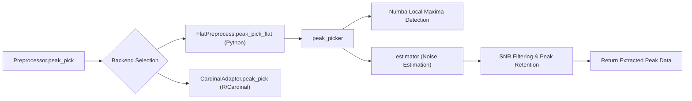

# MassFlow

This document introduces the peak picking module in MassFlow, focusing on:
- Pipeline-level entry point `Preprocessor.peak_pick`
- Flat-array entry point `FlatPreprocess.peak_pick_flat`
- Peak picking helper functions in `preprocess/helper/peak_pick_helper.py`

Covering: API descriptions, example code, parameter and tuning recommendations, and common issues.

## Overview

- Input and Output
  - Input is in flat array form (`mz_data`, `intensity`, `lengths`), representing m/z and intensity data for a batch of spectra.
  - Output is a flat array retaining only peak apexes; non-peak data is zeroed out.
- Peak Detection Strategy
  - Local maxima detection: Scans through the full spectrum with a fixed window `width`, identifying local maximum points within the window.
  - Signal-to-noise ratio filtering: Based on estimated noise level, candidate peaks with SNR below `snr` are discarded.
  - Peak boundary detection (optional): Peak left/right boundaries are controlled via `prominence` and `relheight` parameters.
- Noise Estimation Methods
  - `"sd"`: Noise estimation based on local standard deviation.
  - `"mad"`: Robust noise estimation based on median absolute deviation.
  - `"quantile"`: Noise estimation based on quantiles (default).
  - `"diff"`: Noise estimation based on differences.
- Binned Processing
  - For extremely long spectra, the `nbins` parameter can split the spectrum into equal segments for separate processing, with an `overlap` ratio between segments to ensure continuity of boundary peaks.

### Function Relationship Diagram



## Core API

### Preprocessor.peak_pick (Pipeline Level)

```python
massflow.preprocess.api.PreprocessorAPI.peak_pick(
    *,
    width: int = 5,
    method: str = "quantile",
    snr: float = 2.0,
    return_type: str = "height",
    prominence: float | None = None,
    relheight: float | None = None,
    nbins: int = 1,
    overlap: float = 0.5,
    backend: Literal["python", "cardinal"] = "python",
) -> Self
```

- Description: Pipeline-level peak picking entry point. Processes all spectra in batches via `Preprocessor` chainable calls.
- Input: Bind a data manager via `Preprocessor(dm)`.
- Output: After calling `.start()`, returns a new `MSDataManagerImzML` whose spectra retain only peak m/z and intensity.
- Backend:
  - `"python"`: Uses Numba-accelerated pure Python implementation.
  - `"cardinal"`: Calls the R Cardinal package's `peakPick` function.
- Parameters:
  - `width`: Local maxima detection half-window, default 5.
  - `method`: Noise estimation method, `"sd" | "mad" | "quantile" | "diff"`, default `"quantile"`.
  - `snr`: Signal-to-noise ratio threshold, default 2.0. Peaks with signal below `snr × noise` are discarded.
  - `return_type`: Peak intensity return type, `"height"` (peak apex height) or `"area"` (peak area), default `"height"`.
  - `prominence`: Peak prominence threshold; peaks below this value are discarded (optional).
  - `relheight`: Relative height used to determine peak width (optional).
  - `nbins`: Number of bins, default 1 (no binning).
  - `overlap`: Bin overlap ratio (0 ≤ overlap < 1), default 0.5.
- Exceptions:
  - `ValueError`: Unsupported `method`; invalid `return_type`; `nbins < 1`; `overlap` not in `[0, 0.99]`.

Example:

```python
from massflow.data_manager import MSDataManagerImzML
from massflow.preprocess.preprocessor import Preprocessor

FILE_PATH = "data/example.imzML"
dm = MSDataManagerImzML(filepath=FILE_PATH)
dm.load_head_data()

# Chain call: denoise first, then peak picking
processed = (
    Preprocessor(dm)
    .noise_reduction(method="gaussian_numba", window=7)
    .peak_pick(method="quantile", snr=3.0, width=5)
    .start()
)

plot_spectrum(
    base=dm.ms[0],
    target=processed.ms[0],
    mz_range=(400, 410),
    intensity_range=(0.0, 20),
    plot_mode="stem",
    metrics_box=True,
)

processed.close()
dm.close()
```


### peak_picker (Helper Function Level)

```python
preprocess.helper.peak_pick_helper.peak_picker(
    mz_data: np.ndarray,
    intensity: np.ndarray,
    lengths: np.ndarray,
    width: int = 5,
    method: str = "quantile",
    snr: float = 2.0,
    return_type: str = "height",
    prominence: float | None = None,
    relheight: float | None = None,
    nbins: int = 1,
    overlap: float = 0.5,
) -> tuple[np.ndarray, np.ndarray, np.ndarray]
```

- Description: Flat-array peak picking core function. Performs local maxima detection, noise estimation, and SNR filtering on a batch of spectra.
- Parameters: Same as `Preprocessor.peak_pick`.
- Returns: `(picked_mz, picked_intensity, picked_lengths)` — the extracted flat m/z, intensity, and length arrays. Intensity values at non-peak positions are zeroed out.
- Notes:
  - Internally calls `prepare_flat_inputs` to ensure consistent input format.
  - Noise estimation is performed via the `estimator` function (from `est_noise_helper`).
  - Actual local maxima detection and filtering execute within Numba JIT kernels.

### FlatPreprocess.peak_pick_flat (Flat Batch Level)

```python
massflow.preprocess.flat_pre_fun.FlatPreprocess.peak_pick_flat(
    mz_data: np.ndarray,
    intensity: np.ndarray,
    lengths: np.ndarray,
    width: int = 5,
    method: str = "quantile",
    snr: float = 2.0,
    return_type: str = "height",
    prominence: float | None = None,
    relheight: float | None = None,
    nbins: int = 1,
    overlap: float = 0.5,
) -> FlatBatchResult
```

- Description: The underlying implementation of `Preprocessor.peak_pick` (Python backend). Returns a `FlatBatchResult` containing mz_data, intensity, and lengths.
- Parameters: Same as `peak_picker`, with additional method name validation.
- Supported methods: `"sd"`, `"mad"`, `"quantile"`, `"diff"`.

## Noise Estimation Method Descriptions

| Method | Description | Use Case |
|--------|-------------|----------|
| `quantile` | Estimates noise baseline based on intensity quantiles | General-purpose, insensitive to outlier peaks (default) |
| `sd` | Noise estimation based on local standard deviation | When noise is relatively uniform across the data |
| `mad` | Robust estimation based on median absolute deviation | When data contains many outliers |
| `diff` | Noise estimation based on adjacent point differences | When baseline changes slowly and noise fluctuations are small |

## Parameter and Tuning Recommendations

- `width` (Half-window)
  - Determines the neighborhood range for local maxima detection. Larger width merges adjacent small peaks; smaller width retains more peaks.
  - Suggested range: 3–11. Adjust based on instrument resolution and desired peak density.
- `snr` (Signal-to-Noise Threshold)
  - Noise level × snr = minimum peak value. Candidate peaks below this threshold are discarded.
  - Suggested range: 1.5–5.0. Lower snr retains more weak peaks (including noise); higher snr is more conservative.
- `method` (Noise Estimation Method)
  - `"quantile"` is the most robust default choice.
  - For data with stable baseline, `"sd"` or `"diff"` may be more sensitive.
  - For data containing large peaks, `"mad"` is more robust than `"sd"`.
- `prominence` (Peak Prominence)
  - Measures how prominently a peak stands out relative to the surrounding local baseline.
  - When set to a non-None value, peaks with signal below this prominence are discarded.
- `relheight` (Relative Height)
  - Used to determine the left and right boundaries of a peak, relative to the peak apex.
  - Only meaningful when `return_type="area"`, used to calculate peak area.
- `nbins` and `overlap`
  - For extremely long spectra (e.g., FT-ICR data), binned processing reduces peak memory usage.
  - overlap ensures that peaks near bin boundaries are not lost due to binning.

## References

- `preprocess/helper/peak_pick_helper.py`: Peak picking core implementation (peak_picker)
- `preprocess/helper/est_noise_helper.py`: Noise estimation function (estimator)
- `preprocess/numba/peak_pick_numba.py`: Numba-accelerated local maxima detection and filtering
- `preprocess/numba/est_noise_numba.py`: Numba-accelerated noise estimation
- `preprocess/flat_pre_fun.py`: Flat preprocessing entry point (FlatPreprocess.peak_pick_flat)
- `preprocess/api.py`: Chainable API (PreprocessorAPI.peak_pick)

## Error Handling and Logging

- All input validation errors are logged via `logger.error` before raising `ValueError` or `TypeError`.
- method validation: Only `"sd"`, `"mad"`, `"quantile"`, `"diff"` are supported; otherwise `ValueError` is raised.
- snr validation: Must be finite and positive; otherwise SNR filtering is not performed.
- window validation: `width < 1` is automatically adjusted to 1.
- nbins validation: Must be `>= 1`.
- overlap validation: Must be in `[0.0, 0.99]`.
