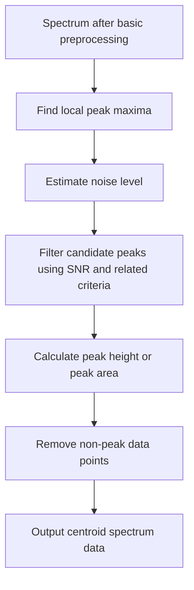

# Peak Picking

This page introduces the peak-picking module in MassFlow.


Authors: Leqiang Dong, Jingwei Dong

**Feedback:** If you find any problems while using MassFlow or reading the documentation, you can submit feedback through [GitHub Issues](https://github.com/NeoNexusX/MassFlow/issues), or contact us by email at 707244007@qq.com.

## Overview

Profile mass spectra usually contain a large number of continuously sampled *m/z* points. Many of these points lie between peaks and do not represent independent ion peaks. Peak picking identifies possible ion-peak positions from the continuous spectral trace and removes weak candidate peaks according to signal intensity and noise level.

After processing, each spectrum is converted from a continuous profile into a sparser peak list containing only the detected peak positions and their corresponding intensities. During peak picking, MassFlow checks local peak maxima, signal-to-noise ratio, and peak prominence, and can also determine peak boundaries from peak shape.

Peak picking does not change the spatial positions of pixels, but it substantially reduces the number of *m/z* data points in each spectrum, providing more compact data for subsequent isotope filtering, peak alignment, and statistical analysis.

- Input and output
  - The input is the mass-spectrometry data to be processed. Users only need to provide the data-file path; MassFlow automatically reads the *m/z* values and signal intensities for each pixel.
  - The output is peak-picked mass-spectrometry data containing only the detected peak positions and their corresponding intensities. Non-peak data points are removed.
- Peak-detection strategy
  - Local-maximum detection: uses a fixed `width` window to inspect local high points in a spectrum and identify possible peak positions.
  - Signal-to-noise filtering: removes candidate peaks whose signal-to-noise ratio is below `snr`, based on the estimated noise level.
  - Peak-boundary detection (optional): parameters such as `prominence` and `relheight` can be used to further determine whether a peak is sufficiently distinct and to define its range.

## Function Description

### Preprocessor.peak_pick

```python
massflow.preprocess.api.PreprocessorAPI.peak_pick(
    *,
    width: int = 5,
    method: str = "quantile",
    snr: float = 2.0,
    return_type: str = "height",
    prominence: float | None = None,
    relheight: float | None = None,
    nbins: int = 1,
    overlap: float = 0.5,
    backend: Literal["python", "cardinal"] = "python",
) -> Self
```

- Function: picks peaks from each spectrum and converts each profile spectrum into a centroid peak list containing only peak maxima.
- Parameters:
  - `width`: half-width of the local-maximum detection window, default `5`. It determines the neighborhood used for local-maximum detection. Larger values merge nearby small peaks, while smaller values retain more peaks. Recommended range: 3–11. Adjust it according to instrument resolution and the expected peak density.
  - `method`: noise-estimation method, `"sd" | "mad" | "quantile" | "diff"`; default `"quantile"`.
    - `quantile` estimates the noise baseline from intensity quantiles. It is a general-purpose method, is not overly influenced by outlier peaks and is a relatively robust choice.
    - `sd` estimates noise from the local standard deviation and is suitable when the noise distribution is relatively uniform across the data.
    - `mad` uses the median absolute deviation for robust noise estimation and is suitable when the data contain many outliers.
    - `diff` estimates noise from differences between adjacent points and is suitable when the baseline changes slowly and noise fluctuations are relatively small.
    - For data with a stable baseline, `"sd"` or `"diff"` may be more sensitive.
    - For data containing very large peaks, `"mad"` is more robust than `"sd"`.
  - `snr`: signal-to-noise threshold, default `2.0`. `snr × noise` defines the minimum peak intensity, and candidate peaks below this threshold are discarded. Recommended range: 1.5–5.0. Lower `snr` values retain more weak peaks, including more noise, while higher values are more conservative.
  - `return_type`: returned peak-intensity type: `"height"` for peak height or `"area"` for peak area. Default: `"height"`.
    - `“height”`: Uses the signal intensity at the peak’s highest point as the peak’s intensity. This method is simple to calculate and is suitable for standard peak extraction, peak alignment, and subsequent peak filtering; it is also the recommended choice for first-time users.
    - `“area”`: Represents peak intensity as the integrated area within the peak’s boundaries. This method is suitable for analyses where you explicitly wish to utilize the complete peak shape information; in such cases, you should pay close attention to how `relheight` affects the integration boundaries.
  - `prominence`: measures how much a peak stands out relative to its surrounding local baseline. Peaks below this value are discarded (optional). When set to a value, peaks with lower prominence are removed.The higher the value set, the stricter the filter.
  - `relheight`: relative height used to determine peak width (optional). It is meaningful only when `return_type="area"` and is used when calculating peak area.
  - `nbins`: number of chunks, default `1` (no chunking). The value must be `>= 1`. For extremely long spectra, such as FT-ICR data, chunked processing can reduce peak memory usage.
  - `overlap`: overlap ratio between chunks (`0 <= overlap < 1`), default `0.5`. Overlap prevents peaks near chunk boundaries from being lost because of chunking.
  - `backend`: backend method, `"python"` (default) or `"cardinal"`.

Example:

```python
from massflow.data_manager import MSDataManagerImzML
from massflow.preprocess.preprocessor import Preprocessor
from massflow.tools.plot import plot_spectrum

FILE_PATH = "data/example.imzML"
dm = MSDataManagerImzML(filepath=FILE_PATH)
dm.load_head_data()

# Chained processing: noise reduction followed by peak picking
processed = (
    Preprocessor(dm)
    .noise_reduction(method="gaussian_numba", window=7)
    .peak_pick(method="quantile", snr=3.0, width=5)
    .start()
)

plot_spectrum(
    base=dm.ms[0],
    target=processed.ms[0],
    mz_range=(400, 410),
    intensity_range=(0.0, 20),
    plot_mode=["line", "stem"],
    metrics_box=True,
)

processed.close()
dm.close()
```

This example performs the following steps:

1. Read the imZML data.
2. Apply Gaussian smoothing.
3. Perform peak picking.

The following are the results obtained using the same dataset but with different methods:

`method=sd`


`method=mad`


`method=quantile`


`method=diff`


## Overall Workflow




## Error Handling

- All input-validation errors are recorded with `logger.error` before a `ValueError` or `TypeError` is raised.
- `method` validation: only `"sd"`, `"mad"`, `"quantile"`, and `"diff"` are supported; otherwise, a `ValueError` is raised.
- `snr` validation: it must be a finite positive value; otherwise, signal-to-noise filtering is not performed.
- `window` validation: `width < 1` is automatically adjusted to `1`.
- `overlap` validation: it must be within `[0.0, 0.99]`.

## References

- [`preprocess/helper/peak_pick_helper.py`](https://github.com/NeoNexusX/MassFlow/blob/main/src/massflow/preprocess/helper/peak_pick_helper.py): core peak-picking implementation (`peak_picker`)
- [`preprocess/helper/est_noise_helper.py`](https://github.com/NeoNexusX/MassFlow/blob/main/src/massflow/preprocess/helper/est_noise_helper.py): noise-estimation function (`estimator`)
- [`preprocess/numba/peak_pick_numba.py`](https://github.com/NeoNexusX/MassFlow/blob/main/src/massflow/preprocess/numba/peak_pick_numba.py): Numba-accelerated local-maximum detection and filtering
- [`preprocess/numba/est_noise_numba.py`](https://github.com/NeoNexusX/MassFlow/blob/main/src/massflow/preprocess/numba/est_noise_numba.py): Numba-accelerated noise estimation
- [`preprocess/flat_pre_fun.py`](https://github.com/NeoNexusX/MassFlow/blob/main/src/massflow/preprocess/flat_pre_fun.py): `FlatPreprocess.peak_pick_flat`, preprocessing entry point for flat data arrays
- [`preprocess/api.py`](https://github.com/NeoNexusX/MassFlow/blob/main/src/massflow/preprocess/api.py): `PreprocessorAPI.peak_pick`, API entry point for peak picking
