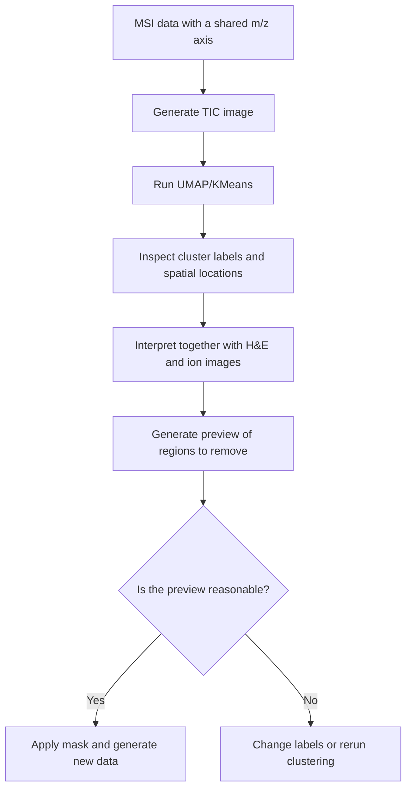

# KMeans Tissue Region Segmentation

This page introduces KMeans-based tissue region segmentation in MassFlow, including result inspection and the workflow for removing or retaining regions.


Authors: Leqiang Dong, Jingwei Dong

**Feedback:** If you find any problems while using MassFlow or reading the documentation, you can submit feedback through [GitHub Issues](https://github.com/NeoNexusX/MassFlow/issues), or contact us by email at 707244007@qq.com.

## Overview

Different regions in MSI tissue may have different overall mass-spectrometry characteristics. KMeans divides pixels into a specified number of discrete classes based on low-dimensional features and maps the classification results back to the original tissue space, making it easy to see where different classes are distributed in the tissue.

After tissue-region segmentation, the following results can be obtained:

1. KMeans assigns a class label to every pixel.
2. Pixels belonging to the same class are displayed with the same color in tissue space, forming one or more spatial regions
3. Users combine TIC images, ion images, H&E images, and tissue location to determine which classes correspond to background, the main tissue area, or other regions of interest.
4. Based on the analysis results, select the categories to be deleted or retained, and generate a preview of the area processing.
5. After confirming that the preview is reasonable, the corresponding region mask is applied to the MSI data.

## Recommended Usage

Tissue-region segmentation in MassFlow generally follows a “run → inspect results → identify regions → generate preview → manually confirm” process. We recommend running the code step by step in Jupyter Notebook, following the order shown on this page.

If you are not familiar with Jupyter Notebook, please read [Best Practices](./jupyter.md) first.

## Function Description

### SegmentationPipeline.run_umap_kmeans

```python
massflow.segmentation.SegmentationPipeline.run_umap_kmeans(
    *,
    sample_ratio: float = 1.0,
    transform_batch_size: int | None = 1024,
    dpi: int = 600,
    save_images: bool = True,
    save_matrix: Literal["npz", "zarr"] | None = None,
    n_components: int = 3,
    umap_metric: str = "cosine",
    n_clusters: int = 10,
    random_state: int | None = None,
    show: bool = False,
) -> UmapKmeansResult
```

- Function: runs UMAP and KMeans using the mass-spectrometry features of each pixel and generates spatial clustering results.
- Parameters: this page focuses on KMeans-related parameters:
  - `n_clusters`: number of classes, default `10`. The current implementation supports `1–20`. Larger values produce finer segmentation, but the same tissue region is also more likely to be split into several smaller classes.
  - `random_state`: fixing the random seed makes repeated results easier to compare.
  - `transform_batch_size`: number of pixels processed in each batch during subsequent UMAP transformation, default `1024`. The input must be a positive integer. Larger values may be faster but use more memory; reduce this value if memory is insufficient.
  - `save_images`: whether to save UMAP and KMeans images, default `True`.
  - `save_matrix`: whether to save clustering results that can be loaded again. Available values are `"npz"`, `"zarr"`, or `None`.
  - `dpi`: resolution of saved images, default `600`.
  - `show`: whether to display the KMeans image while running, default `False`.
  - For UMAP-related parameters, please see [UMAP Dimensionality Reduction and Visualization](./umap.md).
- Output: returns `UmapKmeansResult`, which contains the spatial UMAP image, spatial KMeans image, cluster label for each pixel, and the display color corresponding to each label.


The following example is intended to be run in Jupyter Notebook cell order. The `dm` and `pipeline` variables created in earlier cells are reused in later examples.

In the first cell, load the data and create a `SegmentationPipeline`:

```python
from massflow.data_manager import MSDataManagerImzML
from massflow.segmentation import SegmentationPipeline


dm = MSDataManagerImzML(filepath="data/example.imzML")
dm.load_head_data()

pipeline = SegmentationPipeline(
    dm,
    output_dir="segmentation_output",
)
```

After this step, two variables are created in the Notebook: `dm` and `pipeline`.

The later code continues to use these variables, so the data do not need to be loaded again.


Continue using the `pipeline` created above:

```
result = pipeline.run_umap_kmeans(
    sample_ratio=1.0,
    n_clusters=10,
    random_state=0,
    save_images=True,
    save_matrix="zarr",
    show=False,
)
```

This step first obtains low-dimensional features for each pixel, then uses KMeans to assign the pixels to different classes and maps the clustering result back to tissue space.


To inspect the correspondence between class labels and colors in the image, run:

```
result.print_label_colors()
```


Example output:

Reference dataset 1:

Original TIC image:


KMeans clustering result:


Corresponding UMAP image:


Reference dataset 2:

Original TIC image:


KMeans clustering result:


Corresponding UMAP image:


### SegmentationPipeline.remove_clusters

```python
pipeline.remove_clusters(labels_to_remove)
```

- Function: removes cluster classes that the user has confirmed are not needed and generates transparent preview images of the selected regions.
- Parameters:
  - `labels_to_remove`: KMeans class labels to remove. At least one non-negative class label must be provided.
- Output: returns a two-dimensional region mask and generates transparent UMAP and KMeans preview images in the `cluster_segmentation` directory.
- This step only constructs a region mask; it does not directly modify the original MSI data.


Example:

To remove a specified cluster region, run:

```python
# Use the pipeline variable created and run with SegmentationPipeline above
labels_to_remove=[0]

pipeline.remove_clusters(labels_to_remove)
```

A preview of the regions to be removed is generated.

Experimental dataset 1:

KMeans preview result:


Original result:


Experimental dataset 2:

KMeans preview result:


Original result:


### SegmentationPipeline.remove_background

```python
pipeline.remove_background(
    labels_to_remove=None,
    *,
    remove_num=1,
)
```

- Function: automatically searches from the outside of the image inward and removes outer cluster regions.
- Parameters:
  - `labels_to_remove`: optional. Restricts which classes are allowed to be removed automatically. If omitted, the outer region is searched across all classes.
  - `remove_num`: number of consecutive outer layers to remove, default `1`. The input must be a positive integer.
- Output: returns a two-dimensional region mask and generates transparent region-preview images in the `cluster_segmentation` directory.
- This method is suitable when the background is mainly located around the outside of the tissue. If real tissue itself touches the image boundary, automatic identification may remove real tissue by mistake, so the preview must be checked.


Example:

If you have confirmed that the cluster regions around the outside of the image are background, continue with:

```python
# Use the pipeline variable created and run with SegmentationPipeline above
pipeline.remove_background(
    labels_to_remove=None,
    remove_num=1,
)
```

This operation identifies regions connected to the outside of the image according to the clustering result and generates a preview of the regions to be removed.

Experimental dataset 1:

KMeans preview result:


Original result:


Experimental dataset 2:

KMeans preview result:


Original result:


### SegmentationPipeline.keep_clusters

```python
pipeline.keep_clusters(labels_to_keep)
```

- Function: retains specified classes as well as internal regions spatially enclosed by those classes.
- Parameters:
  - `labels_to_keep`: KMeans class labels to retain. At least one non-negative class label must be provided.
- Output: returns a two-dimensional region mask and generates transparent region-preview images in the `cluster_segmentation` directory.

- Note that `keep_clusters()` is not equivalent to simply “keep only these labels.” Current implementation also retains internal regions enclosed by the specified regions, so the preview should be checked first.

Example:

If you have already determined that only certain regions of interest should be retained, run:

```python
# Use the pipeline variable created and run with SegmentationPipeline above
labels_to_keep=[4]
pipeline.keep_clusters(labels_to_keep)
```

This operation sets the specified cluster classes as retained regions, also retains internal regions enclosed by them, and generates a preview image.

Experimental dataset 1:

KMeans preview result:


Original result:


Experimental dataset 2:

KMeans preview result:


Original result:


### SegmentationPipeline.apply_region_mask

```python
pipeline.apply_region_mask(
    output_path,
    *,
    batch_size=256,
    temp_dir=None,
)
```

- Function: applies the confirmed region mask to the original data and generates a new MSI dataset.
- Parameters:
  - `output_path`: path for saving the new dataset.
  - `batch_size`: amount of data processed in each batch, default `256`. It must be positive.
  - `temp_dir`: temporary directory used only when writing imZML; it can be omitted.
- Output: returns a new data manager corresponding to the input data type.

Example:

To actually apply the region-processing result to the MSI data, use:

```python
# Use the pipeline variable modified by remove_clusters(), remove_background(), or keep_clusters() above

masked = pipeline.apply_region_mask(
    output_path="data/tissue_only.imzML",
    temp_dir="temp/segmentation",
)
```

This step generates a new MSI dataset according to the confirmed region mask.


## Overall Workflow



## Clustering and Region-Selection Methods

### KMeans

KMeans uses features obtained from UMAP to divide pixels into a specified number of classes.

For example:

```python
n_clusters=10
```

means that the current pixels are divided into 10 classes.

- Smaller `n_clusters`: coarser region segmentation.
- Larger `n_clusters`: finer region segmentation, but the same type of tissue may be split into several smaller classes.

The current implementation supports up to 20 classes.

### Three Region-Selection Methods

| Method | Purpose |
| ------------------- | ---------------------------------- |
| `remove_clusters` | Remove explicitly specified classes |
| `remove_background` | Automatically remove classes layer by layer from the outside of the image |
| `keep_clusters` | Retain specified classes and internal regions enclosed by them |

When processing a new dataset for the first time, `remove_clusters()` is recommended as the first choice because the user explicitly specifies which classes should be removed, making the result easier to check and review.


## Error Handling

- A `ValueError` is raised when the imZML data are non-continuous.
- Before running `remove_clusters()`, `remove_background()`, or `keep_clusters()`, you must first run `run_umap_kmeans()` or load an existing `UmapKmeansResult`.
- A region mask must be generated before `apply_region_mask()`.
- The mask shape passed to `apply_region_mask()` must match the spatial dimensions of the data. If the mask retains no pixels, a `ValueError` is raised.
- The current UMAP/KMeans implementation supports continuous-spectrum `MSDataManagerZarr`, imZML, and ion-image Binary/H5/Zarr data managers.

## References

- [`segmentation/segmentation_pipeline.py`](https://github.com/NeoNexusX/MassFlow/blob/main/src/massflow/segmentation/segmentation_pipeline.py): `SegmentationPipeline` and `UmapKmeansResult`
- [`segmentation/umap_kmeans.py`](https://github.com/NeoNexusX/MassFlow/blob/main/src/massflow/segmentation/umap_kmeans.py): UMAP/KMeans analysis and spatial-image output
- [`segmentation/cluster_segmentation.py`](https://github.com/NeoNexusX/MassFlow/blob/main/src/massflow/segmentation/cluster_segmentation.py): cluster-region removal, outer-background removal, and target-region retention
- [`segmentation/region_mask.py`](https://github.com/NeoNexusX/MassFlow/blob/main/src/massflow/segmentation/region_mask.py): spatial-mask application and data writing
