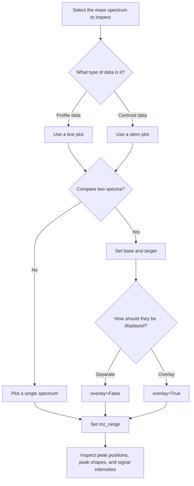

# Spectrum Visualization

This page introduces the mass spectrum plotting functions in MassFlow.

Authors: Leqiang Dong, Jingwei Dong

**Feedback:** If you encounter any problems while using MassFlow or reading the documentation, please submit them through [GitHub Issues](https://github.com/NeoNexusX/MassFlow/issues) or contact us at [707244007@qq.com](mailto:707244007@qq.com).

## Overview

Each acquisition position in mass spectrometry imaging data corresponds to a mass spectrum. A mass spectrum is used to inspect the ion signals detected at a particular position, where:

- the horizontal axis represents *m/z*;
- the vertical axis represents signal intensity.

Mass spectra can be used to obtain an initial understanding of the raw data and to compare changes before and after preprocessing. For example, they can be used to:

- check whether there is an obvious elevated or slowly drifting baseline;
- compare continuous spectra before and after noise reduction;
- check whether major ion peaks are retained after peak picking;
- examine changes in peak positions and peak numbers before and after peak alignment or peak filtering.

A mass spectrum reflects the signal at only one pixel position and cannot represent the entire MSI dataset by itself. In actual analysis, it is recommended to examine spectra from multiple tissue positions together with TIC images and target ion images.

## Function Description

### plot_spectrum

```python
massflow.tools.plot.plot_spectrum(
    base=None,
    target=None,
    save_path=None,
    figsize=(20, 5),
    dpi=300,
    colors=None,
    line_width=None,
    plot_mode=None,
    mz_range=None,
    intensity_range=None,
    metrics_box=True,
    overlay=False,
)
```

- Function: plots a single mass spectrum or compares two mass spectra.

- Parameters:

  - `base`: The primary mass spectrum to be plotted. Typically, this is a mass spectrum passed into the data manager, such as `dm.ms[0]`. Fill in this field when plotting only one mass spectrum.

  - `target`: The second mass spectrum to be compared with the mass spectrum selected as `base`. Fill in this field when comparing results before and after processing; leave it as `None` when plotting only one mass spectrum.

  - `save_path`: Path for saving the image. When kept as `None`, the image is displayed directly.

  - `figsize`: Image size. The default is `(20, 5)`.

  - `dpi`: Image resolution. The default is `300`. A larger value generally gives a higher-resolution saved image.

  - `colors`: Sets the colors of the mass spectra. The default is `None`, which means the program's default color scheme is used. Other colors can be specified when needed.For example, to change the color to red, set `colors=“red”`.

  - `line_width`: Sets the line width. The default width is `1.5`. The default setting is usually sufficient, If you need to adjust this setting, you can enter a different value. This parameter only affects the plot appearance; it does not alter the mass spectrometry data..

  - `plot_mode`: Sets the plotting mode. Continuous line plots `"line"` and stem plots `"stem"` are supported. The default is `"line"`.  
    When comparing two spectra, different plotting modes can also be specified separately. For example, `["line", "stem"]` means that the first spectrum is displayed as a continuous line plot and the second as a stem plot.

  - `mz_range`: Sets the *m/z* range displayed on the horizontal axis. For example, `(400, 410)` displays only the *m/z* range from 400 to 410. If not specified, the range is automatically determined from the input data.

  - `intensity_range`: Sets the signal-intensity range displayed on the vertical axis. For example, `(0, 20)` displays only signal intensities from 0 to 20. If not specified, the range is automatically determined from the input data.

  - `metrics_box`: Determines whether auxiliary comparison information is displayed when comparing two spectra. The default is `True`.When both `base` and `target` are provided, setting this to `True` will displays auxiliary comparison information in the figure; setting it to `False` will display only the mass spectrum.

  - `overlay`: Determines whether two mass spectra are overlaid on the same axes. The default is `False`.If set to `True`, the two mass spectra will be plotted on the same axis.


## Plotting Modes

Different types of mass spectra are better suited to different plotting modes.

| Data type | Recommended plotting mode | Suitable for observing |
| --- | --- | --- |
| Profile data | `line` | Peak shape, noise, baseline, and continuous signal changes |
| Centroid data | `stem` | Peak position, peak number, and peak intensity |

### Profile Data

Profile data retain continuous *m/z* and signal-intensity information, allowing the complete peak shape to be observed.

The recommended setting is:

```python
plot_mode="line"
```

For example:

```python
from massflow.tools.plot import plot_spectrum

plot_spectrum(
    base=dm.ms[0],
    plot_mode="line",
    mz_range=(400, 410),
    metrics_box=False,
)
```

This plotting mode is suitable for observing:

- peak shape;
- spectral noise;
- baseline;
- changes before and after smoothing.


### Centroid Data

Centroid data retain only the identified ion peaks and their intensities and no longer preserve the complete continuous peak shapes.

The recommended setting is:

```python
plot_mode="stem"
```

For example:

```python
from massflow.tools.plot import plot_spectrum

plot_spectrum(
    base=dm.ms[0],
    plot_mode="stem",
    mz_range=(400, 410),
    metrics_box=False,
)
```

This plotting mode makes it easier to observe:

- peak positions;
- the number of peaks;
- the intensity of different peaks.


Therefore, results after peak picking, peak alignment, and subsequent processing performed on a shared *m/z* axis are generally more suitable for viewing with a stem plot.

### Comparing Mass Spectra Before and After Processing

`plot_spectrum` can accept two spectra to compare results before and after processing.

For example:

```python
plot_spectrum(
    base=before.ms[0],
    target=after.ms[0],
    mz_range=(400, 410),
    plot_mode=["line", "stem"],
    metrics_box=True,
)
```

Additional comparison information is also generated:
- `Range`: The *m/z* range of the `base` mass spectrum;
- `Correlation`: The Pearson correlation coefficient between the two spectral intensity sequences;
- `TIC ratio`: Total intensity of `target` / Total intensity of `base`;
- `SNR orig`: Signal-to-noise ratio of `base`;
- `SNR den`: Signal-to-noise ratio of `target`;
- `SNR improvement`: `target SNR / base SNR`.


When comparing spectra, try to ensure that:

1. the same pixel or spectrum position is used;
2. the same `mz_range` is used;
3. comparable vertical-axis ranges are used;
4. the correct `plot_mode` is selected according to the data type.

This helps ensure that the observed differences are caused by data processing rather than by different pixels or different plotting ranges.

### Separate and Overlay Display

By default:

```python
overlay=False
```

the two spectra are displayed separately, which is suitable for examining their individual peak shapes, peak positions, and overall changes.

To display both spectra on the same axes, set:

```python
overlay=True
```

Overlaying the spectra makes it easier to directly compare peak positions and signal-intensity differences.

If the signal intensities of the two spectra differ greatly and the overlaid plot becomes difficult to interpret, the default `overlay=False` can be used instead.


## Overall Workflow



## Error Handling

- When drawing, at least one of the `base` and `target` parameters must be set; if both are `None`, the code will throw an error.
- `spectrum has no data points.`: The current mass spectrum contains no data points. Check whether the spectrum has been loaded successfully or whether the selected pixel position contains valid data.
- `No data points in selected 'mz_range'.`: The selected *m/z* range contains no data points. Reset the *m/z* range according to the range covered by the loaded data.

## References

- [tools/plot.py](https://github.com/NeoNexusX/MassFlow/blob/main/src/massflow/tools/plot.py): Mass spectrum plotting functions.
