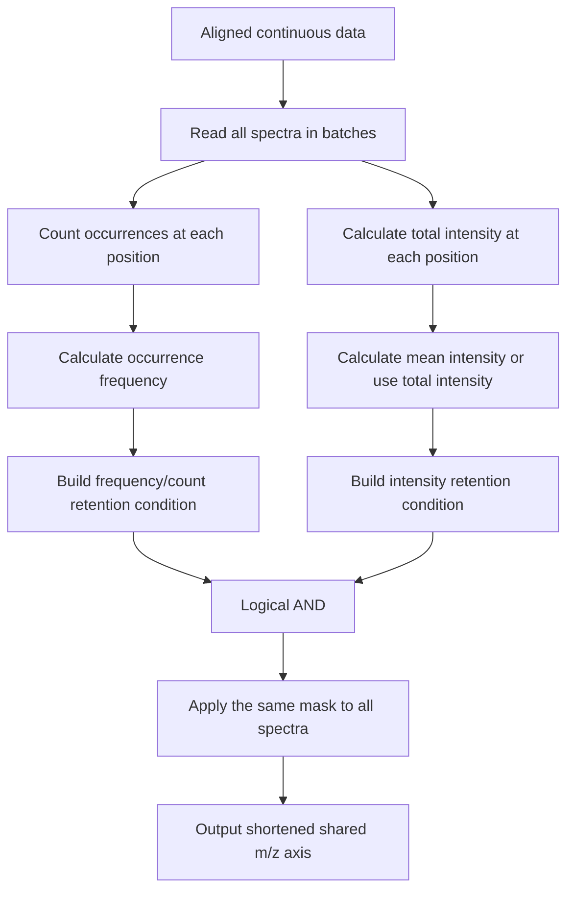

# Statistical Peak Filtering

This page introduces the statistical peak-filtering module in MassFlow.


Authors: Leqiang Dong, Jingwei Dong

**Feedback:** If you find any problems while using MassFlow or reading the documentation, you can submit feedback through [GitHub Issues](https://github.com/NeoNexusX/MassFlow/issues), or contact us by email at 707244007@qq.com.

## Overview

After peak alignment, all pixels share the same *m/z* axis. This axis may contain random peaks that appear in only a very small number of pixels or peaks with very low overall intensity. Statistical peak filtering calculates the occurrence count and aggregated intensity of every shared *m/z* position across the entire dataset, builds a global retention mask `keep_mask`, and applies the same filtering result to all spectra.

- The input must be aligned, continuous data with a shared *m/z* axis  `continuous=True`.
- This is a dataset-level operation. The complete dataset is scanned once to calculate statistics, then scanned again to apply the mask and write the result.
- Occurrence count/frequency conditions and intensity conditions are combined using logical AND.
- The output remains continuous data, but both the shared *m/z* axis and the intensity vector of every spectrum are shortened together.


## Function Description

### Preprocessor.filter_peaks_by_stats

```python
massflow.preprocess.api.PreprocessorAPI.filter_peaks_by_stats(
    *,
    min_count: int | None = None,
    min_frequency: float | None = None,
    intensity_method: Literal["mean", "sum"] = "mean",
    min_intensity: float | None = None,
    intensity_quantile: float | None = 0.01,
    output_path: str | None = None,
) -> Self
```

- Function: filters the shared *m/z* axis according to peak occurrence support and aggregated intensity.

- Parameters:
  - `min_count`: minimum number of spectra in which an *m/z* position has positive intensity. This is suitable when the number of spectra is fixed and thresholds do not need to be compared directly across datasets.
  - `min_frequency`: minimum occurrence frequency in the range `[0, 1]`; frequency is calculated as `counts / spectrum_count`. This is more suitable for datasets with different numbers of spectra. For example, `0.01` means the peak must appear in at least 1% of the spectra.
  - `intensity_method`: choose average intensity `"mean"` or total intensity `"sum"`.
    - `mean` treats missing positions as zero when averaging over the total number of spectra, emphasizing the overall signal across pixels.
    - `sum` changes with the number of spectra, so thresholds should be compared cautiously across datasets.
  - `min_intensity`: absolute lower limit for aggregation intensity; the default is `None`. When set, only *m/z* positions with an aggregation intensity equal to or greater than this threshold are retained.
  - `intensity_quantile`: removes the lowest portion of peaks according to the intensity distribution of the complete peak set. Range: `(0, 1)`. This is a relative threshold and is useful for removing a globally weak fraction of *m/z* positions. If you only want to use occurrence count/frequency conditions, set `intensity_quantile=None`.
  - `output_path`: imZML output path for this dataset-level filtering stage. The final path can also usually be specified once in `Preprocessor(..., output_path=...)`.
  
  Output:
  
  - the filtered `.imZML` file and its matching `.ibd` file.

Example:

```python
from massflow.data_manager import MSDataManagerImzML
from massflow.preprocess import Preprocessor

dm = MSDataManagerImzML(filepath="data/example.imzML")
dm.load_head_data()

filtered = (
    Preprocessor(
        dm,
        batch_size=512,
        temp_dir="temp/preprocess",
        output_path="data/stat_filtered.imzML",
    )
    .peak_pick()
    .peak_align()
    .filter_peaks_by_stats(
        min_frequency=0.01,
        intensity_quantile=0.05,
        intensity_method="mean",
    )
    .start()
)

filtered.close()
dm.close()
```

This example performs the following steps:

1. Read the imZML data.
2. Perform peak picking.
3. Complete peak alignment.
4. Apply statistical peak filtering.

Comparison before and after filtering:


### plot_peak_filter_histogram

```python
massflow.tools.plot_peak_filter.plot_peak_filter_histogram(
    count_display: CountDisplay = "frequency",
    intensity_method: IntensityMethod = "mean",
    min_count: int | None = None,
    min_frequency: float | None = None,
    quantile: float | None = None,
 	show: bool = True,
    output_path: str | Path | None = None,
)
```

- Function: calculates statistical results and plots the distributions of peak occurrence frequency and intensity together with threshold lines. It can be used to check the occurrence count/frequency and aggregated-intensity distributions.

- \- Parameters:

  - `count_display`: Controls how peak occurrences are displayed. `“frequency”` indicates the frequency of a peak’s occurrence across all mass spectra; if `count` is used, the actual number of spectra in which each peak appears is displayed.

  - `intensity_method`: The aggregation method used to calculate the overall intensity of each peak. In the example, `“mean”` indicates that the average intensity of the peak across all mass spectra is used. 

  - `min_frequency`: The reference threshold for peak occurrence frequency. `0.01` means the peak must appear in at least approximately 1% of the mass spectra. This parameter is used in the preview to draw a frequency threshold line; it does not remove peaks on its own.

  - `min_count`: A reference threshold for the number of times a peak must appear. For example, an input value of `10` means that a peak must appear in at least 10 mass spectra to be retained; if it appears in 9 or fewer mass spectra, it will be filtered out.

  - `quantile`: The quantile threshold for aggregated intensity. `0.05` indicates that the 5th percentile of the aggregated intensities of all peaks is used as the reference threshold.

- Return value: `profile` contains peak statistics calculated from the current data, including the information required for subsequent statistical peak filtering. It can be passed to the formal filtering function to avoid recalculating the statistics.

- Feature: it does not delete peaks. The returned `profile` can be reused for formal filtering.


example:

```python
from massflow.tools.plot_peak_filter import plot_peak_filter_histogram

# Peak alignment must be completed before using this function

profile = plot_peak_filter_histogram(
    aligned_dm,
    count_display="frequency",
    intensity_method="mean",
    min_frequency=0.01,
    quantile=0.05,
    output_path="figures/peak_filter_preview.png",
    show=False,
)
```


### filter_peaks_by_stats

```python
preprocess.helper.stat_filter_helper.filter_peaks_by_stats(
    data_manager: MSDataManagerImzML,
    *,
    profile: PeakFilterProfile | None = None,
    min_count: int | None = None,
    min_frequency: float | None = None,
    intensity_method: Literal["mean", "sum"] = "mean",
    min_intensity: float | None = None,
    intensity_quantile: float | None = None,
    output_path: str | Path | None = None,
    temp_dir: str | Path | None = None,
    batch_size: int = 256,
) -> MSDataManagerImzML
```

- Function: formally removes peaks using preview statistics that have already been inspected.
- Requirement: `profile` should come from the current dataset and the currently loaded region. The code checks that the shared *m/z* axis is exactly the same, but it does not verify that the statistical values were calculated from exactly the same set of pixels.
- At least one of `min_count`, `min_frequency`, `min_intensity`, or `intensity_quantile` must be enabled.

## Preview-Then-Apply Workflow

You can use `plot_peak_filter_histogram` to preview the peak occurrence-frequency and intensity distributions first. After manual inspection, use `filter_peaks_by_stats` to apply the statistical criteria and generate a filtered dataset.

Example:

```python
from massflow.preprocess.helper.stat_filter_helper import filter_peaks_by_stats
from massflow.tools.plot_peak_filter import plot_peak_filter_histogram

# Peak alignment must be completed before this step
profile = plot_peak_filter_histogram(
    aligned_dm,
    count_display="frequency",
    intensity_method="mean",
    min_frequency=0.05,
    quantile=0.01,
    output_path="figures/stat_filter_preview.png",
    show=False,
)

filtered_dm = filter_peaks_by_stats(
    aligned_dm,
    profile=profile,
    min_frequency=0.05,
    intensity_method="mean",
    intensity_quantile=0.01,
    output_path="data/stat_filtered.imzML",
)
```

This process has two steps:

1. `plot_peak_filter_histogram` scans all spectra in the currently loaded region, creates the plot, and returns reusable statistical results.
2. `filter_peaks_by_stats` uses the same statistics to construct the retention criteria and writes a new dataset.


## Overall Workflow




## Mask Semantics

Each condition first creates its own Boolean mask. The final mask uses logical AND:

```text
keep = count_mask AND intensity_mask
```

The specific comparison rules are:

| Condition | Retention rule |
|------|----------|
| `min_count` | `counts >= min_count` |
| `min_frequency` | `frequencies >= min_frequency` |
| `min_intensity` | `intensity >= min_intensity` |
| `intensity_quantile` | `intensity > quantile(intensity, q)` |

Note that the quantile condition uses a strict greater-than comparison. Therefore, *m/z* positions exactly equal to the quantile threshold are also removed. If many peaks are exactly equal to the quantile threshold, the actual removal proportion may exceed the configured value.


## Error Handling

- Non-continuous data raise a `ValueError`; run `peak_align` first.
- If all thresholds are `None`, a `ValueError` is raised.
- `intensity_method` must be `"mean"` or `"sum"`.
- Empty data or a `profile` whose *m/z* axis does not match the current data are rejected.

## References

- [`preprocess/helper/stat_filter_helper.py`](https://github.com/NeoNexusX/MassFlow/blob/main/src/massflow/preprocess/helper/stat_filter_helper.py): statistical objects, masks, and public filtering operations
- [`preprocess/numba/stat_filter_numba.py`](https://github.com/NeoNexusX/MassFlow/blob/main/src/massflow/preprocess/numba/stat_filter_numba.py): statistical aggregation and shared-mask write-back kernels
- [`tools/plot_peak_filter.py`](https://github.com/NeoNexusX/MassFlow/blob/main/src/massflow/tools/plot_peak_filter.py): threshold-distribution preview
- [`preprocess/api.py`](https://github.com/NeoNexusX/MassFlow/blob/main/src/massflow/preprocess/api.py): `PreprocessorAPI.filter_peaks_by_stats`, API entry point for statistical peak filtering
- [`preprocess/pipeline/planner.py`](https://github.com/NeoNexusX/MassFlow/blob/main/src/massflow/preprocess/pipeline/planner.py): dataset-level task order and final output routing
