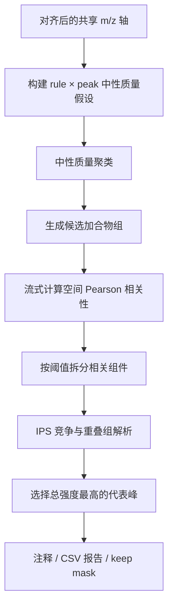

# MassFlow

本文介绍 MassFlow 中的加合物注释与过滤（adduct annotation and filtering）模块，重点包括：

- 流水线级入口 `Preprocessor.filter_peaks_by_adducts`
- 可审计预览 `compute_adduct_annotations`
- 空间相关性证据和 CSV 报告
- `apply_adduct_annotations` 的预览后应用流程

## 概述

加合物过滤用于在对齐后的共享 m/z 轴上寻找可能来自同一中性分子的不同离子形式，并结合 MSI 像素强度的空间相关性确认候选关系。确认后的每个加合物组保留总强度最高的代表峰，删除其余非受保护峰。

该实现不是简单的固定 m/z 差值过滤：

1. 根据每个加合物规则把观测 m/z 转换为中性质量假设。
2. 对中性质量相近的假设进行聚类。
3. 使用像素强度向量之间的 Pearson 相关系数确认候选关系。
4. 处理重叠候选组并确定代表峰。
5. 生成可审计注释、报告和最终共享 m/z mask。

输入必须满足：

- `continuous=True`；
- 具有共享 m/z 轴；
- 已执行 `peak_align`；
- 建议在峰对齐前先执行同位素过滤。

### 流程图



## 核心 API

### Preprocessor.filter_peaks_by_adducts（流水线级）

```python
massflow.preprocess.api.PreprocessorAPI.filter_peaks_by_adducts(
    *,
    polarity: Literal["positive", "negative"] = "positive",
    ppm: float = 5.0,
    mzabs: float = 0.015,
    require_quasi: bool = True,
    min_spatial_correlation: float = 0.7,
    output_path: str | None = None,
    report_path: str | None = None,
) -> Self
```

- 描述：计算加合物关系并直接应用删除决策。
- 任务类型：dataset 任务。
- pipeline 行为：内部固定使用 `remove=True`。
- 批处理：使用 `Preprocessor.batch_size` 计算总强度、空间相关性和写回结果。
- 临时文件：使用 `Preprocessor.temp_dir`。
- 参数：
  - `polarity`：正离子或负离子规则表。
  - `ppm`：中性质量聚类的相对容差部分，默认 `5.0`。
  - `mzabs`：中性质量聚类的绝对容差部分，默认 `0.015`。
  - `require_quasi`：每个候选组件是否必须包含至少一个 `quasi=True` 规则。
  - `min_spatial_correlation`：候选峰像素强度向量的最小 Pearson 相关系数。
  - `output_path`：该过滤阶段的 imZML 输出路径。
  - `report_path`：可选 CSV 审计报告路径；无后缀时自动添加 `.csv`。

示例：

```python
from massflow.data_manager import MSDataManagerImzML
from massflow.preprocess import Preprocessor

dm = MSDataManagerImzML(filepath="data/example.imzML")
dm.load_head_data()

filtered = (
    Preprocessor(
        dm,
        batch_size=512,
        temp_dir="temp/preprocess",
        output_path="data/adduct_filtered.imzML",
    )
    .peak_pick()
    .filter_peaks_by_isotopes()
    .peak_align()
    .filter_peaks_by_adducts(
        polarity="positive",
        ppm=5.0,
        mzabs=0.015,
        min_spatial_correlation=0.7,
        report_path="reports/adduct_filter.csv",
    )
    .start()
)

filtered.close()
dm.close()
```

## 默认规则表

当前默认预设只支持 `nmol=1`、单电荷规则。

### 正离子模式

| 规则 | massdiff | quasi | IPS |
|------|---------:|:-----:|----:|
| `[M+H]+` | 1.007276 | 是 | 1.0 |
| `[M+Na]+` | 22.989218 | 是 | 1.0 |
| `[M+K]+` | 38.963158 | 是 | 1.0 |
| `[M+NH4]+` | 18.033823 | 是 | 1.0 |

### 负离子模式

| 规则 | massdiff | quasi | IPS |
|------|---------:|:-----:|----:|
| `[M-H]-` | -1.007276 | 是 | 1.0 |
| `[M-2H+Na]-` | 20.974666 | 否 | 0.5 |
| `[M-2H+K]-` | 36.948606 | 否 | 0.5 |
| `[M+Cl]-` | 34.969402 | 是 | 1.0 |

对于观测 m/z 和规则 `rule`，中性质量按下式计算：

```text
neutral_mass = (abs(charge) × mz - massdiff) / nmol
```

当前实现会拒绝 `nmol != 1`、`abs(charge) != 1` 或与所选极性不一致的自定义规则，不能把默认预设理解为完整加合物库。

## 候选确认与删除语义

### 中性质量容差

聚类距离阈值为：

```text
tolerance = 2 × ppm × 1e-6 × neutral_mass + mzabs
```

中性质量接近只是候选条件，不会直接导致删除。

### 空间相关性

算法按 batch 流式累计 Pearson 相关系数所需的充分统计量，不会一次性加载所有像素的完整特征矩阵。只有满足：

```text
correlation >= min_spatial_correlation
```

的峰对才会形成连接边。候选质量组可能因此拆分为多个独立空间组件。

### 代表峰和保护规则

- 每个确认组件选择跨所有谱图总强度最高的峰作为代表峰。
- 强度相同时选择索引更小的峰。
- 如果一个峰是任意确认组的代表峰，它会受到全局保护，不会因出现在其他组中而被删除。
- 重叠组使用规则 IPS 总分竞争；较低分组被丢弃。

## 推荐的预览后应用流程

流水线 API 会直接删除峰。需要人工审核时，建议先生成预览，再应用同一个结果：

```python
from massflow.preprocess.helper.adduct_filter_helper import apply_adduct_annotations
from massflow.tools.plot_adduct_filter import plot_adduct_filter

result = plot_adduct_filter(
    aligned_dm,
    polarity="positive",
    min_spatial_correlation=0.7,
    batch_size=512,
    output_path="figures/adduct_filter_preview.png",
    report_path="reports/adduct_filter.csv",
    show=False,
)

filtered_dm = apply_adduct_annotations(
    aligned_dm,
    result,
    output_path="data/adduct_filtered.imzML",
)
```

`AdductAnnotationResult` 与生成它的具体数据管理器实例和读取状态绑定。更换文件、`target_locs` 或读取 dtype 后，旧结果不能直接复用。

## 辅助函数

### compute_adduct_annotations

```python
preprocess.helper.adduct_filter_helper.compute_adduct_annotations(
    data_manager: MSDataManagerImzML,
    *,
    polarity: Literal["positive", "negative"] = "positive",
    rules: tuple[AdductRule, ...] | None = None,
    ppm: float = 5.0,
    mzabs: float = 0.015,
    require_quasi: bool = True,
    min_spatial_correlation: float = 0.7,
    batch_size: int = 256,
) -> AdductAnnotationResult
```

只计算并返回不可变的注释结果，不修改数据集。

### filter_peaks_by_adducts

```python
preprocess.helper.adduct_filter_helper.filter_peaks_by_adducts(
    data_manager: MSDataManagerImzML,
    *,
    polarity: Literal["positive", "negative"] = "positive",
    rules: tuple[AdductRule, ...] | None = None,
    ppm: float = 5.0,
    mzabs: float = 0.015,
    require_quasi: bool = True,
    min_spatial_correlation: float = 0.7,
    batch_size: int = 256,
    remove: bool = False,
    output_path: str | Path | None = None,
    temp_dir: str | Path | None = None,
    report_path: str | Path | None = None,
) -> MSDataManagerImzML
```

直接调用 helper 时 `remove=False`，默认只计算决策并返回原数据管理器；流水线注册会把该参数固定为 `True`。

## CSV 审计报告

报告中的每一行代表一条删除证据，包含：

- 代表峰、被删除峰和支持峰的索引、m/z 与规则名称；
- 中性质量、中性质量跨度和 m/z 差；
- 空间相关系数及其阈值；
- 候选关系数、通过阈值的关系数和唯一删除峰数；
- 极性、`ppm`、`mzabs`、`require_quasi` 和 `batch_size`。

同一个被删除峰可能具有多条支持证据，`summary_evidence` 标记其中用于摘要展示的最强证据。

## 参数说明与调参建议

- `ppm` 和 `mzabs` 共同控制中性质量聚类宽度；增大后候选关系会增加，但错误候选也可能增加。
- `min_spatial_correlation` 越高，确认越保守；默认 `0.7`。
- `require_quasi=True` 可防止只由非 quasi 规则组成的组件进入删除阶段。
- 建议先输出预览图和 CSV 报告，再决定是否在正式数据上执行删除。
- 当前算法依赖共享 m/z 轴上的像素强度相关性，不适用于未对齐的 processed 谱。

## 错误处理

- 未对齐或缺少共享 m/z 轴时抛出 `ValueError`。
- `polarity` 必须为 `"positive"` 或 `"negative"`。
- `ppm` 必须为有限正数。
- `mzabs` 必须为有限非负数。
- `min_spatial_correlation` 必须位于 `[-1, 1]`。
- `batch_size` 必须为正整数。
- 报告路径只能无后缀或使用 `.csv` 后缀。
- 规则名称必须唯一，电荷符号必须与极性一致。

## 实现与溯源边界

当前模块记录的算法基础为 CAMERA 1.68.0 的 primary adduct 规则、中性质量假设、候选聚类、quasi/IPS 竞争与最大强度代表峰逻辑。空间相关组件是 MassFlow 针对 MSI 数据的适配层。

本实现没有宣称覆盖 CAMERA 的完整动态规则表、同位素电荷推断或一般化 OID 因果处理。默认规则和阈值是否适合具体仪器与离子化条件，需要由使用者结合预览和报告评估。

## 参考

- `preprocess/helper/adduct_filter_helper.py`：规则、候选组、相关性、报告与公共 API
- `preprocess/numba/adduct_filter_numba.py`：空间相关性流式统计内核
- `tools/plot_adduct_filter.py`：可审计预览图
- `preprocess/helper/stat_filter_helper.py`：共享 mask 写回
- `preprocess/api.py`：`PreprocessorAPI.filter_peaks_by_adducts`
- `preprocess/pipeline/planner.py`：dataset 任务顺序和输出路由

