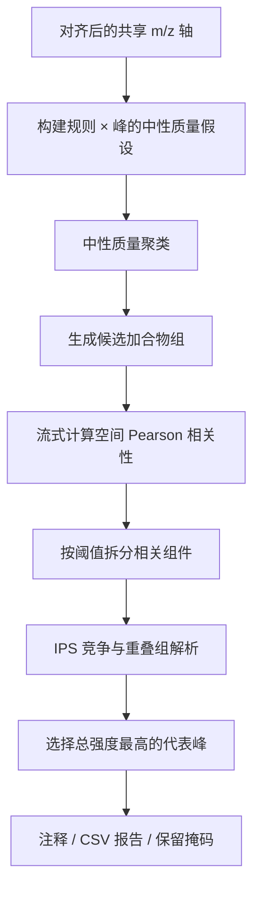

# 加合物注释与过滤

本文介绍 MassFlow 中的加合物注释与过滤模块。


想在线体验质谱成像数据处理，或查找感兴趣的质谱成像数据，可访问 https://sxo.bionet.pro 免费注册体验。


## 概述

加合物过滤用于在对齐后的共享 m/z 轴上寻找可能来自同一中性分子的不同离子形式，并结合 MSI 像素强度的空间相关性确认候选关系。确认后的每个加合物组保留总强度最高的代表峰，删除其余非受保护峰。

该实现不是简单的固定 m/z 差值过滤：

1. 根据每个加合物规则把观测 m/z 转换为中性质量假设。
2. 对中性质量相近的假设进行聚类。
3. 使用像素强度向量之间的 Pearson 相关系数确认候选关系。
4. 处理重叠候选组并确定代表峰。
5. 生成可审计注释、报告和最终共享 m/z 掩码。

输入必须满足：

- 连续型数据，即`continuous=True`；
- 具有共享 m/z 轴；
- 已执行峰对齐 `peak_align`；
- 建议在峰对齐前先执行同位素过滤。

## 功能说明

### Preprocessor.filter_peaks_by_adducts
```python
massflow.preprocess.api.PreprocessorAPI.filter_peaks_by_adducts(
    *,
    polarity: Literal["positive", "negative"] = "positive",
    ppm: float = 5.0,
    mzabs: float = 0.015,
    require_quasi: bool = True,
    min_spatial_correlation: float = 0.7,
    output_path: str | None = None,
    report_path: str | None = None,
) -> Self
```

- 功能：查找并过滤可能来自同一种化合物的加合物峰。在每个确认的加合物组中，程序会保留一个代表峰，并删除其他未受保护的重复峰。
- 参数：
  - `polarity`：正离子或负离子规则表。该参数必须与实验采集时使用的离子模式一致。离子模式设置错误会导致使用错误的加合物规则。
  - `ppm`：中性质量聚类的相对容差部分，默认 `5.0`。输入必须为正数
  - `mzabs`：中性质量聚类的绝对容差部分，默认 `0.015`。输入必须为非负数
  - `ppm` 和 `mzabs` 共同控制中性质量聚类宽度；增大后候选关系会增加，但错误候选也可能增加。
  - `require_quasi`：每个候选组件是否必须包含至少一个主要准分子规则，即 `quasi=True` 规则。可防止只由非准分子规则组成的组件进入删除阶段。
  - `min_spatial_correlation`：候选峰像素强度向量的最小 Pearson 相关系数。输入必须位于`[-1,1]`之间且值越高对峰空间分布一致性的要求越严格，过滤结果也越保守
  - `output_path`：该过滤阶段的 imZML 输出路径。
  - `report_path`：CSV报告的输出路径；无后缀时自动添加 `.csv`。
- 输出：
  - 过滤后的 .imzML 文件；与其配套的 .ibd 文件；
  - CSV 报告。

示例：

```python
from massflow.data_manager import MSDataManagerImzML
from massflow.preprocess import Preprocessor

dm = MSDataManagerImzML(filepath="data/example.imzML")
dm.load_head_data()

filtered = (
    Preprocessor(
        dm,
        batch_size=512,
        temp_dir="temp/preprocess",
        output_path="data/adduct_filtered.imzML",
    )
    .peak_pick()
    .filter_peaks_by_isotopes()
    .peak_align()
    .filter_peaks_by_adducts(
        polarity="positive",
        ppm=5.0,
        mzabs=0.015,
        min_spatial_correlation=0.7,
        report_path="reports/adduct_filter.csv",
    )
    .start()
)

filtered.close()
dm.close()
```
该示例依次完成：

1. 读取 imZML 数据；
2. 进行峰提取；
3. 过滤同位素峰；
4. 完成峰对齐；
5. 进行加合物注释与过滤；
6. 保存过滤后的 imZML 数据和 CSV报告。

加合物过滤结果展示：

### plot_adduct_filter

```python
from massflow.tools.plot_adduct_filter import plot_adduct_filter

#使用前需先完成峰对齐步骤

result = plot_adduct_filter(
    aligned_dm,
    polarity="positive",
    min_spatial_correlation=0.7,
    batch_size=512,
    output_path="figures/adduct_filter_preview.png",
    report_path="reports/adduct_filter.csv",
    show=False,
)
```
- 功能：
  计算可能的加合物关系，并生成预览图和 CSV 报告。该功能不会立即删除峰，适合第一次处理新数据时使用。
- 参数：
  - `polarity`：正离子或负离子规则表。该参数必须与实验采集时使用的离子模式一致。
  - `min_spatial_correlation`：候选峰像素强度向量的最小 Pearson 相关系数。
  - `batch_size`每次读取和处理的谱图数量。
- 输出：
  - 加合物过滤预览图
  - CSV 报告

加合物过滤预览图：


预览图左侧显示可能被删除的峰及其与代表峰的 *m/z* 差，右侧显示候选峰对的空间相关系数分布。检查时应重点关注删除峰数量、相关系数是否集中在阈值以上，以及候选关系是否符合当前离子模式。

### apply_adduct_annotations

```python
from massflow.preprocess.helper.adduct_filter_helper import (
    apply_adduct_annotations,
)

filtered_dm = apply_adduct_annotations(
    aligned_dm,
    result,
    output_path="data/adduct_filtered.imzML",
)
```
- 功能：
将已经检查过的加合物注释结果应用到原数据中，并生成过滤后的 imZML 文件。
- 输出：
  - 过滤后的 .imzML 文件；
  - 与其配套的 .ibd 文件；


## 推荐先预览后应用流程

在预处理流程中直接调用： `filter_peaks_by_adducts()`会直接应用峰删除结果。建议先生成预览结果和CSV 报告，人工检查加合物关系后，再应用过滤结果：

```python
from massflow.preprocess.helper.adduct_filter_helper import apply_adduct_annotations
from massflow.tools.plot_adduct_filter import plot_adduct_filter

#使用之前需要先完成峰对齐

result = plot_adduct_filter(
    aligned_dm,
    polarity="positive",
    min_spatial_correlation=0.7,
    batch_size=512,
    output_path="figures/adduct_filter_preview.png",
    report_path="reports/adduct_filter.csv",
    show=False,
)

filtered_dm = apply_adduct_annotations(
    aligned_dm,
    result,
    output_path="data/adduct_filtered.imzML",
)
```

该过程分为两步：
1. `plot_adduct_filter`计算加合物关系，并生成预览图和 CSV 报告，但不立即修改数据。
2. `apply_adduct_annotations`将已经检查过的注释结果应用到原数据中，生成过滤后的 imZML 文件。


## 总体工作流程图



## 默认加合物规则表

当前默认规则集只支持单中性分子`nmol=1`、单电荷`abs(charge)=1`规则。

### 正离子模式

| 规则 | massdiff | quasi | IPS |
|------|---------:|:-----:|----:|
| `[M+H]+` | 1.007276 | 是 | 1.0 |
| `[M+Na]+` | 22.989218 | 是 | 1.0 |
| `[M+K]+` | 38.963158 | 是 | 1.0 |
| `[M+NH4]+` | 18.033823 | 是 | 1.0 |

### 负离子模式

| 规则 | massdiff | quasi | IPS |
|------|---------:|:-----:|----:|
| `[M-H]-` | -1.007276 | 是 | 1.0 |
| `[M-2H+Na]-` | 20.974666 | 否 | 0.5 |
| `[M-2H+K]-` | 36.948606 | 否 | 0.5 |
| `[M+Cl]-` | 34.969402 | 是 | 1.0 |

其中：
- massdiff 表示该加合物相对于中性分子的质量变化
- quasi 表示该规则是否被视为准分子规则
- IPS 用于候选组发生重叠时的竞争评分

对于观测 m/z 和规则 `rule`，中性质量按下式计算：

$$
\mathrm{neutral\_mass}
=
\frac{|\mathrm{charge}|\times m/z-\mathrm{massdiff}}
{\mathrm{nmol}}
$$
当前实现会拒绝 `nmol != 1`、`abs(charge) != 1` 或与所选极性不一致的自定义规则。

因此，默认规则只包含当前版本支持的常见加合物形式，不能视为完整的加合物库。

## 判断方法说明

### 中性质量容差

允许的中性质量差异为:

$$
tolerance
=
2 \times \mathrm{ppm} \times 10^{-6}
\times{neutral\_mass}
+
mzabs
$$
其中：
- `ppm`控制与分子质量相关的相对误差
- `mzabs` 控制固定的绝对误差

中性质量接近只是候选条件，不会直接导致峰被删除。

### 空间相关性

如果两个离子峰来源于同一个化合物，它们通常会在组织中表现出相似的空间分布。

算法按批次流式累计 Pearson 相关系数所需的充分统计量，不会一次性加载所有像素的完整特征矩阵。只有满足：

```
correlation >= min_spatial_correlation
```

的峰对才会被认为具有足够的空间相关性。候选质量组可能因此拆分为多个独立的空间组件。

### 代表峰和保护规则

- 每个确认组件选择跨所有谱图总强度最高的峰作为代表峰。
- 强度相同时选择索引更小的峰。
- 如果一个峰是任意确认组的代表峰，它会受到全局保护，不会因出现在其他组中而被删除。
- 重叠组使用规则 IPS 总分竞争；较低分组被丢弃。

## CSV 报告

报告中的每一行代表一条删除证据，包含：

- 代表峰、被删除峰和支持峰的索引、m/z 与加合物规则名称；
- 中性质量、中性质量跨度和 m/z 差；
- 空间相关系数及其阈值；
- 候选关系数、通过阈值的关系数和唯一删除峰数；
- 极性、`ppm`、`mzabs`、`require_quasi` 和 `batch_size`。

同一个被删除峰可能具有多条支持证据，`summary_evidence` 标记是否为当前删除结果的主要证据。


## 错误处理

- 未对齐或缺少共享 m/z 轴时抛出 `ValueError`。当出现`ValueError`需要在加合物过滤之前执行`peak_align`
- `batch_size` 必须为正整数。该参数表示每次读取和处理的谱图数量。
- 报告路径只能无后缀或使用 `.csv` 后缀。
- 规则名称必须唯一，电荷符号必须与极性一致。

## 实现与溯源边界

当前模块记录的算法基础为 CAMERA 1.68.0 的主要加合物规则、中性质量假设、候选聚类、准分子/IPS 竞争与最大强度代表峰逻辑。空间相关组件是 MassFlow 针对 MSI 数据的适配层。

本实现没有宣称覆盖 CAMERA 的完整动态规则表、同位素电荷推断或一般化 OID 因果处理。默认规则和阈值是否适合具体仪器与离子化条件，需要由使用者结合预览和报告评估。

## 参考

- [`preprocess/helper/adduct_filter_helper.py`](https://github.com/NeoNexusX/MassFlow/blob/main/src/massflow/preprocess/helper/adduct_filter_helper.py)：规则、候选组、相关性、报告与公共 API
- [`preprocess/numba/adduct_filter_numba.py`](https://github.com/NeoNexusX/MassFlow/blob/main/src/massflow/preprocess/numba/adduct_filter_numba.py)：空间相关性流式统计内核
- [`tools/plot_adduct_filter.py`](https://github.com/NeoNexusX/MassFlow/blob/main/src/massflow/tools/plot_adduct_filter.py)：可审计预览图
- [`preprocess/helper/stat_filter_helper.py`](https://github.com/NeoNexusX/MassFlow/blob/main/src/massflow/preprocess/helper/stat_filter_helper.py)：共享掩码写回
- [`preprocess/api.py`](https://github.com/NeoNexusX/MassFlow/blob/main/src/massflow/preprocess/api.py)：`PreprocessorAPI.filter_peaks_by_adducts`：加合物过滤功能的调用入口
- [`preprocess/pipeline/planner.py`](https://github.com/NeoNexusX/MassFlow/blob/main/src/massflow/preprocess/pipeline/planner.py)：数据集级任务顺序和输出路由


作者：董乐强，董京伟
