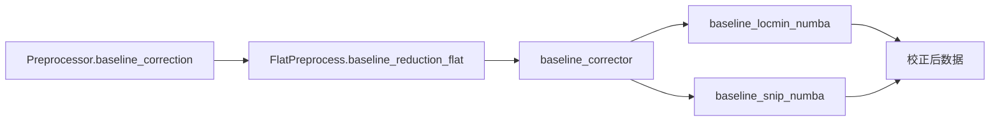

# MassFlow

本文介绍 MassFlow 中的基线校正（baseline correction）模块，重点包括：
- 流水线级入口 `Preprocessor.baseline_correction`
- `preprocess/helper/baseline_correction_helper.py` 中的核心函数

## 概述

- 输入与输出
  - 输入为扁平数组形式（`mz_data`、`intensity`、`lengths`），表示一批谱图的 m/z 和强度数据。
  - 输出为基线校正后的扁平数组，m/z 与坐标保持不变，强度为校正后的结果。
- 方法
  - LocMin Numba（`locmin_numba`）：基于局部极值锚点插值估计基线，使用 Numba 加速。
  - SNIP Numba（`snip_numba`）：多尺度迭代裁剪估计基线，使用 Numba 加速，适合峰形保留。
- 基线缩放
  - `baseline_scale` 用于将估计基线按 `(0, 1]`（默认 `1.0`）缩放，以避免过度扣除。
  - 实际扣除的是"缩放后的基线"；设置 `baseline_scale=1.0` 可保持算法原生行为。

### 函数关系示意图



## 核心 API

### Preprocessor.baseline_correction（流水线级）

```python
massflow.preprocess.api.PreprocessorAPI.baseline_correction(
    *,
    method: str = "locmin_numba",
    smooth: str = "none",
    span: float = 0.1,
    upper: bool = False,
    width: int = 5,
    niter: int = 15,
    baseline_scale: float = 1.0,
    m: int | None = None,
    decreasing: bool = True,
) -> Self
```

- 描述：流水线级基线校正入口。通过 `Preprocessor` 链式调用，按批次对所有光谱执行基线校正。
- 输入：通过 `Preprocessor(dm)` 绑定数据管理器。
- 输出：调用 `.start()` 后返回新的 `MSDataManagerImzML`，其光谱的强度为基线校正后的结果。
- 支持方法：`"locmin_numba"`、`"snip_numba"`。
- 参数：
  - `method`：基线校正方法，默认 `"locmin_numba"`。
  - `smooth`：LocMin 平滑方式，`"none" | "loess" | "spline"`，默认 `"none"`。
  - `span`：Loess 平滑跨度比例（0 < span ≤ 1），默认 0.1。
  - `upper`：`True` 时使用局部最大值作为锚点（上包络），默认 `False`。
  - `width`：局部极值检测的邻域宽度，默认 5。
  - `niter`：用于 LocMin 的迭代次数，默认 15。
  - `baseline_scale`：基线缩放因子，取值 `(0, 1]`，默认 1.0。
  - `m`：SNIP 窗口半宽；若为 `None` 则自动选择。
  - `decreasing`：SNIP 迭代方向，`True` 为从大到小。

示例：

```python
from massflow.data_manager import MSDataManagerImzML
from massflow.preprocess import Preprocessor
from massflow.tools.plot import plot_spectrum

FILE_PATH = "data/example.imzML"
dm = MSDataManagerImzML(filepath=FILE_PATH)
dm.load_head_data()

corrected = (
    Preprocessor(dm)
    .baseline_correction(method="locmin_numba", width=5, baseline_scale=1)
    .start()
)

plot_spectrum(
    base=dm.ms[0],
    target=corrected.ms[0],
    mz_range=(400.0, 450.0),
    intensity_range=(0.0, 500),
    metrics_box=True,
)

corrected.close()
dm.close()
```

### baseline_corrector（辅助函数级）

```python
preprocess.helper.baseline_correction_helper.baseline_corrector(
    intensity: np.ndarray,
    method: str = "locmin_numba",
    smooth: str = "none",
    span: float = 0.1,
    upper: bool = False,
    width: int = 5,
    niter: int = 15,
    baseline_scale: float = 1.0,
    m: int | None = None,
    decreasing: bool = True,
    lengths: np.ndarray | None = None,
) -> tuple[np.ndarray, np.ndarray]
```

- 描述：扁平数组基线校正分发器。根据 `method` 调用对应的 Numba 后端。
- 参数：
  - `intensity`：一维扁平强度数组。
  - `lengths`：光谱长度数组，用于在 Numba 内部按谱拆分处理。
  - 其余参数与流水线级 API 一致。
- 返回值：`(corrected, scaled_baseline)` —— 校正后的强度与缩放后的基线。
- 支持的方法仅限 `"locmin_numba"` 和 `"snip_numba"`。
- 异常：
  - `ValueError`：不支持的方法；`baseline_scale` 非法。
  - `TypeError`：intensity 非 numpy 数组。

### FlatPreprocess.baseline_reduction_flat（扁平批处理级）

```python
massflow.preprocess.flat_pre_fun.FlatPreprocess.baseline_reduction_flat(
    mz_data: np.ndarray,
    intensity: np.ndarray,
    lengths: np.ndarray,
    method: str = "locmin_numba",
    smooth: str = "none",
    span: float = 0.1,
    upper: bool = False,
    width: int = 5,
    niter: int = 15,
    baseline_scale: float = 1.0,
    m: int | None = None,
    decreasing: bool = True,
) -> FlatBatchResult
```

- 描述：`Preprocessor.baseline_correction` 的底层实现。返回包含 mz_data、校正后 intensity 和 lengths 的 `FlatBatchResult`。

## 参数说明与调参建议

- 通用
  - `baseline_scale`（`(0,1]`）：值越小越不容易过度扣除；`1.0` 保持原生算法行为。
- LocMin Numba
  - `width`：窗口越大，锚点越稀疏；建议从 5–9 开始。必须为整数且 `>= 3`。
  - `upper`：为上包络时设为 `True`；基线一般保持 `False`。
  - `smooth`：`"none"` 为原始插值；`"loess"` 为局部平滑；`"spline"` 为全局平滑。
  - `span`：Loess 的 span 可取 0.05–0.3；越大越平滑。
- SNIP Numba
  - `m`（半窗口）：默认自动选择 `min(100, max(10, n//10))`；窗口过大可能导致过度扣除。
  - `decreasing`：`True`（粗到细）通常更稳健；`False`（细到粗）更强调局部优先。

## 参考

- `preprocess/helper/baseline_correction_helper.py`：基线校正分发器（baseline_corrector）
- `preprocess/numba/baseline_correction_numba.py`：Numba 加速实现（baseline_locmin_numba, baseline_snip_numba）
- `preprocess/flat_pre_fun.py`：扁平预处理入口（FlatPreprocess.baseline_reduction_flat）
- `preprocess/api.py`：链式 API（PreprocessorAPI.baseline_correction）

## 错误处理与日志

- 输入校验：intensity 必须为非空一维 numpy 数组，否则抛出 `TypeError` / `ValueError`。
- 基线缩放：`baseline_scale` 必须为有限数且在 `(0,1]`；否则抛出 `ValueError`。
- 方法校验：仅支持 `"locmin_numba"` 和 `"snip_numba"`，否则抛出 `ValueError`。
