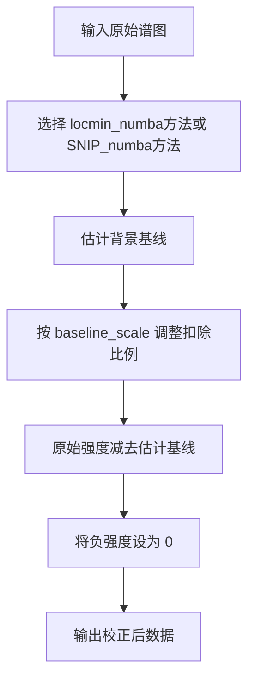

# 基线校正

本文介绍 MassFlow 中的基线校正模块。


作者：董乐强 , 董京伟 

**问题反馈：** 如果在使用 MassFlow 或阅读文档时发现问题，可通过 [GitHub Issues](https://github.com/NeoNexusX/MassFlow/issues) 提交反馈，或联系邮箱：707244007@qq.com。

## 概述

质谱中的基线是随 *m/z* 缓慢变化的背景信号。基线过高时，可能影响峰强度比较、归一化和峰提取。

基线校正会先估计背景曲线，再从原始强度中扣除该背景，使真实峰更容易与背景区分。MassFlow 会把扣除后小于 0 的强度设为 0，并保持 *m/z* 和空间坐标不变。

- 输入与输出
  - 输入为待处理的质谱数据。使用者只需要提供数据文件路径，MassFlow 会自动读取每个像素的 m/z 和信号强度。
  - 输出为基线校正后的质谱数据，处理前后的 *m/z* 位置和像素坐标保持不变，强度为校正后的结果。

- 方法：

  - LocMin（`locmin_numba`）：根据谱图中局部较低的信号位置估计背景变化趋势，适合常规基线校正。

  - SNIP（`snip_numba`）：通过多次迭代逐步估计背景，通常更适合峰较密集、背景变化较明显的数据，并能较好地保留峰形。

## 使用前先判断是否需要基线校正

基线校正不是所有数据都必须执行的步骤。

处理前应先查看原始轮廓质谱：

- 如果峰间背景已经接近稳定水平，没有明显整体抬升或缓慢漂移，通常不需要做基线校正；
- 如果峰间背景明显高于零点附近，并随 *m/z* 呈缓慢变化趋势，再考虑使用基线校正。


## 功能说明

### Preprocessor.baseline_correction

```python
massflow.preprocess.api.PreprocessorAPI.baseline_correction(
    *,
    method: str = "locmin_numba",
    smooth: str = "none",
    span: float = 0.1,
    upper: bool = False,
    width: int = 5,
    niter: int = 15,
    baseline_scale: float = 1.0,
    m: int | None = None,
    decreasing: bool = True,
) -> Self
```

- 功能：按批次对所有质谱执行基线校正。

- 参数：
  - `method`：基线校正方法，默认 `"locmin_numba"`。可选方法为`"locmin_numba"`和`"snip_numba"`
  - `baseline_scale`：基线缩放因子，取值 `(0, 1]`，默认 1.0。值越小越不容易过度扣除；`1.0` 保持原生算法行为。
  - 选择LocMin Numba方法需要调整的参数：
    - `smooth`：LocMin 平滑方式，`"none"` 为原始插值；`"loess"` 为局部平滑；`"spline"` 为全局平滑。默认 `"none"`。
    - `span`：Loess 平滑跨度比例（0 < span ≤ 1），默认 0.1。值越大越平滑。
    - `upper`：`True` 时使用局部最大值作为锚点（上包络），默认 `False`。为上包络时设为 `True`；基线一般保持 `False`。
    - `width`：局部极值检测的邻域宽度，默认 5。窗口越大，锚点越稀疏；建议从 5–9 开始。必须为整数且 `>= 3`。
    - `niter`：用于 LocMin 的迭代次数，默认 15。
  
  - 选择SNIP Numba方法需要调整的参数
    - `m`：SNIP 窗口半宽；若为 `None` 则自动选择。默认自动选择 `min(100, max(10, n//10))`；窗口过大可能导致过度扣除。
    - `decreasing`：SNIP 迭代方向，`True` 为从大到小。`decreasing`：`True`（粗到细）通常更稳健；`False`（细到粗）更强调局部优先。
  

示例：

```python
from massflow.data_manager import MSDataManagerImzML
from massflow.preprocess import Preprocessor
from massflow.tools.plot import plot_spectrum
from massflow.tools.imzml_monkey_patch import risky_imzml_loader

with risky_imzml_loader():
    dm = MSDataManagerImzML(filepath="data/examplegit.imzML")
    dm.load_head_data()

corrected = (
    Preprocessor(dm)
    .baseline_correction(method="locmin_numba", width=5, baseline_scale=1)
    .start()
)

plot_spectrum(
    base=dm.ms[0],
    target=corrected.ms[0],
    mz_range=(400.0, 450.0),
    intensity_range=(0.0, 50),
    metrics_box=True,
)

corrected.close()
dm.close()
```

该示例依次完成：

1. 读取 imZML 数据；
2. 使用 LocMin 方法估计每条谱图的基线；
3. 从原始强度中扣除基线；
4. 将扣除后小于 0 的强度设为 0； 
5. 显示处理前后的谱图对比；

输出结果展示：


## 总体处理流程图



## 错误处理与日志

- 输入数据必须为非空一维 numpy 数组，否则抛出 `TypeError` / `ValueError`。
- 基线缩放的`baseline_scale` 必须为有限数且在 `(0,1]`；否则抛出 `ValueError`。
- 方法仅支持 `"locmin_numba"` 和 `"snip_numba"`，输入其他方法会抛出 `ValueError`。

## 参考

- [`preprocess/helper/baseline_correction_helper.py`](https://github.com/NeoNexusX/MassFlow/blob/main/src/massflow/preprocess/helper/baseline_correction_helper.py)：基线校正分发器（baseline_corrector）
- [`preprocess/numba/baseline_correction_numba.py`](https://github.com/NeoNexusX/MassFlow/blob/main/src/massflow/preprocess/numba/baseline_correction_numba.py)：Numba 加速实现（baseline_locmin_numba、baseline_snip_numba）
- [`preprocess/flat_pre_fun.py`](https://github.com/NeoNexusX/MassFlow/blob/main/src/massflow/preprocess/flat_pre_fun.py)：`FlatPreprocess.baseline_reduction_flat`：扁平数据组预处理入口
- [`preprocess/api.py`](https://github.com/NeoNexusX/MassFlow/blob/main/src/massflow/preprocess/api.py)：`PreprocessorAPI.baseline_correction`：基线校正功能的调用入口
