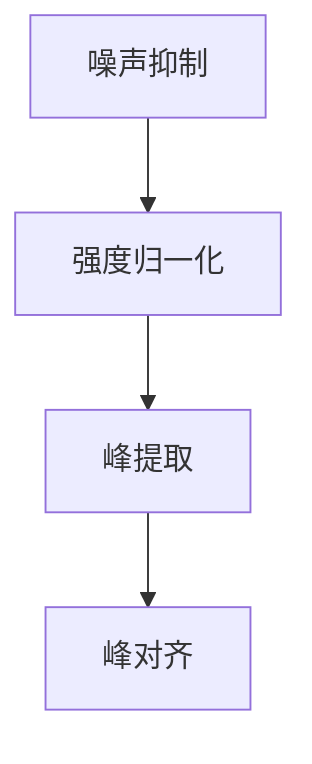
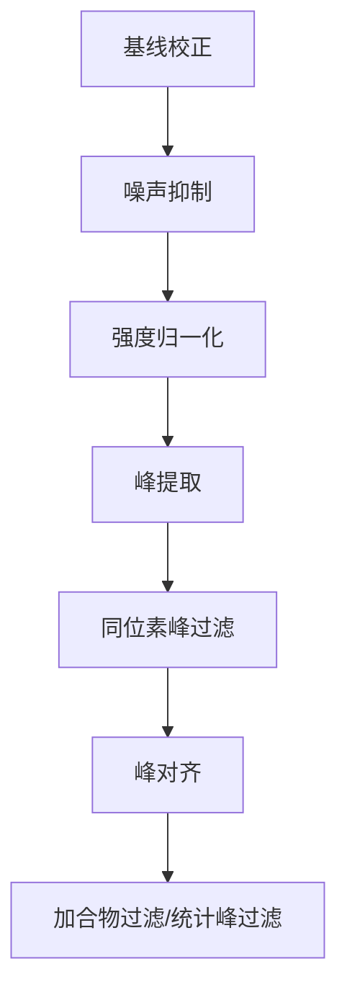

# 快速开始

MassFlow 是一个面向质谱成像（MSI）与质谱（MS）数据的模块化计算框架，提供高效的数据读取、预处理，与管理功能。


作者：董乐强 , 董京伟 

**问题反馈：** 如果在使用 MassFlow 或阅读文档时发现问题，可通过 [GitHub Issues](https://github.com/NeoNexusX/MassFlow/issues) 提交反馈，或联系邮箱：707244007@qq.com。

## 概述

质谱成像数据通常包含大量像素和质谱信息。直接处理这些数据时，可能会受到背景信号、噪声、峰位置偏移以及低质量峰等因素影响。

MassFlow 将常用的 MSI 预处理步骤整合到同一套流程中。使用者只需要提供数据文件，并选择需要执行的处理步骤，即可生成新的 MSI 数据。

它适合：

- 希望对 imZML 数据进行预处理的 MSI、代谢组学和质谱研究人员；
- 希望进行峰提取、峰对齐、同位素过滤、加合物过滤或统计过滤的用户；
- 希望进一步查看离子图或进行 UMAP/KMeans 组织区域划分的用户。

## MassFlow具有的功能

- **读取 MSI 数据** —— 直接读取 `.imzML` 和 `.ibd` 文件，并用于后续处理。
- **基线校正** —— 去除随 *m/z* 缓慢变化的背景信号。
- **噪声抑制** —— 减少谱线中的随机波动，使真实峰更加清晰。
- **强度归一化** —— 减少不同像素之间整体信号强弱带来的差异。
- **峰提取** —— 从轮廓谱中识别主要离子峰。
- **峰对齐** —— 将不同像素中位置接近的峰对应到统一的 *m/z* 位置。
- **峰过滤** —— 根据同位素、加合物关系或统计特征去除部分重复峰和低质量峰。
- **空间分析** —— 查看离子图，并使用 UMAP/KMeans 辅助观察不同组织区域。

## 快速上手步骤
### 1. 准备数据

准备一对配套的 `.imzML` 和 `.ibd` 文件，并放在同一文件夹中，例如：

```text
data/
├── example.imzML
└── example.ibd
```

`.imzML` 文件保存实验和质谱结构信息，`.ibd` 文件保存实际的质谱数据。两者需要配套使用。

### 2.安装MassFlow

安装 MassFlow 需要 Python 3.12 或更高版本。所以安装前请先检查 Python 版本。

打开 PowerShell运行：

```
python --version
```

运行后会显示当前python的版本，例如：

```
Python 3.12.13
```

如果显示的版本低于 Python 3.12，请先安装或切换到 Python 3.12 及以上版本。

如果显示 Python 3.12 或更高版本，即可继续安装。


确认python版本之后在终端中运行：

```
pip install massflow
```

MassFlow 会被安装到当前 python 的环境中。

安装完成后可以运行：

```
python -c "import massflow; print('MassFlow 安装成功')"
```

检查 MassFlow 是否安装成功

若看到输出:

```
MassFlow 安装成功
```

说明 MassFlow 已经可以正常导入。


### 3.运行第一条处理流程

新建一个 Python 文件，例如：

```text
run_massflow.py
```

复制下面的代码：

```python
from massflow.data_manager import MSDataManagerImzML
from massflow.preprocess import Preprocessor


dm = MSDataManagerImzML(
    filepath="data/example.imzML"
)
dm.load_head_data()

processed = (
    Preprocessor(
        dm,
        output_path="data/processed.imzML",
    )
    .noise_reduction()
    .normalization()
    .peak_pick()
    .peak_align()
    .start()
)

processed.close()
dm.close()
```

处理完成后会生成新的：

```text
processed.imzML
processed.ibd
```

原始数据不会被修改。

这段代码依次完成：



这是一条用于快速上手的基础流程，并不代表所有数据都必须执行完全相同的步骤。正式分析前，应根据自己的数据类型和处理结果选择合适的功能。

### 4. 根据需要加入峰过滤

如果需要进一步去除同位素峰、可能的加合物峰或低频峰，可以继续加入相应步骤。

例如：

```python
processed = (
    Preprocessor(
        dm,
        output_path="data/processed.imzML",
    )
    .baseline_correction()
    .noise_reduction()
    .normalization()
    .peak_pick()
    .filter_peaks_by_isotopes()
    .peak_align()
    .filter_peaks_by_adducts(
        polarity="positive",
    )
    .start()
)
```

峰过滤会真正删除部分峰，因此第一次处理新数据时，建议先查看对应功能页面，确认参数和结果后再应用。

其中，加合物过滤建议先查看预览结果和 CSV 报告，再决定是否正式删除峰。


## 推荐的处理顺序

MassFlow 中常用的预处理顺序为：



并不是所有数据都需要执行全部步骤。

例如：

- 没有基线偏移的数据无需基线校正
- 已经是质心谱的数据通常不需要再次进行峰提取；
- 不需要去除同位素峰时，可以跳过同位素峰过滤；
- 不研究加合物关系时，可以跳过加合物过滤；
- 是否进行统计峰过滤取决于后续分析目的。

## 下一步

完成第一次运行后，可以根据需要继续阅读：

- [基线校正](./baseline_correction.md)：去除质谱背景基线；
- [噪声抑制](./noise_reduction.md)：减少谱线中的随机波动；
- [强度归一化](./normalization.md)：减小不同像素之间的整体强度差异；
- [峰提取](./peak_pick.md)：从轮廓谱中识别离子峰；
- [同位素峰过滤](./isotope_filter.md)：去除确认的后续同位素峰；
- [峰对齐](./peak_alignment.md)：建立统一的参考 *m/z* 轴；
- [加合物注释与过滤](./adduct_filter.md)：识别并检查可能的加合物关系；
- [统计峰过滤](./stat_filter.md)：根据峰的出现频率和强度进一步筛选；
- [离子图读取与绘制](./ion_image_visualization.md)：查看处理后的空间分布；
- [UMAP 降维与可视化](./umap.md)：查看像素间整体质谱差异；
- [KMeans 组织区域划分](./segmentation.md)：查看分区效果并生成区域掩码。

各功能页面会进一步说明参数含义、使用方法以及如果出现报错可以如何处理。
