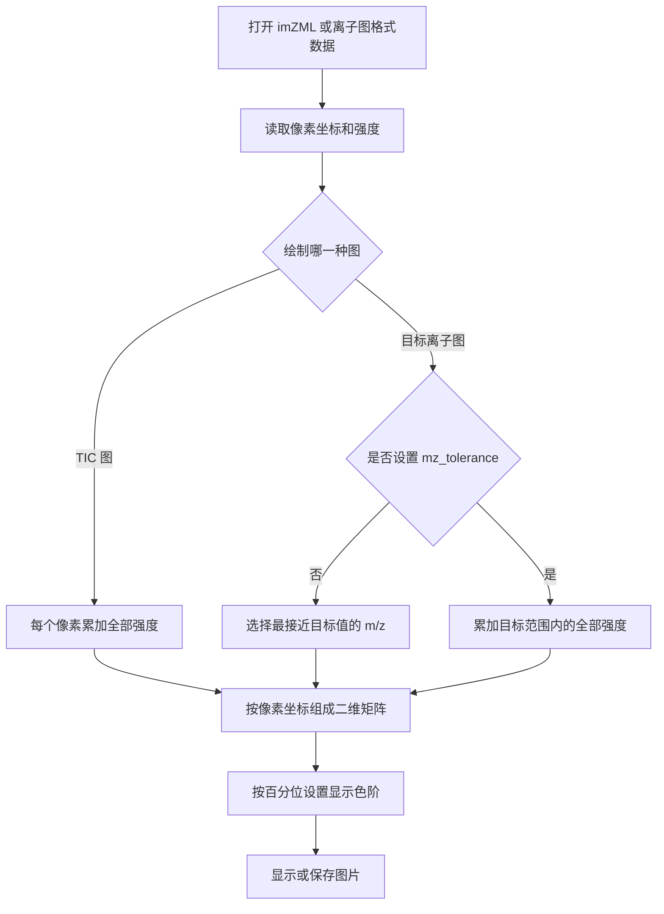

# 离子图读取与绘制

本文介绍 MassFlow 中的离子图和总离子流图（TIC）读取与绘制功能。


作者：董乐强 , 董京伟 

**问题反馈：** 如果在使用 MassFlow 或阅读文档时发现问题，可通过 [GitHub Issues](https://github.com/NeoNexusX/MassFlow/issues) 提交反馈，或联系邮箱：707244007@qq.com。

## 概述

离子图用于观察某个 *m/z* 信号在组织切片中的空间分布。图中每个位置对应一个采集像素，颜色表示该像素在目标 m/z 附近的信号强度。

总离子流图（TIC 图）把每个像素谱图中的全部强度相加，可用于快速查看：

- 组织的大致轮廓；
- 是否存在空白区域、异常亮点或扫描缺口；
- 数据坐标是否与实际切片方向基本一致；
- 后续组织区域划分是否具有可用的空间基础。

本模块支持直接读取：

- imZML 数据：`MSDataManagerImzML`；
- MassFlow Binary 离子图数据：`IonImageDataManagerBinary`；
- MassFlow H5 离子图数据：`IonImageDataManagerH5`；
- MassFlow ion-image Zarr 数据：`IonImageDataManagerZarr`。

其中，imZML 可以让所有像素共用同一组 *m/z*，也可以让每个像素保存自己的峰列表；后者在文件信息中通常称为 `processed` 数据。对于这类数据，程序会在每条谱图中分别寻找目标 *m/z*。


## 功能说明

### read_ion_image（需要数值矩阵时使用）

```python
massflow.tools.plot_ion_image.read_ion_image(
    data_manager,
    *,
    mz: float | None = None,
    batch_size: int = 256,
    mz_tolerance: float | None = None,
) -> numpy.ndarray
```

- 功能：读取目标 m/z 的离子图，并返回一个二维强度矩阵。
- 特点：只读取数据，不显示图片，也不自动保存图片。
- 参数：
  - `data_manager`：已经打开的数据。
  - `mz`：目标 *m/z*，必须填写。
  - `batch_size`：imZML 每批读取的谱图数量，默认 `256`。值增大可能提高读取速度，同时增加内存占用。
  - `mz_tolerance`：目标 m/z 两侧的绝对范围。保持 `None` 时只读取最接近目标值的一个位置；填写数值时，会把范围内的全部强度相加。该参数必须为非负数。
- 输出：
  - 一个形状为“图像高度 × 图像宽度”的二维矩阵；
  - 未采集位置通常为 `0`。

### plot_ion_image

```python
massflow.tools.plot_ion_image.plot_ion_image(
    data_manager,
    *,
    mz: float | None = None,
    batch_size: int = 256,
    mz_tolerance: float | None = None,
    output_path: str | Path | None = None,
    show: bool = True,
    dpi: int = 300,
    figsize: tuple[float, float] = (20, 5),
    title: str | None = None,
    structure_only: bool = False,
    cmap: str = "viridis",
    percentiles: tuple[float, float] = (0, 95),
    scale_factor: float = 1,
) -> None
```

- 功能：读取目标 *m/z*，并绘制离子图。
- 参数：
  - `mz`、`batch_size`、`mz_tolerance`：与 `read_ion_image` 相同。
  - `output_path`：图片保存路径。填写后会创建上级文件夹并保存图片。
  - `show`：是否弹出或显示图片。脚本批量运行时建议设为 `False`。当设置 `show=True` 时会在代码运行结束后自动显示图片 。
  - `dpi`：图片分辨率，默认 `300`。
  - `figsize`：图片尺寸，默认 `(20, 5)`。
  - `title`：图片标题。
  - `structure_only`：设为 `True` 时，只保留实际采集区域，并使用透明背景；不会显示坐标轴、色条和标题。需要读出颜色对应的强度范围时，应使用 `structure_only=False`
  - `cmap`：设置离子图的颜色方案，默认 `"viridis"`。可使用绘图库支持的颜色方案，例如 `"plasma"`、`"inferno"`、`"magma"` 和 `"cividis"` 等。如需设置可查阅Matplotlib cmap参数相关讲解。	
  - `percentiles`：显示颜色范围，默认数值`percentiles=(0, 95)`。降低上限可让弱信号更明显，但也可能使高强度区域饱和。
  - `scale_factor`：整体图片缩放倍数，必须大于 `0`。
- 输出：生成的离子图

示例：

```python
from massflow.data_manager import MSDataManagerImzML
from massflow.tools.plot_ion_image import plot_ion_image


dm = MSDataManagerImzML(filepath="data/example.imzML")
dm.load_head_data()

plot_ion_image(
    dm,
    mz=500.2000,
    mz_tolerance=0.01,
    output_path="figures/ion_500_2000.png",
    title="m/z 500.2000",
    structure_only=False,
    percentiles=(0, 95),
    show=False,
)

dm.close()
```

离子图输出展示：


### read_tic_image（需要数值矩阵时使用）

```python
massflow.tools.plot_ion_image.read_tic_image(
    data_manager,
    *,
    batch_size: int = 256,
) -> numpy.ndarray
```

- 功能：把每个像素谱图中的全部强度相加，返回 TIC 二维矩阵。
- 输出：一个形状为“图像高度 × 图像宽度”的二维矩阵。
- 特点：不保存图片，也不修改数据。

### plot_tic_image

```python
massflow.tools.plot_ion_image.plot_tic_image(
    data_manager,
    *,
    batch_size: int = 256,
    output_path: str | Path = "./tic_image_output/tic_image.png",
    save_image: bool = True,
    save_matrix: bool = False,
    show: bool = False,
    dpi: int = 300,
    figsize: tuple[float, float] = (20, 5),
    title: str | None = None,
    structure_only: bool = True,
    cmap: str = "viridis",
    percentiles: tuple[float, float] = (0, 95),
    scale_factor: float = 1,
) -> bool
```

- 功能：生成并保存 TIC 图。
- 参数：
  - `save_image`：是否保存图片，默认 `True`。
  - `save_matrix`：是否同时保存 TIC 数值矩阵，默认 `False`。
  - `structure_only`：默认 `True`，输出透明背景的组织轮廓图。此模式不会显示坐标轴、色条和标题。需要读出颜色对应的强度范围时，应使用 `structure_only=False`
  - 其他绘图参数与 `plot_ion_image` 相同。
- 输出：
  - 默认保存TIC图`tic_image.png`；
  - 设置`save_matrix=True` 时，在图片所在文件夹生成 `tic_result.zarr`，其中数组名称为 `tic_matrix`。

示例：

```python
from massflow.data_manager import MSDataManagerImzML
from massflow.tools.plot_ion_image import plot_tic_image


dm = MSDataManagerImzML(filepath="data/example.imzML")
dm.load_head_data()

plot_tic_image(
    dm,
    output_path="figures/tic_image.png",
    save_image=True,
    save_matrix=True,
    structure_only=True,
    show=False,
)

dm.close()
```

TIC图输出展示：


### 读取 MassFlow 离子图格式

当数据已经保存为 Binary、H5 或 ion-image Zarr 时，不需要调用 `load_head_data()`。

```python
from massflow.data_manager import IonImageDataManagerZarr
from massflow.tools.plot_ion_image import plot_ion_image


dm = IonImageDataManagerZarr(
    filepath="data/example_ion_image.zarr",
    mode="r",
)

```

Binary 和 H5 只需更换数据管理器：

```python
from massflow.data_manager import (
    IonImageDataManagerBinary,
    IonImageDataManagerH5,
)

binary_dm = IonImageDataManagerBinary(filepath="data/example.iib", mode="r")
h5_dm = IonImageDataManagerH5(filepath="data/example.h5", mode="r")
```


## 总体工作流程图



## *m/z* 选择方法

### 不设置 mz_tolerance

```python
mz_tolerance=None
```

程序会选择最接近目标值的 *m/z*：

- 对共享 *m/z* 轴数据，整份数据使用同一个最近位置；
- 对 processed imZML，每条谱图分别寻找自己的最近位置；
- 即使最近位置距离目标值较远，程序也不会自动拒绝，因此使用者应先确认实际 *m/z* 轴和仪器误差。

### 设置 mz_tolerance

```python
mz=500.0
mz_tolerance=0.01
```

程序会累加以下范围：

```text
499.99 <= m/z <= 500.01
```

该范围包含边界。若范围内有多个 *m/z* 位置，它们的强度会相加；若没有任何位置，结果为 `0`。

`mz_tolerance` 使用绝对 *m/z* 单位，当前函数没有 ppm 选项。若实验方法使用 ppm，需要先自行换算为目标 *m/z* 附近的绝对范围。

### 容差如何选择

- 容差过小：可能漏掉轻微漂移的目标峰；
- 容差过大：可能把相邻化合物、同位素峰或其他干扰峰一起累加；
- processed 数据：不同像素的峰位置可能不同，更需要结合仪器质量精度选择范围；
- 已完成峰对齐的数据：通常可使用较小范围，或直接选择最近 *m/z* 位置。

## 错误处理

- 报错 `"'mz' is required"`：调用离子图函数时没有填写 `mz`。
- 没有读取到任何像素：检查文件内容、`target_locs` 和数据是否成功打开。
- 图片几乎全黑：尝试降低 `percentiles` 上限，并检查目标 *m/z* 是否存在。
- 图片大面积饱和：提高 `percentiles` 上限，或检查是否存在极端高强度像素。

## 参考

- [`tools/plot_ion_image.py`](https://github.com/NeoNexusX/MassFlow/blob/main/src/massflow/tools/plot_ion_image.py)：离子图、TIC 读取和绘制公共函数
- [`data_manager/ms_data_manager_imzml.py`](https://github.com/NeoNexusX/MassFlow/blob/main/src/massflow/data_manager/ms_data_manager_imzml.py)：imZML 数据读取
- [`data_manager/ion_image_data_manager_binary.py`](https://github.com/NeoNexusX/MassFlow/blob/main/src/massflow/data_manager/ion_image_data_manager_binary.py)：Binary 离子图数据
- [`data_manager/ion_image_data_manager_h5.py`](https://github.com/NeoNexusX/MassFlow/blob/main/src/massflow/data_manager/ion_image_data_manager_h5.py)：H5 离子图数据
- [`data_manager/ion_image_data_manager_zarr.py`](https://github.com/NeoNexusX/MassFlow/blob/main/src/massflow/data_manager/ion_image_data_manager_zarr.py)：ion-image Zarr 数据
