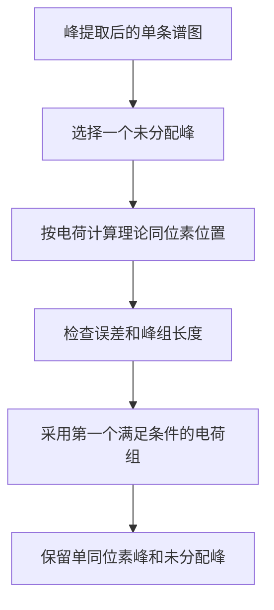

# 同位素峰过滤

本文介绍 MassFlow 中的同位素峰过滤模块。

[TOC]

## 概述

同一种化合物由于天然同位素的存在，常会在质谱中出现一组相邻峰，同位素峰过滤用于在峰提取之后识别同一同位素簇中的后续同位素峰，并只保留最低 *m/z* 的起始峰以及未被分配到同位素簇的峰。

- 输入必须是已处理且已质心化的数据：每条谱具有自己的峰 *m/z* 数组。
- 程序会分别检查每个像素中的质谱，不会把不同像素的峰混在一起判断。
- 被识别为后续同位素峰的数据点会被真正删除。
- 推荐使用顺序为峰提取→同位素峰过滤→峰对齐 `peak_pick → filter_peaks_by_isotopes → peak_align`。

## 功能说明

### Preprocessor.filter_peaks_by_isotopes

```python
massflow.preprocess.api.PreprocessorAPI.filter_peaks_by_isotopes(
    *,
    mz_tolerance: float = 10.0,
    units: Literal["da", "ppm"] = "ppm",
    min_charge: int = 1,
    max_charge: int = 3,
    min_isotope_count: int = 3,
    max_isotope_count: int = 10,
    use_decreasing_model: bool = True,
    start_intensity_check: int = 2,
) -> Self
```

- 功能：在每条已质心化谱中识别同位素簇，删除簇内除最低 m/z 起始峰以外的峰。
- 参数：
  - `mz_tolerance`：同位素峰匹配容差，默认 `10.0`。输入值必须为有限正数
  - `units`：容差单位，`"ppm"` 或 `"da"`，默认 `"ppm"`。`ppm`容差不能超过 `100 ppm`。`da` 容差不能超过 `0.1 Da`。
  - `min_charge`、`max_charge`：搜索的电荷范围。搜索顺序从 `max_charge` 递减到 `min_charge`。电荷范围必须满足 `1 <= min_charge <= max_charge`。
  - `min_isotope_count`：一个候选簇被接受所需的最少峰数，包含起始峰。
  - `max_isotope_count`：一个候选簇最多检查的峰数，包含起始峰。
  - 同位素峰数必须满足 `2 <= min_isotope_count <= max_isotope_count`。
  - `use_decreasing_model`：是否启用后续同位素峰强度递减约束。
  - `start_intensity_check`：从第几个同位素索引开始检查强度递减，默认 `2`。输入值必须为非负整数值。

示例：

```python
from massflow.data_manager import MSDataManagerImzML
from massflow.preprocess import Preprocessor

dm = MSDataManagerImzML(filepath="data/example.imzML")
dm.load_head_data()

filtered = (
    Preprocessor(
        dm,
        batch_size=512,
        output_path="data/isotope_filtered.imzML",
    )
    .peak_pick(method="mad", snr=2.0)
    .filter_peaks_by_isotopes(
        mz_tolerance=10.0,
        units="ppm",
        min_charge=1,
        max_charge=3,
        min_isotope_count=3,
    )
    .start()
)

filtered.close()
dm.close()
```

该示例依次完成：

1. 读取 imZML 数据；
2. 将轮廓谱提取为逐谱质心峰列表；
3. 在 1～3 价电荷范围内寻找同位素组；
4. 保留每组起始峰并删除后续峰；
5. 保存过滤后的峰列表。


### 流程图




## 算法说明

当前实现使用固定的碳同位素质量差：

```text
ISOTOPE_MASS_DIFFERENCE = 1.003354838 Da
```

对于起始峰 `M` 和电荷 `z`，第 `k` 个候选同位素峰位置为：

$$
(m/z)_{\mathrm{expected}}
=
M
+
\frac{k \times 1.003354838}{z}
$$
逐谱处理过程如下：

1. 从最低 m/z 的未分配峰开始。
2. 按 `max_charge → min_charge` 的顺序测试电荷状态。
3. 对每个期望 m/z，在容差窗口内选择误差最小的峰。
4. 遇到缺失峰、已分配峰或不满足强度模型时停止扩展。
5. 若簇大小达到 `min_isotope_count`，保留起始峰并删除其余同位素峰。
6. 未组成有效同位素簇的峰保持不变。

### 强度递减模型

默认 `start_intensity_check=2` 不检查 M+1 是否低于起始峰，而是从 M+2 开始逐项比较：当前候选峰不能高于前一个已找到峰。若真实同位素分布不符合这一简化条件，算法可能不确认该组。若把 `start_intensity_check` 设置为大于或等于 `max_isotope_count`，循环中不会到达强度检查起点，相当于虽然保留 `use_decreasing_model=True`，实际却没有执行递减检查；当前入口不会阻止这种组合。

## 使用注意事项

- 不要在 `peak_align` 之后调用本算法。共享 m/z 轴会被识别为连续型数据并触发 `ValueError`。
- 该实现只依据同位素质量间距和可选强度趋势判断，不使用分子式、理论同位素丰度或空间相关性。
- 较大的 `max_charge` 和 `max_isotope_count` 会增加每个起始峰的搜索工作量。
- 容差过宽可能把邻近非同位素峰并入簇；容差过窄可能漏掉真实同位素峰。

## 参考

- [`preprocess/helper/isotope_filter_helper.py`](https://github.com/NeoNexusX/MassFlow/blob/main/src/massflow/preprocess/helper/isotope_filter_helper.py)：输入校验与数组压缩入口
- [`preprocess/numba/isotope_filter_numba.py`](https://github.com/NeoNexusX/MassFlow/blob/main/src/massflow/preprocess/numba/isotope_filter_numba.py)：逐谱保留掩码和 Numba 并行实现
- [`preprocess/flat_pre_fun.py`](https://github.com/NeoNexusX/MassFlow/blob/main/src/massflow/preprocess/flat_pre_fun.py)：`FlatPreprocess.isotope_filter_flat`：扁平数据组预处理入口
- [`preprocess/api.py`](https://github.com/NeoNexusX/MassFlow/blob/main/src/massflow/preprocess/api.py)：`PreprocessorAPI.filter_peaks_by_isotopes`:同位素过滤功能调用入口
- [`preprocess/pipeline/planner.py`](https://github.com/NeoNexusX/MassFlow/blob/main/src/massflow/preprocess/pipeline/planner.py)：峰提取、同位素过滤、参考轴构建与峰对齐的执行顺序


作者：董乐强，董京伟
