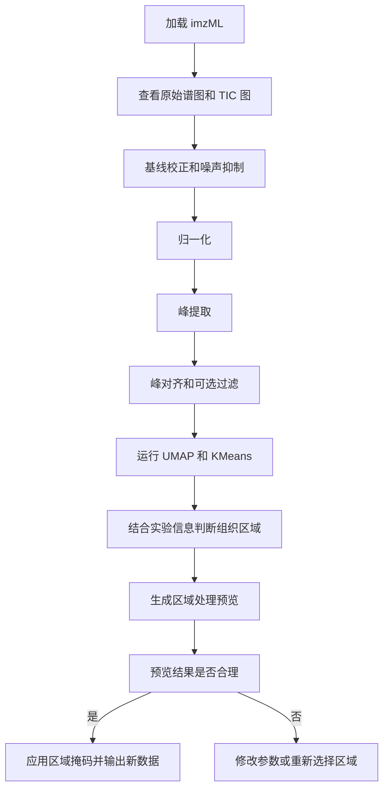

# 最佳实践

本文介绍如何在 Jupyter Notebook 中加载 imZML 数据、分阶段完成预处理，并使用 `SegmentationPipeline` 完成 UMAP、KMeans、区域选择和新 imZML 数据写出。


作者：董乐强 , 董京伟 

**问题反馈：** 如果在使用 MassFlow 或阅读文档时发现问题，可通过 [GitHub Issues](https://github.com/NeoNexusX/MassFlow/issues) 提交反馈，或联系邮箱：707244007@qq.com。

## 1.使用思路

Jupyter Notebook 可以把一整套数据处理步骤分成多个代码单元格，按照顺序一步一步运行。每完成一步，都可以先查看结果，再决定是否修改参数或继续下一步。 本文中的示例代码需要从上到下依次运行。前面的代码运行完成后，后面的代码会继续使用前面已经得到的结果，因此第一次使用时不要跳过前面的步骤。

本文采用以下顺序作为示例：



本文中的算法均使用默认参数，目的是说明完整的使用流程。默认参数不一定适合所有数据；要获得更好的处理效果，请根据数据特征并参考对应的文档进行调参

## 2.准备 Jupyter Notebook

开始前，请确保当前 Python 环境已经安装 MassFlow 和 Jupyter。

如果当前 MassFlow 环境中还未安装 Jupyter，可以在 MassFlow 项目目录的终端中安装：

```
pip install jupyter
```

安装完成后运行：

```
jupyter notebook
```

如果是使用 Jupyter Lab 也可以运行：

```
jupyter lab
```


启动成功后，会在浏览器中打开 Jupyter 页面。

如图所示：


## 3.准备工作目录

在自己的数据分析文件夹中启动 Jupyter，并新建一个 Python Notebook，例如：`imzml_workflow.ipynb`

建议的文件结构如下：

```text
my_msi_analysis/
├── data/
│   ├── example.imzML
│   └── example.ibd
├── processed_data/          # 预处理和区域划分后的 imzML
├── segmentation_results/   # UMAP、KMeans 和区域预览
├── tic_image/              # TIC 图
└── imzml_workflow.ipynb
```

其中：

- `data/`：保存原始 `.imzML` 和 `.ibd` 文件；
- `processed_data/`：保存预处理后和区域处理后的数据；
- `segmentation_results/`：保存 UMAP、KMeans 和区域预览结果；
- `tic_image/`：保存 TIC 图；
- `imzml_workflow.ipynb`：保存本次分析过程。

`.imzML` 和配套的 `.ibd` 必须使用相同的文件名，并放在同一个文件夹中。

注意代码中只需要填写 `.imzML` 文件的路径。本文后面的相对路径均以个人工作目录 `my_msi_analysis` 为起点。


创建 Python Notebook 步骤如图所示：


## 4. 加载 imzML 数据

### 4.1 创建数据管理器

新建第一个代码单元格：

```
from massflow.data_manager import MSDataManagerImzML
from massflow.preprocess import Preprocessor
from massflow.segmentation import SegmentationPipeline
from massflow.tools.plot import plot_spectrum
from massflow.tools.plot_ion_image import plot_tic_image

dm = MSDataManagerImzML(filepath="./data/example.imzML")
dm.load_head_data()
```

运行后，当前 Notebook 中会创建变量：`dm` 

### 4.2 查看一条原始谱图

可以查看任意一张谱图和需要观察的 *m/z* 范围：

```python
plot_spectrum(dm.ms[1], mz_range=(400, 600))
```

这里 `mz_range=(400, 600)` 表示只查看 *m/z* 400–600 的范围，可以根据自己的数据修改。


### 4.3 查看原始 TIC 图

```python
plot_tic_image(
    dm,
    output_path="./tic_image/tic_image.png",
    save_image=True,
    show=True
)
```

TIC 图可用于检查组织轮廓、空白区域、异常强信号和扫描缺口。


## 5. 分阶段进行预处理

### 5.1 基线校正和噪声抑制

基线校正不是每份数据都必须执行,建议当基线明显抬高或缓慢漂移时，再加入基线校正`baseline_correction()`。

噪声抑制用于减少连续谱线中的快速小幅波动。

当前示例同时执行了基线校正和噪声抑制：

```python
bc_and_nr_dm = (
    Preprocessor(
        dm,
        output_path="./processed_data/bc_and_nr.imzML",
    )
    .baseline_correction() #当基线明显抬高或缓慢漂移时使用
    .noise_reduction()
    .start()
)
```

查看处理后的结果：

```python
plot_spectrum(bc_and_nr_dm.ms[1], mz_range=(400, 600))
```


### 5.2 归一化

归一化用于减小不同像素整体信号量差异

确认前一步处理合理后，再进行归一化：

```python
normalized_dm = (
    Preprocessor(
        bc_and_nr_dm,#此为第一阶段进行基线校正和噪声抑制而产生的变量
        output_path="./processed_data/normalized.imzML",
    )
    .normalization()
    .start()
)
```

查看归一化后的 TIC 图：

```python
plot_tic_image(
    normalized_dm,
    output_path="./tic_image/tic_image_normalized.png",
    save_image=True,
    show=True
)
```


归一化后，应重点观察不同区域之间的整体强度差异是否更加适合比较，同时注意不要只根据 TIC 图判断处理是否合理，还需要结合后续目标离子和实际实验目的。

### 5.3 峰提取

峰提取用于把轮廓谱转换为只保留峰位置和峰强度的质心谱：

```python
picked_dm = (
    Preprocessor(
        normalized_dm,#为第二阶段进行归一化而产生的变量
        output_path="./processed_data/peak_picked.imzML",
    )
    .peak_pick()
    .start()
)
```

查看峰提取前后的结果：

```python
plot_spectrum(
    base=normalized_dm.ms[1],
    target=picked_dm.ms[1],
    mz_range=(400, 420),
    plot_mode=["line", "stem"],
    metrics_box=False,
)
```

峰提取前的连续谱与峰提取后的棒状谱对比:


其中：

- 连续谱表示峰提取前的轮廓谱；
- 棒状谱表示峰提取后的质心谱。

重点检查主要峰是否被正确保留，以及是否出现明显漏峰或大量无意义的小峰。

### 5.4可选：同位素峰过滤

同位素峰过滤不是每份数据都必须执行。如果希望减少同一化合物产生的后续同位素峰，可以在峰提取之后、峰对齐之前进行过滤。

第一次使用时，如果暂时不确定是否需要同位素峰过滤，可以先跳过本小节，直接进行峰对齐。

```python
isotope_filtered_dm = (
    Preprocessor(
        picked_dm,
        output_path="./processed_data/isotope_filtered.imzML",
    )
    .filter_peaks_by_isotopes()
    .start()
)
```

如果执行了同位素峰过滤，下一步峰对齐时应使用 `isotope_filtered_dm`；如果没有执行，则继续使用 `picked_dm`。

同位素峰过滤结果展示：


### 5.5 峰对齐

峰对齐把不同像素中位置接近的峰匹配到一条共享 *m/z* 轴。用于组织区域划分的数据应先完成峰对齐。

```python
aligned_dm = (
    Preprocessor(
        picked_dm,#为第三阶段进行峰提取而产生的变量
        output_path="./processed_data/aligned.imzML",
    )
    .peak_align()
    .start()
)
```

查看峰提取前后的结果：

```python
plot_spectrum(
    base=picked_dm.ms[1],
    target=aligned_dm.ms[1],
    mz_range=(400, 410),
    plot_mode="stem",
    metrics_box=False,
)
```


### 5.6可选：峰对齐后的峰过滤

两种峰过滤都不是必须步骤，应根据实验目的选择，不需要依次全部运行。

#### 1. 统计峰过滤

统计峰过滤可以根据峰在不同像素中的出现情况和整体强度进一步筛选峰。例如，希望减少只在极少像素中出现或整体强度较低的峰时，可以使用该功能。注意使用该功能之前要先进行峰对齐

```python
stat_filtered_dm = (
    Preprocessor(
        aligned_dm,
        output_path="./processed_data/stat_filtered.imzML",
    )
    .filter_peaks_by_stats()
    .start()
)
```

统计峰过滤的结果会受到阈值设置影响。第一次处理新数据时，建议先查看对应功能页面中的参数说明和预览方法，再决定是否应用过滤。详细说明见 [统计峰过滤](./stat_filter.md)。

统计峰过滤结果展示：

#### 2.加合物过滤

如果希望识别并减少可能来自同一化合物的不同加合离子，可以在峰对齐后进行加合物过滤。

下面以正离子模式为例：

```python
adduct_filtered_dm = (
    Preprocessor(
        aligned_dm,
        output_path="./processed_data/adduct_filtered.imzML",
    )
    .filter_peaks_by_adducts(
    )
    .start()
)
```

加合物过滤需要结合离子模式、候选关系和空间分布判断结果是否合理。详细说明见 [加合物注释与过滤](./adduct_filter.md)。

加合物过滤结果展示：

### 5.7 按自己的需求组合预处理步骤

常用步骤和建议位置如下：

| 处理步骤   | `Preprocessor` 方法           | 建议位置               |
| ---------- | ----------------------------- | ---------------------- |
| 基线校正   | `.baseline_correction()`      | 噪声抑制之前           |
| 噪声抑制   | `.noise_reduction()`          | 峰提取之前             |
| 归一化     | `.normalization()`            | 峰提取之前             |
| 峰提取     | `.peak_pick()`                | 峰对齐之前             |
| 同位素过滤 | `.filter_peaks_by_isotopes()` | 峰提取之后、峰对齐之前 |
| 峰对齐     | `.peak_align()`               | 峰提取之后             |
| 统计过滤   | `.filter_peaks_by_stats()`    | 峰对齐之后             |
| 加合物过滤 | `.filter_peaks_by_adducts()`  | 峰对齐之后             |

不是所有数据都需要执行全部步骤。第一次处理新数据时，推荐像本文一样拆分运行并逐步检查；参数确定以后，才适合把已确认的相邻步骤写在同一条链中。

## 6. 使用 KMeans 进行组织区域分析

UMAP 和 KMeans 在这里承担不同的作用。

- **UMAP**：将每个像素中较高维的质谱特征转换为较低维的特征表示，帮助观察像素之间的整体差异；
- **KMeans**：根据这些特征把像素划分为不同类别，并重新显示到组织空间中。

### 6.1 创建区域分析对象

`aligned_dm` 表示为已经完成峰对齐的 imzML 数据，在执行此步之前应先完成峰对齐。

```python
seg = SegmentationPipeline(
    aligned_dm,
    output_dir="./segmentation_results",
)
```

### 6.2 运行 UMAP 和 KMeans

第一次使用时，可以先运行默认参数：

```
result = seg.run_umap_kmeans(
)
```

运行完成后，可以继续查看类别编号与图中颜色的对应关系：

```
result.print_label_colors()
```

后面填写需要删除或保留的类别编号时，应根据这里的编号、KMeans 图中的空间位置以及实际组织信息进行选择。

运行后会生成：

```
./segmentation_results/umap_kmeans/umap_image.png
./segmentation_results/umap_kmeans/kmeans_image.png
```

KMeans聚类结果：


对应的UMAP图：


查看结果时：

- UMAP 图主要用于观察整体差异和空间变化；
- KMeans 图用于查看不同类别在组织中的空间分布；
- 类别编号本身没有固定的生物学意义；

如果区域划分过于粗糙或过于零散，可以再根据 [UMAP 降维与可视化](./umap.md) 和 [KMeans 组织区域划分](./segmentation.md) 中的说明调整参数。

### 6.3 选择需要保留或删除的组织区域

不要只根据 KMeans 类别编号决定删除哪些区域。先结合 KMeans 图、TIC 图、离子图以及实际组织位置判断每个类别的含义。

下面三种方法是三种不同的区域选择方式，通常根据自己的数据选择其中一种，不需要依次全部运行。

#### 方法一：删除明确不需要的类别

如果已经确认某些完整类别属于背景或无关区域，例如类别 `0`可运行以下代码进行去除：

```
LABELS_TO_REMOVE = [0]

seg.remove_clusters(LABELS_TO_REMOVE)
```

这里的 `[0]` 只是示例，必须根据自己的 KMeans 结果以及想要的预览结果进行修改。

#### 方法二：从图像外围自动删除背景

如果背景主要位于组织外围，可以运行：

```python
seg.remove_background(
    remove_num=1)
```

会根据外围区域生成待删除区域。默认删除一层背景；需要删除多层时，可通过设置 `remove_num`进行调节。

如果真实组织本身接触图像边缘，自动判断可能误删真实组织，因此必须仔细检查预览结果。

#### 方法三：保留指定类别及其包围区域

如果已经明确哪些类别属于目标组织，并且想要保留指定类别可以运行以下代码：

```python
LABELS_TO_KEEP = [4]

seg.keep_clusters(LABELS_TO_KEEP)
```

`keep_clusters()` 不只是简单保留这些类别，还会保留被指定类别在空间上包围的内部区域。

因此，运行后同样需要检查区域预览。

### 6.4 检查区域预览

在运行任意一种区域选择方法后，会生成透明背景预览：

```text
./segmentation_results/cluster_segmentation/kmeans_image.png
./segmentation_results/cluster_segmentation/umap_image.png
```

如果预览不合理，应返回前一步重新选择类别，或重新调整 UMAP/KMeans 参数。

三种方法结果预览：

方法一：删除明确不需要的类别


方法二：从图像外围自动删除背景


方法三：保留指定类别及其包围区域


### 6.5 应用掩码并输出新的 imzML

确认预览结果没有问题后，运行：

```python
masked_dm = seg.apply_region_mask(
    output_path="./processed_data/segmentation_masked.imzML",
)
```

该步骤会生成：

```text
./processed_data/segmentation_masked.imzML
./processed_data/segmentation_masked.ibd
```

原始文件和预处理阶段文件不会被修改。


## 常见问题

由于 Jupyter 后面的代码单元格通常依赖前面的运行结果。因此第一次使用时应从上到下依次运行。

并且Notebook 中创建的变量只保存在当前运行环境中。如果关闭 Jupyter 或重启 Kernel，这些变量会被清除。即使页面中的代码仍然存在，也需要重新运行前面的代码单元格。

如果出现以下问题：


可能是因为：

- 创建该变量的单元格还没有运行；
- Jupyter 的 Kernel 已经重新启动。

此时从前面的数据读取步骤开始重新运行即可。


## 相关功能

如果需要进一步了解各个处理步骤的作用，可跳转至以下相关功能页面：

- [基线校正](./baseline_correction.md)：去除质谱背景基线；
- [噪声抑制](./noise_reduction.md)：减少谱线中的随机波动；
- [强度归一化](./normalization.md)：减小不同像素之间的整体强度差异；
- [峰提取](./peak_pick.md)：从轮廓谱中识别离子峰；
- [同位素峰过滤](./isotope_filter.md)：去除确认的后续同位素峰；
- [峰对齐](./peak_alignment.md)：建立统一的参考 *m/z* 轴；
- [加合物注释与过滤](./adduct_filter.md)：识别并检查可能的加合物关系；
- [统计峰过滤](./stat_filter.md)：根据峰的出现频率和强度进一步筛选；
- [离子图读取与绘制](./ion_image_visualization.md)：查看处理后的空间分布；
- [UMAP 降维与可视化](./umap.md)：查看像素间整体质谱差异；
- [KMeans 组织区域划分](./segmentation.md)：查看分区效果并生成区域掩码。

各功能页面会进一步说明参数含义、使用方法以及如果出现报错可以如何处理。

