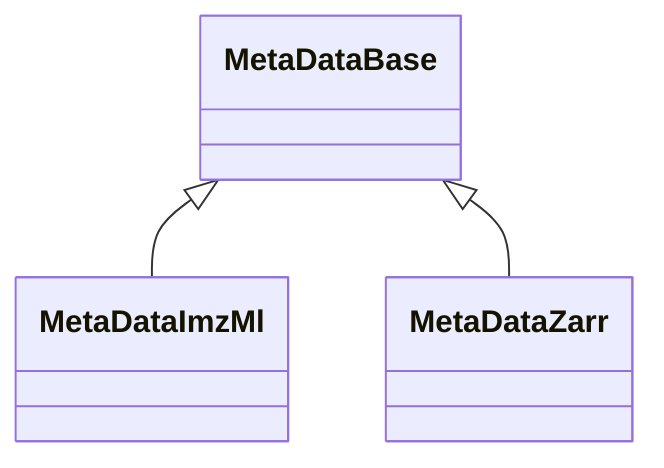

# MassFlow 元数据

元数据独立于谱数组，描述数据集本身。谱数据管理器通过 `dm.ms.meta` 暴露元数据，离子图管理器通过 `dm.meta` 暴露元数据。

## 当前类

| 类名 | 模块 | 职责 |
| --- | --- | --- |
| `MetaDataBase` | `massflow.module.ms_meta_data` | 公共字段、描述符、校验和字典访问 |
| `MetaDataImzMl` | `massflow.module.ms_meta_data_imzml` | 从管理器的解析器提取 imzML 字段 |
| `MetaDataZarr` | `massflow.module.ms_meta_data_zarr` | 从 Zarr 加载和写入元数据 |



解析器属于 `MSDataManagerImzML`；元数据对象保存提取后的字段值。读取文件时应构造数据管理器，不要把文件路径传给元数据构造函数。

## 字段与打印标签

| Python 字段 | 含义 |
| --- | --- |
| `name`、`version` | 数据集名称和数值型元数据版本 |
| `max_count_of_pixels_x`、`max_count_of_pixels_y` | 图像宽度和高度 |
| `pixel_size_x`、`pixel_size_y` | 可用时的物理像素尺寸 |
| `mask` | 二维占用掩膜 |
| `continuous`、`processed` | m/z 编码标志 |
| `profile_spectrum`、`centroid_spectrum` | 谱类型标志 |
| `scan_type`、`scan_direction`、`line_scan_direction`、`scan_pattern` | 采集布局字段 |
| `spectrum_count_num`、`instrument_model` | 后端元数据字段 |
| `absolute_position_offset_x`、`absolute_position_offset_y` | 空间偏移 |
| `ms1_spectrum`、`msn_spectrum` | MS 级别标志 |

表格末三行包含由 `MetaDataImzMl` 和 `MetaDataZarr` 定义的字段。访问字段时不加 `meta_`，例如 `dm.ms.meta.pixel_size_x`；打印标签则使用 `meta_pixel_size_x` 等形式。

标准谱类型标志中，生效的类型为 `True`，另一个类型为 `None`；编码标志采用同样的约定。`str(meta)` 会省略 `None`，并以数组形状代替全部数组内容。字段未显示并不表示其值为 `False`。

## 读取元数据

```python
from massflow.data_manager import MSDataManagerImzML

with MSDataManagerImzML(filepath="data/example.imzML") as dm:
    dm.load_head_data()
    meta = dm.ms.meta
    print(meta)
    print(meta.pixel_size_x, meta.pixel_size_y)
    print(meta.to_dict())
```

谱 Zarr 可改用 `MSDataManagerZarr(filepath="data/example.zarr")`，同样通过 `load_head_data()` 和 `dm.ms.meta` 访问；读模式下文件必须已经存在。

## 创建与复制元数据

```python
from massflow.module.ms_meta_data_imzml import MetaDataImzMl

meta = MetaDataImzMl(
    name="example",
    version=1.0,
    max_count_of_pixels_x=227,
    max_count_of_pixels_y=93,
    pixel_size_x=100.0,
    pixel_size_y=100.0,
)
meta.profile_spectrum = True
meta.centroid_spectrum = None
meta.continuous = True
meta.processed = None
```

描述符和属性把标准字段同步到 `_meta`。通过 `get()`、`keys()`、`items()`、`values()` 或 `to_dict()` 读取时使用 Python 字段名，而非打印标签。

准备输出管理器时使用 `target_dm.copy_meta(source_dm)`。后端复制方法保留兼容的描述字段，但排除 mask、谱数、编码和谱类型等需要重新确定的字段；输出处理负责设置或重建它们。复制元数据不会复制谱数组。

`MetaDataZarr.to_zarr(root)` 将标量写入组属性，并把可选 mask 写成数组；`MetaDataZarr.from_zarr(root)` 负责读回，通常由 Zarr reader/writer 自动调用。详见 [Zarr 格式规范](./zarr_schema.md)。

imzML 内存中的元数据复制不保证所有字段都会序列化到文件：当前导出器不写入像素尺寸和极性条目。Zarr 支持其 schema 中列出的字段。
