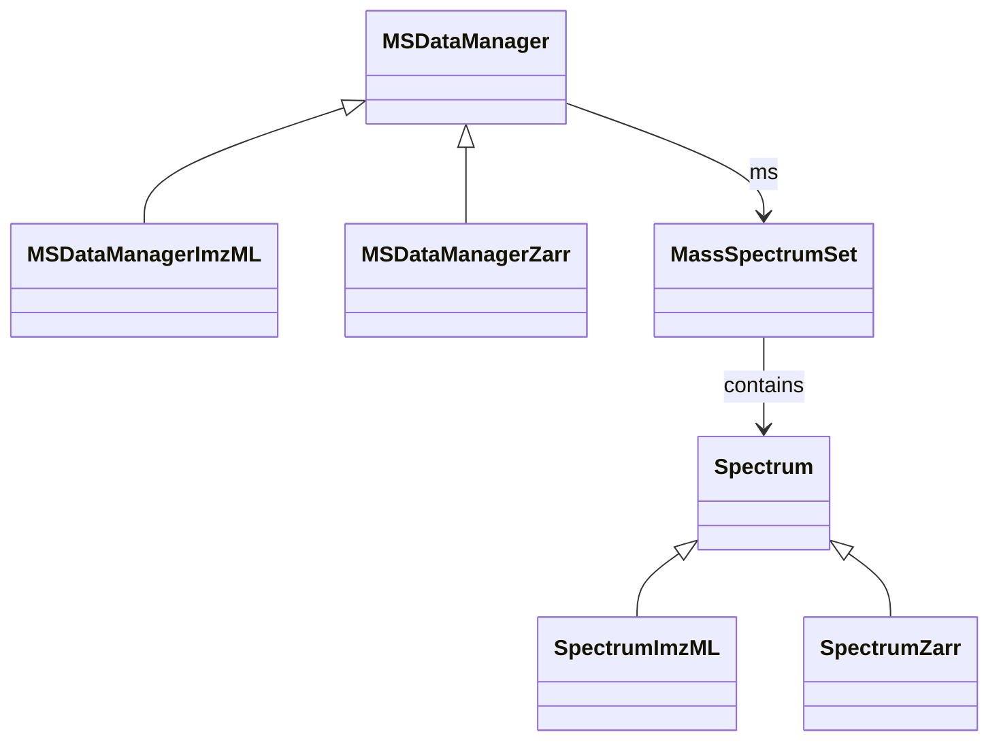

# 质谱数据结构

MassFlow 将单条谱对象、内存中的谱集合和文件数据管理器分开。元数据详见[元数据](./metadata.md)。

## 类型与导入路径

| 类型 | 模块 | 职责 |
| --- | --- | --- |
| `Spectrum` | `massflow.module.spectrum` | 单条谱的 m/z、强度和坐标 |
| `SpectrumImzML` | `massflow.module.spectrum_imzml` | 由 imzML/ibd 支持的惰性谱 |
| `SpectrumZarr` | `massflow.module.spectrum_zarr` | 由 Zarr reader 支持的惰性谱 |
| `MassSpectrumSet` | `massflow.module.mass_spectrum_set` | 谱对象的顺序与坐标访问 |
| `MSDataManager` | `massflow.data_manager.ms_data_manager` | 谱管理器抽象接口 |
| `MSDataManagerImzML` | `massflow.data_manager.ms_data_manager_imzml` | imzML 元数据、惰性谱、批读取和导出 |
| `MSDataManagerZarr` | `massflow.data_manager.ms_data_manager_zarr` | pixel-major 谱 Zarr 读写 |

具体管理器统一从 `massflow.data_manager` 导出。



## 单条谱对象

```python
import numpy as np
from massflow.module.spectrum import Spectrum

spectrum = Spectrum(
    mz_list=np.array([100.0, 200.0]),
    intensity=np.array([1.0, 3.0], dtype=np.float32),
    coordinate=(1, 1, 1),
)
print(spectrum.mz_list, spectrum.intensity)
print(spectrum.get_coordinates())
```

`Spectrum` 接受 `mz_list`、`intensity`、`coordinate`、`sort_by_mz=True` 和 `shared_mz_list=None`。构造时 `sort_by_mz` 记录排序状态，传入数组应已经具有预期顺序。

惰性子类通常由数据管理器创建。访问未加载的强度时，相应 reader 才读取该条谱。continuous 数据可复用共享 m/z 轴，修改共享轴前应复制。`clear_data()` 按子类的加载约定释放已加载谱值。

## MassSpectrumSet

`MassSpectrumSet(meta=None)` 保存谱对象，元数据通过 `ms.meta` 访问；continuous 数据可通过 `ms.shared_mz_list` 暴露共享轴。

- `ms.add_spectrum(spectrum)`：加入谱；完全相同 `(x, y, z)` 已存在时替换旧对象，保留原队列位置。
- `ms[index]`：顺序索引；`ms[start:end]`：返回列表切片。
- `ms[x, y, z]`：显式坐标访问；需要明确 z 层时建议使用三个坐标。
- `len(ms)` 和迭代使用顺序队列。
- `ms.coordinate_index`：坐标查找结构。

集合行为不等于文件层去重：pixel-major Zarr 写入保留输入行，ion-major Zarr 写出在 finalize 时对重复像素保留最后一条。

## 通过管理器读取

```python
from massflow.data_manager import MSDataManagerImzML

with MSDataManagerImzML(filepath="data/example.imzML") as dm:
    dm.load_head_data()
    print(dm.ms.meta)
    print(len(dm.ms))
    spectrum = dm.ms[0]
    print(spectrum.mz_list, spectrum.intensity)
```

`load_head_data()` 加载元数据，并在 `target_locs` 范围内创建惰性占位谱；加载过程中的检查可能读取抽样谱。imzML 路径需要对应的 `.ibd` 文件。新的加载操作建议使用新的管理器，避免重复填充同一个集合。

谱 Zarr 改用 `MSDataManagerZarr(filepath="data/example.zarr")`，同样使用 `load_head_data()` / `dm.ms`。combined Zarr 的 pixel-major `/spectra` 视图可供谱管理器读取，ion-only 文件则不具备该视图。

## 批次访问

`flat_generator(batch_size=256, include_mz=True)` 依次返回：

```python
mz_data, intensity_flat, lengths, coordinates
```

- `intensity_flat`：逐谱连接的一维强度数组。
- `lengths`：每条谱的点数。
- `coordinates`：对应像素的坐标行。
- continuous 批次返回一条共享 m/z 轴；processed 批次在需要时返回逐谱连接的 m/z。

`matrix_generator()` 对 processed 谱提供填充后的矩阵，对 continuous 谱提供共享轴及强度矩阵。变长或含空谱时，flat 接口可通过 lengths 直接表示谱长，无须填充。

## 写出与预处理

显式设置输出路径，并在关闭 Zarr 写出器前调用 `finalize()`。预处理流水线会为输出自动完成 finalize。

```python
from massflow.data_manager import MSDataManagerImzML
from massflow.preprocess import Preprocessor

with MSDataManagerImzML(filepath="data/example.imzML") as dm:
    dm.load_head_data()
    output = (
        Preprocessor(dm, output_format="spectra_zarr",
                     output_path="output/aligned.zarr")
        .peak_pick().peak_align().start()
    )
    output.close()
```

离子图管理器 `IonImageDataManagerBinary`、`IonImageDataManagerH5`、`IonImageDataManagerZarr` 通过 `get_ion_vector()`、`get_ion_block()`、`get_ion_image()` 提供 ion-major 访问，与谱管理器接口分开。布局说明见[离子图可视化](./ion_image_visualization.md)和 [Zarr 格式规范](./zarr_schema.md)。
