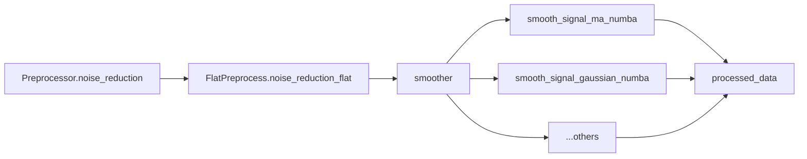

# MassFlow

本文介绍 MassFlow 中的噪声抑制与平滑模块，重点包括：
- 流水线级入口 `Preprocessor.noise_reduction`
- `preprocess/helper/noise_reduction_helper.py` 中的平滑函数

## 概述

- 输入与输出
  - 输入为扁平数组形式（`mz_data`、`intensity`、`lengths`），表示一批谱图的 m/z 和强度数据。
  - 输出为平滑后的扁平数组，m/z 和坐标保持不变，强度为去噪后的结果。
- 方法
  - 移动平均（`ma_numba`）：基于窗口的均匀卷积平滑，Numba 加速。
  - 高斯平滑（`gaussian_numba`）：离散高斯核卷积平滑，Numba 加速。
  - Savitzky-Golay 平滑（`savgol_numba`）：多项式拟合平滑，Numba 加速。
- 所有方法均在 Numba JIT 内核中执行批次处理，利用 `prange` 并行循环提升性能。

### 函数关系示意图



## 核心 API

### Preprocessor.noise_reduction

```python
massflow.preprocess.api.PreprocessorAPI.noise_reduction(
    *,
    method: str = "ma_numba",
    window: int = 5,
    sd: float | None = None,
    polyorder: int = 3,
    deriv: int = 0,
    delta: float = 1.0,
) -> Self
```

- 描述：流水线级噪声抑制入口。通过 `Preprocessor` 链式调用，按批次对所有光谱执行平滑降噪。
- 输入：通过 `Preprocessor(dm)` 绑定数据管理器。
- 输出：调用 `.start()` 后返回新的 `MSDataManagerImzML`，其光谱的强度为平滑后的结果。
- 支持方法：`"ma_numba"`、`"gaussian_numba"`、`"savgol_numba"`。
- 参数：
  - `method`：平滑方法，默认 `"ma_numba"`。
  - `window`：窗口长度（正整数），默认 5。偶数会自动调整为奇数以保证居中对齐。
  - `sd`：高斯核标准差，默认 `window / 4.0`。
  - `polyorder`：Savitzky-Golay 多项式阶数，必须 < `window`，默认 3。
  - `deriv`：导数阶数（SG 参数），默认 0。
  - `delta`：采样间隔（SG 参数），默认 1.0。

示例：

```python
from massflow.data_manager import MSDataManagerImzML
from massflow.preprocess.preprocessor import Preprocessor
from massflow.tools.plot import plot_spectrum

FILE_PATH = "data/example.imzML"
dm = MSDataManagerImzML(filepath=FILE_PATH)
dm.load_head_data()

denoised = (
    Preprocessor(dm)
    .noise_reduction(method="gaussian_numba", window=5)
    .start()
)

plot_spectrum(
    base=dm.ms[100],
    target=denoised.ms[100],
    mz_range=(400.0, 420.0),
    metrics_box=True,
)

denoised.close()
dm.close()
```


### smoother（辅助函数级）

```python
preprocess.helper.noise_reduction_helper.smoother(
    intensity: np.ndarray | None = None,
    *,
    method: str = "ma_numba",
    window: int = 5,
    sd: float | None = None,
    polyorder: int = 2,
    deriv: int = 0,
    delta: float = 1.0,
    lengths: np.ndarray | None = None,
) -> np.ndarray
```

- 描述：扁平数组平滑分发器。根据 `method` 调用对应的 Numba 后端。
- 参数：
  - `intensity`：一维扁平强度数组。
  - `lengths`：光谱长度数组，用于在 Numba 内部按谱拆分处理。
  - 其余参数与流水线 API 一致。
- 返回值：平滑后的一维强度数组。
- 支持的方法仅限 `"ma_numba"`、`"gaussian_numba"` 和 `"savgol_numba"`。

### FlatPreprocess.noise_reduction_flat（扁平批处理级）

```python
massflow.preprocess.flat_pre_fun.FlatPreprocess.noise_reduction_flat(
    mz_data: np.ndarray,
    intensity: np.ndarray,
    lengths: np.ndarray,
    method: str = "ma_numba",
    window: int = 5,
    sd: float | None = None,
    polyorder: int = 3,
    deriv: int = 0,
    delta: float = 1.0,
) -> FlatBatchResult
```

- 描述：`Preprocessor.noise_reduction` 的底层实现。返回包含 mz_data、平滑后 intensity 和 lengths 的 `FlatBatchResult`。

## 方法详解

### 移动平均（ma_numba）

对窗口内数据点求算术平均。使用 `uniform_filter1d` 风格的一维卷积实现，`window` 决定平滑程度。偶数窗口自动加 1。

### 高斯平滑（gaussian_numba）

使用离散高斯核进行加权卷积。`sd` 控制平滑程度，默认 `sd = window / 4.0`。`sd` 越大平滑越强。

### Savitzky-Golay 平滑（savgol_numba）

使用最小二乘多项式拟合的滑动窗口。`polyorder` 决定多项式阶数（通常 1–3），`window` 为奇数窗口。与 `scipy.signal.savgol_filter` 行为一致。

## 参数说明与调参建议

- `window`：对所有方法通用。
  - 为正整数。偶数会自动调整为奇数。
  - 建议范围：5–15，可根据峰宽和噪声强度调节。
  - 窗口越大越平滑，但也可能模糊窄峰。
- `sd`（高斯核标准差）
  - 默认 `window / 4.0`，增大则平滑更强。
- `polyorder`（SG 多项式阶数）
  - 必须小于 `window`；推荐 1–3。
  - 较低阶数（如 1）更平滑，较高阶数（如 3）保峰更好。
- `method` 选择建议
  - `"ma_numba"`：通用，最快速。
  - `"gaussian_numba"`：平滑更柔和，对高斯噪声有理论支持。
  - `"savgol_numba"`：保峰能力强，适合后续需要峰面积的场景。

## 参考

- `preprocess/helper/noise_reduction_helper.py`：平滑分发器（smoother）
- `preprocess/numba/noise_reduction_numba.py`：Numba 加速实现（smooth_signal_ma_numba, smooth_signal_gaussian_numba, smooth_signal_savgol_numba）
- `preprocess/flat_pre_fun.py`：扁平预处理入口（FlatPreprocess.noise_reduction_flat）
- `preprocess/api.py`：链式 API（PreprocessorAPI.noise_reduction）

## 错误处理与日志

- 输入校验：intensity 必须为非空一维 numpy 数组，否则抛出 `TypeError`。
- window 校验：必须为正整数，否则抛出 `ValueError`。
- sd 校验：必须为正，否则抛出 `ValueError`。
- method 校验：仅支持 `"ma_numba"`、`"gaussian_numba"`、`"savgol_numba"`，否则抛出 `ValueError`。
