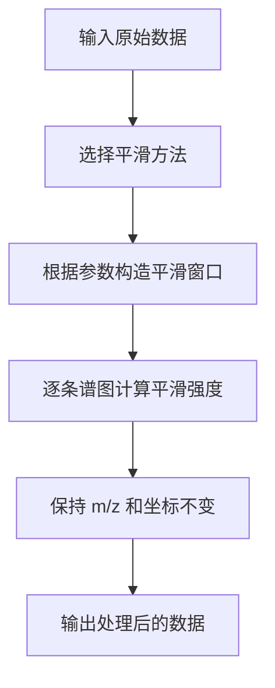

# 噪声抑制与平滑模块

本文介绍 MassFlow 中的噪声抑制与平滑模块。

[TOC]

## 概述

质谱信号中常会出现连续、快速的小幅波动。这些波动通常不代表真实离子峰，却可能在后续峰提取时被误认为峰。噪声抑制通过邻近数据点重新计算强度，使谱线更平滑，并减少峰提取时产生的假峰。

MassFlow 提供以下三种平滑方法：

- 移动平均平滑（`ma_numba`）：使用邻近数据点的平均强度替换当前强度。方法简单，平滑效果明显，但窗口过大时可能使窄峰变宽或降低。
- 高斯平滑滤波（`gaussian_numba`）：距离当前点越近的数据对结果影响越大。与普通移动平均相比，通常能获得更自然的平滑结果。
- Savitzky–Golay 平滑滤波（`savgol_numba`）：在局部范围内拟合谱线变化，通常更有利于保留峰形，但需要合理设置窗口大小和多项式阶数。

输入与输出

- 输入为待处理的质谱数据。使用者只需要提供数据文件路径，MassFlow 会自动读取每个像素的 m/z 和信号强度。
- 输出为平滑处理后的质谱数据，处理前后的 *m/z* 位置和像素坐标保持不变，强度为去噪后的结果。


## 功能说明

### Preprocessor.noise_reduction

```python
massflow.preprocess.api.PreprocessorAPI.noise_reduction(
    *,
    method: str = "ma_numba",
    window: int = 5,
    sd: float | None = None,
    polyorder: int = 3,
    deriv: int = 0,
    delta: float = 1.0,
) -> Self
```

- 功能：按批次对所有质谱执行平滑降噪。
- 参数：
  - `method`：平滑方法，默认 `"ma_numba"`。共有三种方法可供选择`"ma_numba"`、`"gaussian_numba"`、`"savgol_numba"`。
    - `"ma_numba"`：通用方法，最快速；
    - `"gaussian_numba"`：高斯平滑，平滑更柔和，对高斯噪声有理论支持；
    - `"savgol_numba"`：Savitzky–Golay平滑，保峰能力强，适合后续需要峰面积的场景。
  - `window`：窗口长度（正整数），默认 5。
    - 输入必须为正整数，偶数会自动调整为奇数以保证居中对齐。
    - 建议范围：5–15，可根据峰宽和噪声强度调节。窗口越大越平滑，但也可能模糊窄峰。
  - `sd`：高斯核标准差，只用于高斯平滑。默认 `window / 4.0`，增大则平滑更强。
  - `polyorder`：Savitzky-Golay 多项式阶数，输入值必须小于 `window`值，默认 3。较低阶数（如 1）更平滑，较高阶数（如 3）保峰更好。
  - `deriv`：导数阶数，只用于Savitzky–Golay平滑，默认 0。普通平滑必须保持 0；大于 0 时输出的是导数，不再是原始强度。
  - `delta`：采样间隔，只用于Savitzky–Golay平滑，计算导数时的数据点间隔，默认 1.0。

示例：

```python
from massflow.data_manager import MSDataManagerImzML
from massflow.preprocess.preprocessor import Preprocessor
from massflow.tools.plot import plot_spectrum

FILE_PATH = "data/example.imzML"
dm = MSDataManagerImzML(filepath=FILE_PATH)
dm.load_head_data()

denoised = (
    Preprocessor(dm)
    .noise_reduction(method="gaussian_numba", window=5)
    .start()
)

plot_spectrum(
    base=dm.ms[100],
    target=denoised.ms[100],
    mz_range=(400.0, 420.0),
    metrics_box=True,
)

denoised.close()
dm.close()
```

该示例依次完成：

1. 读取 imZML 数据；
2. 进行噪声抑制
3. 展示前后数据对比图


## 总体工作流程图




## 方法详解

### 移动平均（ma_numba）

移动平均使用当前位置附近多个数据点的平均强度重新计算当前强度。它操作简单、速度较快，窗口长度`window` 决定平滑程度，但窗口过大时可能使窄峰变宽或降低。偶数窗口自动加 1。

### 高斯平滑（gaussian_numba）

高斯平滑对距离当前位置较近的数据点给予更高权重，对较远的数据点给予较低权重。与普通移动平均相比，通常可以获得更自然的平滑结果。`sd` 控制平滑程度，默认 `sd = window / 4.0`。`sd` 越大平滑越强。

### Savitzky-Golay 平滑（savgol_numba）

Savitzky–Golay 方法在一个较小范围内拟合谱线的变化趋势，通常更有利于保留峰形。它需要同时设置窗口和拟合阶数，因此更适合已经有一定调参经验的使用者。`polyorder` 决定多项式阶数（通常 1–3），`window` 为奇数窗口。使用时应保证 `polyorder` 小于实际窗口大小。

以下为同一谱图，三种方法处理的结果：

移动平均（ma_numba）:

高斯平滑（gaussian_numba）:

Savitzky-Golay 平滑（savgol_numba）:


## 错误处理

- 输入校验：intensity 必须为非空一维 numpy 数组，否则抛出 `TypeError`。
- window 校验：必须为正整数，否则抛出 `ValueError`。
- sd 校验：必须为正，否则抛出 `ValueError`。
- method 校验：仅支持 `"ma_numba"`、`"gaussian_numba"`、`"savgol_numba"`，否则抛出 `ValueError`。

## 参考

- `preprocess/helper/noise_reduction_helper.py`：平滑分发器（smoother）
- `preprocess/numba/noise_reduction_numba.py`：Numba 加速实现（smooth_signal_ma_numba, smooth_signal_gaussian_numba, smooth_signal_savgol_numba）
- `preprocess/flat_pre_fun.py`：FlatPreprocess.noise_reduction_flat：扁平预处理入口
- `preprocess/api.py`：PreprocessorAPI.noise_reduction：噪声抑制与平滑功能的调用入口

