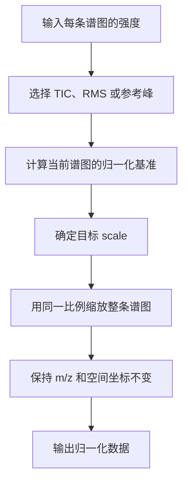

# 归一化

本文介绍 MassFlow 中的归一化模块。

[TOC]

## 概述

不同像素的整体信号强度可能受到组织厚度、取样量、离子化效率和仪器响应变化影响。强度归一化用于把每条谱图调整到可比较的尺度，减少“整条谱图整体偏强或偏弱”对离子图和后续统计分析的影响。

- 输入与输出
  - 输入为待处理的质谱数据。使用者只需要提供数据文件路径，MassFlow *会自动读取每个像素的* *m/z* 和信号强度。
  - 输出为归一化后的质谱数据，处理前后的 *m/z* 位置和像素坐标保持不变，强度替换为归一化后的值。
- 方法
  - TIC（Total Ion Current）归一化（`tic_numba`）：将每条谱的强度缩放使总和（sum）等于指定值。
  - RMS（Root Mean Square）归一化（`rms_numba`）：将每条谱的强度缩放使均方根（RMS）等于指定值。
  - 参考峰归一化（`ref_numba`）：将每条谱的强度缩放使指定 m/z 附近的信号归一化到目标值。

## 功能说明

### Preprocessor.normalization

```python
massflow.preprocess.api.PreprocessorAPI.normalization(
    *,
    method: str = "tic_numba",
    scale: float | None = None,
    ref: float | None = None,
    ref_tolerance: float = 0.1,
) -> Self
```

- 功能：按批次对所有质谱执行归一化。

- 参数：
  - `method`：归一化方法，默认 `"tic_numba"`。有三种方法可供选择：`"tic_numba"`、`"rms_numba"`、`"ref_numba"`。
    
    - 需要像素间总强度可比时，优先选 `"tic_numba"`。
    - 希望对极端值更稳健时，选 `"rms_numba"`。
    - 已知内标峰时，选 `"ref_numba"`。
    
  - `scale`：归一化后的幅度缩放因子（可选），输入值必须为有限非负数。若提供，强度会被乘以此值。常用场景：TIC 归一化后设为 1000 或 10000 便于数值展示。
  
  - `ref`：目标内标峰 *m/z* 值（`ref_numba` 时若为None，自动取值）。
  
  - `ref_tolerance`：参考峰匹配容差（`ref_numba` 方法使用），默认 0.1Da。输入值必须为有限的非负数
  
    

示例：

```python
from massflow.data_manager import MSDataManagerImzML
from massflow.preprocess.preprocessor import Preprocessor
from massflow.tools.plot import plot_spectrum

FILE_PATH = "data/example.imzML"
dm = MSDataManagerImzML(filepath=FILE_PATH)
dm.load_head_data()

normalized = (
    Preprocessor(dm)
    .noise_reduction(method="gaussian_numba", window=7)
    .normalization(method="tic_numba")
    .start()
)

plot_spectrum(
    base=dm.ms[100],
    target=normalized.ms[100],
    mz_range=(400.0, 420.0),
    metrics_box=True,
)
normalized.close()
dm.close()
```

该示例依次完成：

1. 读取 imZML 数据；
2. 计算每条谱图的总离子流；
3. 将每条谱图中的所有信号强度除以该谱图的总强度，使归一化后的总强度为 1；


### 总体工作流程图




## 方法详解

### TIC 归一化（tic_numba）

根据每条谱图中所有信号强度的总和对整条谱图进行统一缩放。归一化后，一条谱图中所有信号强度之和为 1。如果设置了 `scale`，归一化结果会再乘以 `scale`，此时所有信号强度之和约为 `scale`。

适用场景：它适合用于减小不同像素之间总信号量差异，使不同像素的谱图更方便进行比较。

### RMS 归一化（rms_numba）

根据整条谱图的均方根强度$RMS=\sqrt{\frac{1}{n}\sum_{i=1}^{n}x_i^2}$，对所有峰进行统一缩放。归一化后，谱图的 RMS 为 1。如果设置了 `scale`，归一化结果会再乘以 `scale`，此时谱图的 RMS 约为 `scale`。

适用场景：对强峰不敏感，在含高动态范围信号的数据中更稳定。

### 参考峰归一化（ref_numba） 

参考峰归一化使用一个预先选定的离子峰作为参照，将每条谱图中的其他峰按该参考峰的强度进行缩放。如果设置了 `scale`，归一化结果会再乘以 `scale`。

建议明确设置目标内标峰 *m/z* 值 `ref` 和合适的参考峰匹配容差 `ref_tolerance`。当使用 `method="ref_numba"` 但没有填写 `ref` 时，程序会自动取当前传入 *m/z* 数据的中间位置作为临时参考值。因此，在实际分析中建议根据实验使用的内标或已知稳定离子峰明确设置 `ref`，不要依赖程序自动选择参考值。


## 错误处理与日志

- 输入校验：输入数据必须为非空一维 numpy 数组，否则抛出 `TypeError`。

- method 校验：仅支持 `"tic_numba"`、`"rms_numba"`、`"ref_numba"`。

  

## 参考

- [`preprocess/helper/normalizer_helper.py`](https://github.com/NeoNexusX/MassFlow/blob/main/src/massflow/preprocess/helper/normalizer_helper.py)：归一化分发器（normalizer）

- [`preprocess/numba/normalization_numba.py`](https://github.com/NeoNexusX/MassFlow/blob/main/src/massflow/preprocess/numba/normalization_numba.py)：Numba 加速实现（normalizer_numba）

- [`preprocess/flat_pre_fun.py`](https://github.com/NeoNexusX/MassFlow/blob/main/src/massflow/preprocess/flat_pre_fun.py)：`FlatPreprocess.normalization_flat`：扁平预处理入口

- [`preprocess/api.py`](https://github.com/NeoNexusX/MassFlow/blob/main/src/massflow/preprocess/api.py)：`PreprocessorAPI.normalization`：归一化功能的调用入口

  

作者：董乐强，董京伟
