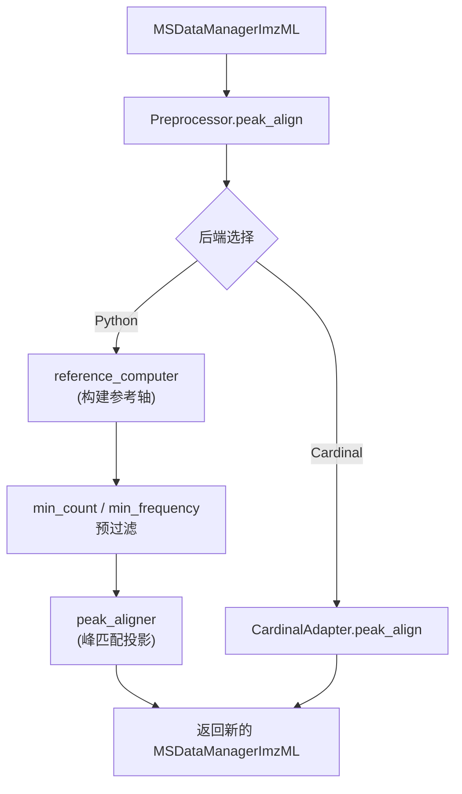

# MassFlow

本文介绍 MassFlow 中的峰对齐（peak alignment）模块，重点包括：
- 流水线级入口 `Preprocessor.peak_align`
- 参考轴构建函数 `reference_computer`
- 扁平数组对齐函数 `peak_aligner`
- 参考峰预过滤（`min_count`、`min_frequency`）功能

核心实现位于：
- `src/massflow/preprocess/helper/peak_align_helper.py`
- `src/massflow/preprocess/numba/peak_align_numba.py`

## 概述

峰对齐的工作流程主要分为两个阶段：

- **参考轴构建阶段**
  - 自动估计所有谱图共享的 m/z 域范围和分辨率步长：`estimate_domain_parallel`
  - 将每条谱的峰按容差分配到域网格中：`bin_peaks_parallel`
  - 合并容差窗口内相邻的参考峰：`merge_peaks`
  - 顶层入口函数：`reference_computer`
  - 可选预过滤：通过 `min_count` 和 `min_frequency` 在构建阶段缩短参考轴

- **峰匹配与对齐阶段**
  - 将每条谱的峰投影到共享参考轴上：`peak_aligner`
  - 基于最近邻匹配和容差判断，将原始峰强度分配至参考轴位置
  - 对齐后的数据写入磁盘，返回新的 `MSDataManagerImzML`

- **统一入口**
  - `Preprocessor.peak_align`：接收数据，选择后端（Python 或 Cardinal），调用对应的对齐逻辑

### 流程图



## 核心 API

### Preprocessor.peak_align（流水线级）

```python
massflow.preprocess.api.PreprocessorAPI.peak_align(
    *,
    reference: np.ndarray | None = None,
    tolerance: float | None = None,
    units: str = "ppm",
    binfun: str = "median",
    binratio: float = 2.0,
    min_count: int | None = None,
    min_frequency: float | None = None,
    backend: Literal["python", "cardinal"] = "python",
) -> Self
```

- 描述：流水线级峰对齐统一入口。通过 `Preprocessor` 链式调用，将所有谱图对齐到共享参考 m/z 轴。
- 输入：通过 `Preprocessor(dm)` 绑定数据管理器。
- 输出：调用 `.start()` 后返回新的 `MSDataManagerImzML`，所有谱图共享相同的 m/z 轴（连续数据模式）。
- 参数：
  - `reference`：外部参考 m/z 轴；`None` 时自动计算。
  - `tolerance`：容差半窗口；`None` 时根据数据分辨率自动估算。
  - `units`：容差单位，`"ppm"`（相对）或 `"Da"`（绝对），默认 `"ppm"`。
  - `binfun`：分辨率聚合策略，`"median" | "min" | "max"`，默认 `"median"`。
  - `binratio`：容差缩放因子，默认 2.0。
  - `min_count`：参考峰最小支持谱数（仅 Python 后端）。
    - 合并后 count ≥ min_count 的参考峰被保留。
    - 用于预过滤低支持度的噪声峰，缩短参考轴。
  - `min_frequency`：参考峰最小出现频率，取值范围 [0, 1]（仅 Python 后端）。
    - 频率 = min(count, n_spectra) / n_spectra。
    - 与 `min_count` 同时设置时取 AND 语义。
  - `backend`：后端方法，`"python"`（默认）或 `"cardinal"`。

示例（默认参考轴构建）：

```python
from massflow.data_manager import MSDataManagerImzML
from massflow.preprocess.preprocessor import Preprocessor

FILE_PATH = "data/example.imzML"
dm = MSDataManagerImzML(filepath=FILE_PATH)
dm.load_head_data()

picked = (
    Preprocessor(dm)
    .peak_pick()
    .start()
)

aligned = (
    Preprocessor(picked)
    .peak_align(units="ppm", binfun="median", binratio=2.0)
    .start()
)

plot_spectrum(
    base=picked.ms[0],
    target=aligned.ms[0],
    mz_range=(400, 410),
    intensity_range=(0.0, 20),
    plot_mode="stem",
    metrics_box=True,
)

aligned.close()
dm.close()
```


示例（带预过滤，缩短参考轴）：

```python
aligned_filter = (
    Preprocessor(dm)
    .peak_align(
        units="ppm",
        binfun="median",
        binratio=2.0,
        min_count=2,
        min_frequency=0.01,
    )
    .start()
)

plot_spectrum(
    base=picked.ms[0],
    target=aligned_filter.ms[0],
    mz_range=(400, 410),
    intensity_range=(0.0, 20),
    plot_mode="stem",
    metrics_box=True,
)
```


### reference_computer（参考轴构建）

```python
preprocess.helper.peak_align_helper.reference_computer(
    data_manager: MSDataManager,
    reference: Optional[NDArray] = None,
    binfun: str = "median",
    binratio: float = 2.0,
    tolerance: Optional[float] = None,
    units: str = "ppm",
    batch_size: int = 256,
    max_threads: int = 2,
    min_count: Optional[int] = None,
    min_frequency: Optional[float] = None,
) -> tuple[NDArray, float]
```

- 描述：构建共享参考 m/z 轴并估算容差。工作流程：
  1. `estimate_domain_parallel`：遍历所有谱图，估计 m/z 范围与分辨率步长。
  2. `bin_peaks_parallel`：将每条谱的峰映射到域网格，累积 counts。
  3. `merge_peaks`：合并相邻峰，m/z 按 counts 加权平均，counts 求和合并。
  4. `_filter_reference_by_counts`（可选）：应用 `min_count` / `min_frequency` 过滤。
- 返回值：`(reference, tolerance)`。
- 说明：若传入外部 `reference`，则跳过参考轴构建阶段，同时忽略 `min_count` / `min_frequency` 参数。

### peak_aligner（扁平对齐）

```python
preprocess.helper.peak_align_helper.peak_aligner(
    mz_data: NDArray[np.float64],
    intensity: NDArray[np.float64],
    lengths: NDArray[np.int32],
    reference: NDArray[np.float64],
    tolerance: float,
    units: str = "ppm",
) -> NDArray[np.float64]
```

- 描述：将一个批次中的每条谱投影到参考 m/z 轴上，返回形状为 `(n_spectra, n_reference)` 的二维对齐强度矩阵。
- 参数：
  - `mz_data`、`intensity`、`lengths`：扁平数组形式的输入谱图。
  - `reference`：参考 m/z 轴（必须已排序）。
  - `tolerance`：容差半窗口。
  - `units`：`"ppm"` 或 `"Da"`。
- 匹配规则：
  - 对每条谱的每个峰，在参考轴上搜索容差窗口内的最近邻。
  - 若找到匹配，将峰强度赋值给对应参考位置。
  - 同一条谱中多个峰匹配到同一参考位置时，保留强度最大的峰。
- 实现：内部调用 Numba JIT 编译的 `align_spectra_flat_parallel_jit` 内核。

### FlatPreprocess.peak_align_flat（扁平批处理级）

```python
massflow.preprocess.flat_pre_fun.FlatPreprocess.peak_align_flat(
    mz_data: np.ndarray,
    intensity: np.ndarray,
    lengths: np.ndarray,
    reference: Optional[np.ndarray] = None,
    tolerance: Optional[float] = None,
    units: str = "ppm",
) -> FlatBatchResult
```

- 描述：`Preprocessor.peak_align`（Python 后端）中每个批次的底层调用。要求 `reference` 和 `tolerance` 必须预先计算好。
- 返回值：`FlatBatchResult`，其中 `intensity` 为对齐后的二维矩阵展平，`lengths` 均为参考轴长度。

## 参考峰预过滤

### 过滤参数语义

- `min_count`：参考峰必须被至少 `min_count` 条谱图支持（在 bin 和 merge 阶段累积的 counts）。值必须为正整数。
- `min_frequency`：参考峰的出现频率必须 ≥ `min_frequency`。取值范围 [0, 1]。频率计算中 counts 会被封顶到 `n_spectra`，防止 merge 阶段求和高估频率。

### 过滤时机

过滤发生在 `reference_computer` 内部，在 `merge_peaks` 之后、正式对齐之前。过滤后的 reference 直接传给 `peak_aligner`，因此对齐阶段使用的矩阵列数随之减少。

### 注意事项

- 当前过滤参数仅 Python 后端支持。Cardinal 后端传入 `min_count` 或 `min_frequency` 会抛出 `ValueError`。
- 参考轴的 counts 语义是"构建阶段的支持度"，与最终对齐阶段的实际匹配命中数可能不同（因为对齐阶段有独立的 nearest 匹配规则）。
- 默认情况下不启用任何过滤，以保持与旧版本行为一致。

## 后端比较

| 特性 | Python 后端 | Cardinal 后端 |
|------|-----------|-------------|
| 实现 | Numba JIT 编译 | R Cardinal 包 |
| 参考峰预过滤 | 支持 | 不支持 |
| 性能 | GPU/多核并行 | 单机 R 运行时 |
| 输出格式 | MSDataManagerImzML | MSDataManagerImzML |

## 参数说明与调参建议

- `units`：推荐使用 `"ppm"`（相对容差），对 m/z 范围变化有更好的适应性。
- `binfun`：分辨率聚合策略。
  - `"median"`：中位数，稳健（默认推荐）。
  - `"min"`：最细分辨率，参考轴更大。
  - `"max"`：最粗分辨率，参考轴更小。
- `binratio`：容差 = 步长 × binratio。增大 `binratio` 可容入更多匹配，但可能引入误匹配。
- `tolerance`：显式指定容差时，`binratio` 和分辨率自动估算被忽略。
- `min_count`：建议从 2 开始调参。较低的值保留更多峰，较高的值缩短参考轴更显著。
- `min_frequency`：建议范围 0.005–0.05。频率 = 0.01 表示要求每个参考峰至少在 1% 的谱图中出现过。

## 数据流总结

1. **收集信息**：遍历谱图收集 m/z 范围和分辨率信息。
2. **构建参考轴**：
   - `estimate_domain_parallel` → 生成初始网格。
   - `bin_peaks_parallel` → 将峰值映射到网格，累积 counts。
   - `merge_peaks` → 合并相邻峰。
   - `_filter_reference_by_counts` → 预过滤（可选）。
3. **执行对齐**：
   - 按批次调用 `peak_aligner`，将每条谱投影到参考轴。
   - 结果实时写入磁盘，释放内存。
4. **返回结果**：返回包含对齐后数据的 `MSDataManagerImzML`。

## 参考

- `preprocess/helper/peak_align_helper.py`：参考轴构建、峰对齐核心函数
- `preprocess/numba/peak_align_numba.py`：Numba 加速的搜索和对齐内核
- `preprocess/flat_pre_fun.py`：扁平预处理入口（FlatPreprocess.peak_align_flat）
- `preprocess/api.py`：链式 API（PreprocessorAPI.peak_align）
- `preprocess/preprocessor.py`：流水线执行器（_prepare_peak_align_task）

## 错误处理与日志

- `units` 校验：`"ppm"` / `"relative"` 归一化为相对单位，其他归一化为绝对单位。
- `min_count` 校验：必须为正整数，否则抛出 `ValueError`。
- `min_frequency` 校验：必须在 [0, 1] 范围内，否则抛出 `ValueError`。
- `reference` + `tolerance` 缺失：在 `peak_align_flat` 中若不提供 reference 和 tolerance，抛出 `ValueError`。
- Cardinal 后端 + min_count/min_frequency：抛出 `ValueError`。
