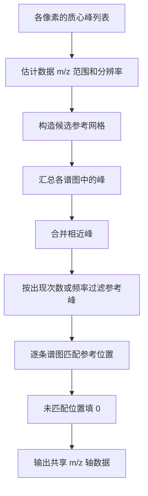

# 峰对齐

本文介绍 MassFlow 中的峰对齐模块。


作者：董乐强，董京伟

**问题反馈：** 如果在使用 MassFlow 或阅读文档时发现问题，可通过 [GitHub Issues](https://github.com/NeoNexusX/MassFlow/issues) 提交反馈，或联系邮箱：707244007@qq.com。

## 概述

同一种离子在不同像素中可能因为质量测量误差出现在略有差异的 *m/z* 位置。峰对齐用于建立一条共享参考 *m/z* 轴，并把每条质心谱中的峰匹配到这条轴上，使后续离子图、加合物过滤和统计过滤能够按同一列比较所有像素。

峰对齐主要包括两个步骤：

- 建立参考 *m/z* 轴：MassFlow 会综合所有像素中检测到的峰，将位置非常接近的峰归为同一组，并为每组确定一个统一的参考 *m/z*。
- 将每条谱匹配到参考轴：程序会检查每条谱中的峰，将其匹配到最接近且满足质量误差要求的参考 *m/z* 位置，最后输出峰对齐后的新质谱数据。

完成峰对齐后：

- 不同像素中的同一种离子会出现在相同的 *m/z* 位置；
- 每个像素都使用相同的峰位置进行比较；
- 后续可以更方便地绘制离子图；
- 也可以继续进行加合物过滤和统计过滤。

## 功能说明

### Preprocessor.peak_align

```python
massflow.preprocess.api.PreprocessorAPI.peak_align(
    *,
    reference: np.ndarray | None = None,
    tolerance: float | None = None,
    units: str = "ppm",
    binfun: str = "median",
    binratio: float = 2.0,
    min_count: int | None = None,
    min_frequency: float | None = None,
    backend: Literal["python", "cardinal"] = "python",
) -> Self
```

- 功能：建立或接收参考 *m/z* 轴，并把全部谱图对齐到该轴。
- 参数：
  - `reference`：外部参考 *m/z* 轴；`None` 时自动计算。提供现成 `reference` 后，程序不会重新建立参考轴，`min_count` 和 `min_frequency` 也不再参与参考轴筛选。
  - `tolerance`：容差半窗口；`None` 时根据数据分辨率自动估算。
  - `units`：容差单位，`"ppm"`（相对）或 `"Da"`（绝对）。默认使用 `"ppm"`（相对容差），对 *m/z* 范围变化有更好的适应性。
  - `binfun`：分辨率聚合策略，`"median" | "min" | "max"`。
    - `"median"`：中位数，稳健（默认推荐），
    - `"min"`：最细分辨率，参考轴更大。
    - `"max"`：最粗分辨率，参考轴更小。
  - `binratio`：容差缩放因子，默认 2.0。容差 = 步长 × binratio。增大 `binratio` 可容入更多匹配，但可能引入误匹配。
  - `min_count`：参考峰最小支持谱数（仅 Python 后端）。
    - 合并后 count ≥ min_count 的参考峰被保留。
    - 用于预过滤低支持度的噪声峰，缩短参考轴。
    - 建议从 2 开始调参。较低的值保留更多峰，较高的值缩短参考轴更显著。
  - `min_frequency`：参考峰最小出现频率，取值范围 [0, 1]（仅 Python 后端）。
    - 频率 =` min(count, n_spectra)` / `n_spectra`。
    - 与 `min_count` 同时设置时取 逻辑与（AND） 语义。
    - 频率 = 0.01 表示要求每个参考峰至少在 1% 的谱图中出现过。
  - `backend`：后端方法，`"python"`（默认）或 `"cardinal"`。

示例（默认参考轴构建）：

```python
from massflow.data_manager import MSDataManagerImzML
from massflow.preprocess.preprocessor import Preprocessor
from massflow.tools.plot import plot_spectrum

FILE_PATH = "data/example.imzML"
dm = MSDataManagerImzML(filepath=FILE_PATH)
dm.load_head_data()
aligned = (
    Preprocessor(
        dm,
        output_path="data/peak_aligned.imzML")
    .peak_pick()
    .peak_align(units="ppm", binfun="median", binratio=2.0)
    .start()
)

picked = (
    Preprocessor(dm)
    .peak_pick()
    .start()
)

plot_spectrum(
    base=picked.ms[0],
    target=aligned.ms[0],
    mz_range=(400, 410),
    intensity_range=(0.0, 20),
    plot_mode="stem",
    metrics_box=True,
)

picked.close()
aligned.close()
dm.close() # 如需继续运行下一个示例，请在最后再关闭
```


示例（带预过滤，缩短参考轴）：

```python
aligned_filter = (
    Preprocessor(
        dm,
        output_path="data/peak_aligned_filter.imzML")
    .peak_pick()
    .peak_align(
        units="ppm",
        binfun="median",
        binratio=2.0,
        min_count=2,
        min_frequency=0.01,
    )
    .start()
)
picked = (
    Preprocessor(dm)
    .peak_pick()
    .start()
)

plot_spectrum(
    base=picked.ms[0],
    target=aligned_filter.ms[0],
    mz_range=(400, 410),
    intensity_range=(0.0, 20),
    plot_mode="stem",
    metrics_box=True,
)
```


### reference_computer（参考轴构建，可选）

```python
preprocess.helper.peak_align_helper.reference_computer(
    data_manager: MSDataManager,
    reference: Optional[NDArray] = None,
    binfun: str = "median",
    binratio: float = 2.0,
    tolerance: Optional[float] = None,
    units: str = "ppm",
    batch_size: int = 256,
    max_threads: int = 2,
    min_count: Optional[int] = None,
    min_frequency: Optional[float] = None,
) -> tuple[NDArray, float]
```

- 功能：只计算参考 *m/z* 轴和内部使用的匹配容差，不写出对齐数据。
- 工作流程：
  1. 汇总所有像素中检测到的峰；
  2. 将 *m/z* 非常接近的峰归为同一组；
  3. 为每组确定一个统一的参考 *m/z*；
  4. 根据需要去除只在很少像素中出现的参考峰。
- 函数返回两个结果：
  - `reference`：建立好的共享参考 *m/z* 轴。
  - `tolerance`：后续峰匹配时使用的容差。
- 如果已经提供了现成的 `reference`，程序会直接使用该参考轴，不再重新建立参考轴。此时，`min_count` 和 `min_frequency` 不再参与参考轴筛选。
- `reference_computer` 更适合以下情况：
  - 希望先查看程序建立的参考 *m/z* 轴。
  - 需要比较不同参数对参考轴的影响。

## 总体工作流程图



## 参考峰预过滤

在建立共享参考 *m/z* 轴时，MassFlow 可以先去掉只在很少像素中出现的参考峰。 这样可以减少最终参考轴中的峰数量，使后续峰对齐和统计分析更加集中。

### 过滤参数

主要需要关注两个参数： 

- `min_count`表示一个参考峰至少需要在多少条谱图中得到支持。数值越大：保留的参考峰越少，筛选更严格；数值越小：保留更多低频峰。如果研究中包含只在少量像素出现的局部特异性离子，不建议把 `min_count` 设置得过高。
- `min_frequency`表示一个参考峰至少需要在多大比例的谱图中出现。数值较小：保留更多低频峰，也会增加参考轴长度；数值较大：参考轴更短，但可能删除只存在于局部组织区域的真实峰。

### 过滤时机

参考峰过滤发生在建立参考 *m/z* 轴之后、正式进行峰对齐之前。

处理顺序为：建立参考 *m/z* 轴→去除出现次数或出现频率过低的参考峰→使用筛选后的参考轴进行峰对齐。

过滤后，只有保留下来的参考峰会参与后续对齐，因此最终参考 *m/z* 轴会变短，对齐后的数据中需要比较的峰也会相应减少。

## 错误处理

- 参数`"ppm"` / `"relative"` 归一化为相对单位，其他归一化为绝对单位。
- `min_count`的输入必须为正整数，否则抛出 `ValueError`。
- `min_frequency`的输入必须在 [0, 1] 范围内，否则抛出 `ValueError`。
- 当选择`Cardinal` 后端并传入 `min_count` 或 `min_frequency` 会抛出 `ValueError`。

## 参考

- [`preprocess/helper/peak_align_helper.py`](https://github.com/NeoNexusX/MassFlow/blob/main/src/massflow/preprocess/helper/peak_align_helper.py)：参考轴构建、峰对齐核心函数
- [`preprocess/numba/peak_align_numba.py`](https://github.com/NeoNexusX/MassFlow/blob/main/src/massflow/preprocess/numba/peak_align_numba.py)：Numba 加速的搜索和对齐内核
- [`preprocess/flat_pre_fun.py`](https://github.com/NeoNexusX/MassFlow/blob/main/src/massflow/preprocess/flat_pre_fun.py)：`FlatPreprocess.peak_align_flat`：扁平预处理入口
- [`preprocess/api.py`](https://github.com/NeoNexusX/MassFlow/blob/main/src/massflow/preprocess/api.py)：`PreprocessorAPI.peak_align`：峰对齐功能调用入口
