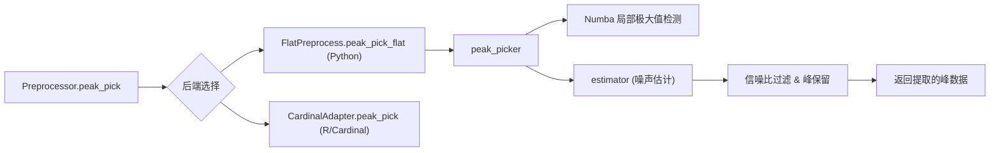

# MassFlow

本文介绍 MassFlow 中的峰提取（peak picking）模块，重点包括：
- 流水线级入口 `Preprocessor.peak_pick`
- 扁平数组入口 `FlatPreprocess.peak_pick_flat`
- `preprocess/helper/peak_pick_helper.py` 中的峰提取辅助函数

内容涵盖：API 说明、示例代码、参数与调参建议、以及常见问题。

## 概述

- 输入与输出
  - 输入为扁平数组形式（`mz_data`、`intensity`、`lengths`），表示一批谱图的 m/z 和强度数据。
  - 输出为只保留峰顶点的扁平数组，非峰数据被置零。
- 峰检测策略
  - 局部极大值检测：通过固定窗口 `width` 扫描整条谱图，识别窗口内的极大值点。
  - 信噪比过滤：基于估计的噪声水平，去除信噪比低于 `snr` 的候选峰。
  - 峰边界检测（可选）：通过 `prominence` 和 `relheight` 参数控制峰的左右边界。
- 噪声估计方法
  - `"sd"`：基于局部标准差的噪声估计。
  - `"mad"`：基于中位数绝对偏差的稳健噪声估计。
  - `"quantile"`：基于分位数的噪声估计（默认）。
  - `"diff"`：基于差分的噪声估计。
- 分块处理
  - 对于极长的谱图，可通过 `nbins` 参数将谱图等分为若干段分别处理，各段之间有 `overlap` 比例的重叠以保证边界峰的连续性。

### 函数关系示意图



## 核心 API

### Preprocessor.peak_pick（流水线级）

```python
massflow.preprocess.api.PreprocessorAPI.peak_pick(
    *,
    width: int = 5,
    method: str = "quantile",
    snr: float = 2.0,
    return_type: str = "height",
    prominence: float | None = None,
    relheight: float | None = None,
    nbins: int = 1,
    overlap: float = 0.5,
    backend: Literal["python", "cardinal"] = "python",
) -> Self
```

- 描述：流水线级峰提取入口。通过 `Preprocessor` 链式调用，按批次处理所有光谱。
- 输入：通过 `Preprocessor(dm)` 绑定数据管理器。
- 输出：调用 `.start()` 后返回新的 `MSDataManagerImzML`，其光谱仅保留峰的 m/z 和强度。
- 后端：
  - `"python"`：使用 Numba 加速的纯 Python 实现。
  - `"cardinal"`：调用 R 语言 Cardinal 包的 `peakPick` 函数。
- 参数：
  - `width`：局部极大值检测窗口半宽，默认 5。
  - `method`：噪声估计方法，`"sd" | "mad" | "quantile" | "diff"`，默认 `"quantile"`。
  - `snr`：信噪比阈值，默认 2.0。信号低于 `snr × noise` 的峰被丢弃。
  - `return_type`：峰强度返回类型，`"height"`（峰顶高度）或 `"area"`（峰面积），默认 `"height"`。
  - `prominence`：峰的突出度阈值，小于此值的峰被丢弃（可选）。
  - `relheight`：用于确定峰宽度的相对高度（可选）。
  - `nbins`：分块数，默认 1（不分块）。
  - `overlap`：分块重叠比例（0 ≤ overlap < 1），默认 0.5。
- 异常：
  - `ValueError`：不支持的 `method`；`return_type` 非法；`nbins < 1`；`overlap` 不在 `[0, 0.99]`。

示例：

```python
from massflow.data_manager import MSDataManagerImzML
from massflow.preprocess.preprocessor import Preprocessor

FILE_PATH = "data/example.imzML"
dm = MSDataManagerImzML(filepath=FILE_PATH)
dm.load_head_data()

# 链式调用：先降噪，再峰提取
processed = (
    Preprocessor(dm)
    .noise_reduction(method="gaussian_numba", window=7)
    .peak_pick(method="quantile", snr=3.0, width=5)
    .start()
)

plot_spectrum(
    base=dm.ms[0],
    target=processed.ms[0],
    mz_range=(400, 410),
    intensity_range=(0.0, 20),
    plot_mode="stem",
    metrics_box=True,
)

processed.close()
dm.close()
```


### peak_picker（辅助函数级）

```python
preprocess.helper.peak_pick_helper.peak_picker(
    mz_data: np.ndarray,
    intensity: np.ndarray,
    lengths: np.ndarray,
    width: int = 5,
    method: str = "quantile",
    snr: float = 2.0,
    return_type: str = "height",
    prominence: float | None = None,
    relheight: float | None = None,
    nbins: int = 1,
    overlap: float = 0.5,
) -> tuple[np.ndarray, np.ndarray, np.ndarray]
```

- 描述：扁平数组峰提取核心函数。对一批谱图执行局部极大值检测、噪声估计和信噪比过滤。
- 参数：与 `Preprocessor.peak_pick` 相同。
- 返回值：`(picked_mz, picked_intensity, picked_lengths)` —— 提取后的扁平 m/z、强度和长度数组。非峰位置的强度值被置零。
- 说明：
  - 内部调用 `prepare_flat_inputs` 确保输入格式一致。
  - 噪声估计通过 `estimator` 函数（来自 `est_noise_helper`）完成。
  - 实际的局部极大值检测和滤波在 Numba JIT 内核中执行。

### FlatPreprocess.peak_pick_flat（扁平批处理级）

```python
massflow.preprocess.flat_pre_fun.FlatPreprocess.peak_pick_flat(
    mz_data: np.ndarray,
    intensity: np.ndarray,
    lengths: np.ndarray,
    width: int = 5,
    method: str = "quantile",
    snr: float = 2.0,
    return_type: str = "height",
    prominence: float | None = None,
    relheight: float | None = None,
    nbins: int = 1,
    overlap: float = 0.5,
) -> FlatBatchResult
```

- 描述：`Preprocessor.peak_pick`（Python 后端）的底层实现。返回包含 mz_data、intensity 和 lengths 的 `FlatBatchResult`。
- 参数：与 `peak_picker` 相同，额外进行方法名合法性校验。
- 支持的方法：`"sd"`, `"mad"`, `"quantile"`, `"diff"`。

## 噪声估计方法说明

| 方法 | 描述 | 适用场景 |
|------|------|----------|
| `quantile` | 基于强度的分位数估计噪声基线 | 通用，对离群峰不敏感（默认） |
| `sd` | 基于局部标准差的噪声估计 | 噪声分布在数据中比较均匀的情况 |
| `mad` | 基于中位数绝对偏差的稳健估计 | 含有较多离群值的情况 |
| `diff` | 基于相邻点差分的噪声估计 | 基线缓慢变化、噪声波动较小的情况 |

## 参数说明与调参建议

- `width`（窗口半宽）
  - 决定局部极大值检测的邻域范围。较大的 width 合并邻近小峰，较小的 width 保留更多峰。
  - 建议范围：3–11。根据仪器分辨率和期望峰密度调节。
- `snr`（信噪比阈值）
  - 噪声水平 × snr = 最小峰值。峰值低于此阈值的候选峰被丢弃。
  - 建议范围：1.5–5.0。较低的 snr 保留更多弱峰（含噪），较高的 snr 更保守。
- `method`（噪声估计方法）
  - `"quantile"` 是最稳健的默认选择。
  - 对于基线平稳的数据，`"sd"` 或 `"diff"` 可能更敏感。
  - 对于含大峰的数据，`"mad"` 的稳健性优于 `"sd"`。
- `prominence`（峰突出度）
  - 衡量一个峰相对于周围局部基线的突出程度。
  - 当设为非 None 值时，信号低于此突出度的峰将被丢弃。
- `relheight`（相对高度）
  - 用于确定峰左右边界的相对高度（相对于峰顶）。
  - 仅在 `return_type="area"` 时有意义，用于计算峰面积。
- `nbins` 与 `overlap`
  - 对于极长谱图（如 FT-ICR 数据），分块处理可降低内存峰值。
  - overlap 确保块边界附近的峰不会因分块而丢失。

## 参考

- `preprocess/helper/peak_pick_helper.py`：峰提取核心实现（peak_picker）
- `preprocess/helper/est_noise_helper.py`：噪声估计函数（estimator）
- `preprocess/numba/peak_pick_numba.py`：Numba 加速的局部极大值检测与滤波
- `preprocess/numba/est_noise_numba.py`：Numba 加速的噪声估计
- `preprocess/flat_pre_fun.py`：扁平预处理入口（FlatPreprocess.peak_pick_flat）
- `preprocess/api.py`：链式 API（PreprocessorAPI.peak_pick）

## 错误处理与日志

- 所有输入校验错误在抛出 `ValueError` 或 `TypeError` 前会通过 `logger.error` 记录。
- method 校验：仅支持 `"sd"`, `"mad"`, `"quantile"`, `"diff"`，否则抛出 `ValueError`。
- snr 校验：必须为有限正值，否则不进行信噪比过滤。
- window 校验：自动将 `width < 1` 调整为 1。
- nbins 校验：必须 `>= 1`。
- overlap 校验：必须在 `[0.0, 0.99]` 范围内。
