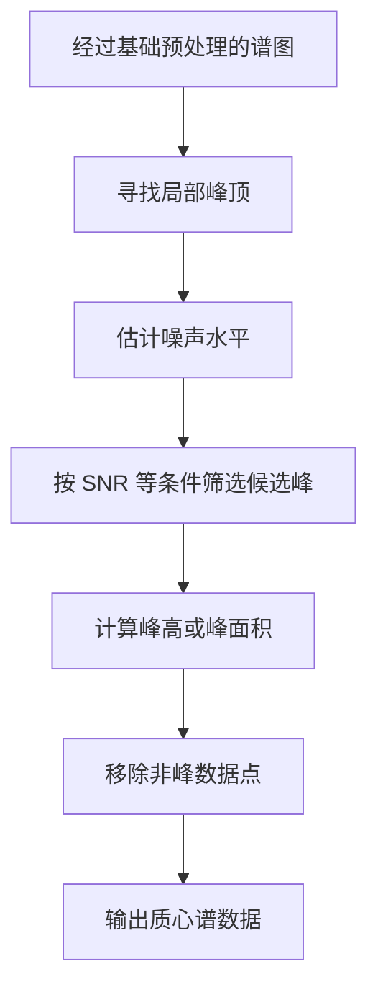

# 峰提取

本文介绍 MassFlow 中的峰提取模块。

[TOC]

## 概述

轮廓质谱通常包含大量连续的 m/z 采样点，其中很多数据点位于峰与峰之间，并不代表独立的离子峰。 峰提取用于从连续谱线中识别可能的离子峰位置，并结合信号强度和噪声水平去除不明显的候选峰。

处理后，每条谱图会由连续谱线转换为较稀疏的峰列表，只保留识别出的峰位置及其对应强度。 MassFlow 在峰提取过程中会检查局部峰顶、信噪比和峰的突出程度，并可根据峰形确定峰的范围。

峰提取不会改变像素的空间位置，但会明显减少每条谱图中的 *m/z* 数据点数量，为后续同位素过滤、峰对齐和统计分析提供更简洁的数据。

- 输入与输出
  - 输入为待处理的质谱数据。使用者只需要提供数据文件路径，MassFlow 会自动读取每个像素的 m/z 和信号强度。
  - 输出为峰提取后的质谱数据，只保留识别出的峰位置及其对应强度，非峰数据点被移除。
- 峰检测策略
  - 局部极大值检测： 通过固定窗口 `width` 检查谱图中的局部高点，寻找可能的峰位置。
  - 信噪比过滤：根据估计的噪声水平，去除信噪比低于 `snr` 的候选峰。
  - 峰边界检测（可选）： 可通过 `prominence` 和 `relheight` 等参数进一步判断峰是否足够明显，并确定峰的范围。

## 功能说明

### Preprocessor.peak_pick

```python
massflow.preprocess.api.PreprocessorAPI.peak_pick(
    *,
    width: int = 5,
    method: str = "quantile",
    snr: float = 2.0,
    return_type: str = "height",
    prominence: float | None = None,
    relheight: float | None = None,
    nbins: int = 1,
    overlap: float = 0.5,
    backend: Literal["python", "cardinal"] = "python",
) -> Self
```

- 功能：在每条谱图中提取峰，将每条轮廓谱转换为只保留峰顶的质心峰列表。
- 参数：
  - `width`：局部极大值检测窗口半宽，默认 5。决定局部极大值检测的邻域范围。较大的 width 合并邻近小峰，较小的 width 保留更多峰。建议范围：3–11。根据仪器分辨率和期望峰密度调节。
  - `method`：噪声估计方法，`"sd" | "mad" | "quantile" | "diff"`，默认 `"quantile"`。
    - `quantile`基于强度的分位数估计噪声基线,为通用方法但是对离群峰不敏感，是最稳健的选择。
    - `sd`基于局部标准差的噪声估计,适用于噪声分布在数据中比较均匀的情况
    - `mad`基于中位数绝对偏差的稳健估计，适用于含有较多离群值的情况
    - `diff`基于相邻点差分的噪声估计，适用于基线缓慢变化、噪声波动较小的情况
    - 对于基线平稳的数据，`"sd"` 或 `"diff"` 可能更敏感。
    - 对于含大峰的数据，`"mad"` 的稳健性优于 `"sd"`。
  - `snr`：信噪比阈值，默认 2.0。 `snr × noise` 为最小峰值，峰值低于此阈值的候选峰被丢弃。建议范围：1.5–5.0。较低的 snr 保留更多弱峰（含噪），较高的 snr 更保守。
  - `return_type`：峰强度返回类型，`"height"`（峰顶高度）或 `"area"`（峰面积），默认 `"height"`。
  - `prominence`：衡量一个峰相对于周围局部基线的突出程度，小于此值的峰被丢弃（可选）。当设为非 None 值时，信号低于此突出度的峰将被丢弃。
  - `relheight`：用于确定峰宽度的相对高度（可选）。仅在 `return_type="area"` 时有意义，用于计算峰面积。
  - `nbins`：分块数，默认 1（不分块）。输入值必须`>= 1`。极长谱图（如 FT-ICR 数据），分块处理可降低内存峰值。
  - `overlap`：分块重叠比例（0 ≤ overlap < 1），默认 0.5。overlap 确保块边界附近的峰不会因分块而丢失。
  - `backend`：后端方法，`"python"`（默认）或 `"cardinal"`。

示例：

```python
from massflow.data_manager import MSDataManagerImzML
from massflow.preprocess.preprocessor import Preprocessor
from massflow.tools.plot import plot_spectrum

FILE_PATH = "data/example.imzML"
dm = MSDataManagerImzML(filepath=FILE_PATH)
dm.load_head_data()

# 链式调用：先降噪，再峰提取
processed = (
    Preprocessor(dm)
    .noise_reduction(method="gaussian_numba", window=7)
    .peak_pick(method="quantile", snr=3.0, width=5)
    .start()
)

plot_spectrum(
    base=dm.ms[0],
    target=processed.ms[0],
    mz_range=(400, 410),
    intensity_range=(0.0, 20),
    plot_mode=["line", "stem"],
    metrics_box=True,
)

processed.close()
dm.close()
```

该示例依次完成：

1. 读取 imZML 数据；

2. 进行高斯平滑；

3. 进行峰提取；

   


## 总体流程图




## 错误处理

- 所有输入校验错误在抛出 `ValueError` 或 `TypeError` 前会通过 `logger.error` 记录。
- method 校验：仅支持 `"sd"`, `"mad"`, `"quantile"`, `"diff"`，否则抛出 `ValueError`。
- snr 校验：必须为有限正值，否则不进行信噪比过滤。
- window 校验：自动将 `width < 1` 调整为 1。
- overlap 校验：必须在 `[0.0, 0.99]` 范围内。

## 参考

- [`preprocess/helper/peak_pick_helper.py`](https://github.com/NeoNexusX/MassFlow/blob/main/src/massflow/preprocess/helper/peak_pick_helper.py)：峰提取核心实现（peak_picker）
- [`preprocess/helper/est_noise_helper.py`](https://github.com/NeoNexusX/MassFlow/blob/main/src/massflow/preprocess/helper/est_noise_helper.py)：噪声估计函数（estimator）
- [`preprocess/numba/peak_pick_numba.py`](https://github.com/NeoNexusX/MassFlow/blob/main/src/massflow/preprocess/numba/peak_pick_numba.py)：Numba 加速的局部极大值检测与滤波
- [`preprocess/numba/est_noise_numba.py`](https://github.com/NeoNexusX/MassFlow/blob/main/src/massflow/preprocess/numba/est_noise_numba.py)：Numba 加速的噪声估计
- [`preprocess/flat_pre_fun.py`](https://github.com/NeoNexusX/MassFlow/blob/main/src/massflow/preprocess/flat_pre_fun.py)：`FlatPreprocess.peak_pick_flat`：扁平预处理入口
- [`preprocess/api.py`](https://github.com/NeoNexusX/MassFlow/blob/main/src/massflow/preprocess/api.py)：`PreprocessorAPI.peak_pick`：峰提取功能的调用入口


作者：董乐强，董京伟
