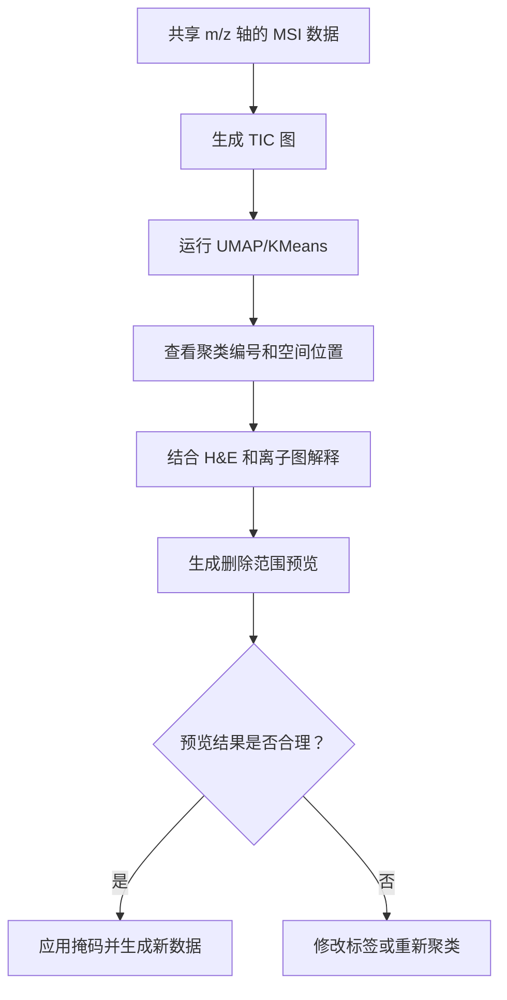

# KMeans 组织区域划分

本文介绍 MassFlow 中的 KMeans 组织区域划分、结果检查以及区域删除或保留流程。


作者：董乐强，董京伟

**问题反馈：** 如果在使用 MassFlow 或阅读文档时发现问题，可通过 [GitHub Issues](https://github.com/NeoNexusX/MassFlow/issues) 提交反馈，或联系邮箱：707244007@qq.com。

## 概述

MSI 组织中的不同区域可能具有不同的整体质谱特征。KMeans 会根据低维特征把像素分成指定数量的离散类别，并将分类结果重新映射到原始组织空间中，从而直观显示不同类别在组织中的分布位置。

组织区域划分后，可以得到以下结果：

1. KMeans 为每个像素分配一个类别编号；
2. 属于同一类别的像素会以相同颜色显示在组织空间中，从而形成一个或多个区域；
3. 使用者结合 TIC、离子图、H&E 和组织位置判断哪些类别是背景、组织主体或其他感兴趣区域；
4. 根据判断结果选择需要删除或保留的类别，并生成区域处理预览；
5. 确认预览结果符合预期后，再将对应的区域掩码应用到 MSI 数据中。

## 推荐使用方法

MassFlow的组织区域划分通常需要经过“运行 → 查看结果 → 判断区域 → 生成预览 → 人工确认”的过程，因此推荐在 Jupyter Notebook 中按照本文顺序逐步运行代码。

如果还不熟悉 Jupyter Notebook，可以先阅读文件[最佳实践](./jupyter.md)

## 功能说明

### SegmentationPipeline.run_umap_kmeans

```python
massflow.segmentation.SegmentationPipeline.run_umap_kmeans(
    *,
    sample_ratio: float = 1.0,
    transform_batch_size: int | None = 1024,
    dpi: int = 600,
    save_images: bool = True,
    save_matrix: Literal["npz", "zarr"] | None = None,
    n_components: int = 3,
    umap_metric: str = "cosine",
    n_clusters: int = 10,
    random_state: int | None = None,
    show: bool = False,
) -> UmapKmeansResult
```

- 功能：根据每个像素的质谱特征运行 UMAP 和 KMeans，并生成空间聚类结果。
- 参数：本页主要关注 KMeans 相关参数：
  - `n_clusters`：类别数量，默认 `10`，当前支持 `1–20`。数值越大，区域划分越细，但同一组织区域也更可能被拆成多个小类；
  - `random_state`：固定随机种子便于重复比较；
  - `transform_batch_size`：后续分批进行 UMAP 转换时，每批处理的像素数量，默认 `1024`。输入必须为正整数，且数值越大可能更快，但占用更多内存，内存不足时可以适当减小。
  - `save_images`：是否保存 UMAP 和 KMeans 图像，默认 `True`。
  - `save_matrix`：是否保存可再次加载的聚类结果，可选 `"npz"`、`"zarr"` 或 `None`。
  - `dpi`：保存图片的分辨率，默认 `600`。
  - `show`：是否在运行时显示 KMeans 图，默认 `False`。
  - UMAP 相关参数见 [UMAP 降维与可视化](./umap.md)。
- 输出：返回 `UmapKmeansResult`，其中包含 UMAP 空间图、KMeans 空间图、每个像素的聚类编号以及编号对应的显示颜色。


以下示例按 Jupyter Notebook 单元格顺序运行。前面单元格中创建的 `dm`、`pipeline` 会在后续示例中继续使用。

第一个单元格先读取数据并创建 `SegmentationPipeline`：

```python
from massflow.data_manager import MSDataManagerImzML
from massflow.segmentation import SegmentationPipeline


dm = MSDataManagerImzML(filepath="data/example.imzML")
dm.load_head_data()

pipeline = SegmentationPipeline(
    dm,
    output_dir="segmentation_output",
)
```

这一步完成后，当前 Notebook 中会创建两个：`dm` 和 `pipeline`。

后面的代码会继续使用这两个变量，不需要再次读取数据。


继续使用上一步创建的 `pipeline`：

```
result = pipeline.run_umap_kmeans(
    sample_ratio=1.0,
    n_clusters=10,
    random_state=0,
    save_images=True,
    save_matrix="zarr",
    show=False,
)
```

该步骤会先获取每个像素的低维特征，再使用 KMeans 将像素划分为不同类别，并把聚类结果重新映射到组织空间。


如果希望查看类别编号和图中颜色之间的对应关系，可以继续运行：

```
result.print_label_colors()
```


输出结果展示：

参考数据集1：

原始tic图：


KMeans聚类结果：


对应的UMAP图：


参考数据集2:

原始TIC 图：


kmeans聚类结果：


对应的umap图：


### SegmentationPipeline.remove_clusters

```python
pipeline.remove_clusters(labels_to_remove)
```

- 功能：删除使用者已经确认不需要的聚类类别，并生成透明区域预览图。
- 参数：
  - `labels_to_remove`：需要删除的 KMeans 类别编号。至少需要提供一个非负类别编号。
- 输出：返回二维区域掩码，并在 `cluster_segmentation` 目录中生成透明 UMAP 和 KMeans 预览图。
- 该步骤只建立区域掩码，不会直接修改原始 MSI 数据。


示例：

如果想要删除指定的聚类区域，可以运行：

```python
#使用上文已经创建并运行过 SegmentationPipeline 的 pipeline 变量
labels_to_remove=[0]

pipeline.remove_clusters(labels_to_remove)
```

运行后会生成待移除区域的预览图。

实验数据1：

Kmeans预览图结果：


原始结果：


实验数据2：

Kmeans预览图结果：


原始结果：


### SegmentationPipeline.remove_background

```python
pipeline.remove_background(
    labels_to_remove=None,
    *,
    remove_num=1,
)
```

- 功能：从图像外侧开始，自动寻找并删除位于外层的聚类区域。
- 参数：
  - `labels_to_remove`：可选，用于限制允许被自动删除的类别；不填写时会从所有类别中寻找外层区域。
  - `remove_num`：连续删除多少层外侧区域，默认 `1`，输入必须为正整数。
- 输出：返回二维区域掩码，并在 `cluster_segmentation` 目录中生成透明区域预览图。
- 该方法适合背景主要位于组织外围的情况。如果真实组织本身接触图像边缘，自动判断可能误删真实组织，因此必须检查预览结果。


示例：

如果已经确认图像外围的聚类区域属于背景，可以继续运行：

```python
#使用上文已经创建并运行过 SegmentationPipeline 的 pipeline 变量
pipeline.remove_background(
    labels_to_remove=None,
    remove_num=1,
)
```

该操作会根据聚类结果识别与图像外围相连的区域，并生成待移除区域预览。

实验数据1：

Kmeans预览图结果：


原始结果：


实验数据2：

Kmeans预览图结果：


原始结果：


### SegmentationPipeline.keep_clusters

```python
pipeline.keep_clusters(labels_to_keep)
```

- 功能：保留指定类别以及被这些类别在空间上包围的内部区域。
- 参数：
  - `labels_to_keep`：需要保留的 KMeans 类别编号。至少需要提供一个非负类别编号
- 输出：返回二维区域掩码，并在 `cluster_segmentation` 目录中生成透明区域预览图。

- 需要注意，`keep_clusters()` 并不等同于简单地“只保留这些标签”。当前实现还会保留被指定区域包围的内部区域，因此应先检查预览结果。

示例：

如果已经确定只希望保留某些感兴趣的区域，可运行以下示例：

```python
#使用上文已经创建并运行过 SegmentationPipeline 的 pipeline变量
labels_to_keep=[4]
pipeline.keep_clusters(labels_to_keep)
```

该操作会将指定的聚类类别设为保留区域，同时保留被该区域包围的内部区域，并生成预览图

实验数据1

Kmeans预览图结果：


原始结果：


实验数据2：

Kmeans预览图结果：


原始结果：


### SegmentationPipeline.apply_region_mask

```python
pipeline.apply_region_mask(
    output_path,
    *,
    batch_size=256,
    temp_dir=None,
)
```

- 功能：将已经确认的区域掩码应用到原始数据，并生成新的 MSI 数据。
- 参数：
  - `output_path`：新数据的保存路径。
  - `batch_size`：每批处理的数据量，默认 `256`，必须为正数。
  - `temp_dir`：仅 imZML 写出时使用的临时目录，可不填写。
- 输出：`.imzML` 输出返回已加载的 `MSDataManagerImzML`；同格式输出返回对应源格式的新数据管理器。

示例：

真正将区域处理结果应用到 MSI 数据，需要使用：

```python
#使用上文运行过remove_clusters()、remove_background()或keep_clusters() 而产生修改的变量pipeline

masked = pipeline.apply_region_mask(
    output_path="data/tissue_only.imzML",
    temp_dir="temp/segmentation",
)
```

这一步会根据已经确认的区域掩码生成新的 MSI 数据。


## 总体工作流程图



## 聚类与区域选择方法说明

### KMeans

KMeans 根据 UMAP 得到的特征，将像素分成指定数量的类别。

例如：

```python
n_clusters=10
```

表示尝试把当前像素划分为 10 类。

- `n_clusters` 较小：区域划分更粗；
- `n_clusters` 较大：区域划分更细，但同一种组织可能被拆成多个小类别。

当前实现最多支持 20 个类别。

### 三种区域选择方式

| 方法                | 作用                               |
| ------------------- | ---------------------------------- |
| `remove_clusters`   | 删除明确指定的类别                 |
| `remove_background` | 自动从图像外侧逐层删除类别         |
| `keep_clusters`     | 保留指定类别以及被其包围的内部区域 |

对于第一次处理新数据，建议优先使用 `remove_clusters()`，因为需要删除哪些类别由使用者明确指定，更容易检查和复核。


## 错误处理

- imzML 为非连续型数据时会抛出 `ValueError`。
- 在执行 `remove_clusters()`、`remove_background()` 或 `keep_clusters()` 之前，必须先运行 `run_umap_kmeans()` 或加载已有的 `UmapKmeansResult`。
- 在执行 `apply_region_mask()` 之前，必须先生成区域掩码。
- `apply_region_mask()` 的掩码形状必须与数据的空间尺寸一致；如果掩码没有保留任何像素，会抛出 `ValueError`。
- 当前 UMAP/KMeans 不直接支持 `MSDataManagerZarr`（spectra Zarr）；支持的是 imZML 和 ion-image Binary/H5/Zarr 数据管理器。

## 参考

- [`segmentation/segmentation_pipeline.py`](https://github.com/NeoNexusX/MassFlow/blob/main/src/massflow/segmentation/segmentation_pipeline.py)：`SegmentationPipeline` 和 `UmapKmeansResult`
- [`segmentation/umap_kmeans.py`](https://github.com/NeoNexusX/MassFlow/blob/main/src/massflow/segmentation/umap_kmeans.py)：UMAP/KMeans 分析和空间图输出
- [`segmentation/cluster_segmentation.py`](https://github.com/NeoNexusX/MassFlow/blob/main/src/massflow/segmentation/cluster_segmentation.py)：聚类区域删除、外围背景删除和目标区域保留
- [`segmentation/region_mask.py`](https://github.com/NeoNexusX/MassFlow/blob/main/src/massflow/segmentation/region_mask.py)：空间掩码应用和数据写出
