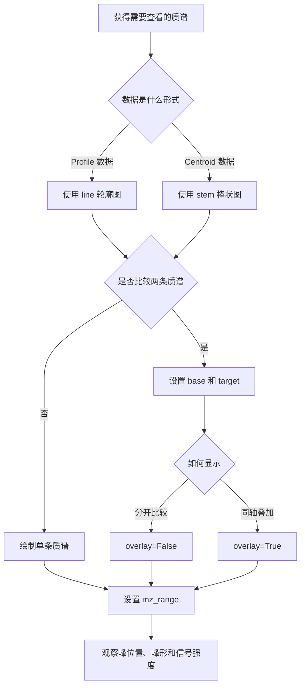

# 谱图可视化

本文介绍 MassFlow 中的质谱图绘制功能。


作者：董乐强，董京伟

**问题反馈：** 如果在使用 MassFlow 或阅读文档时发现问题，可通过 [GitHub Issues](https://github.com/NeoNexusX/MassFlow/issues) 提交反馈，或联系邮箱：[707244007@qq.com](mailto:707244007@qq.com)。

## 概述

质谱成像数据中的每个采集位置都对应一条质谱。质谱图用于查看某一个位置检测到的离子信号，其中：

- 横轴表示 *m/z*；
- 纵轴表示信号强度。

通过质谱图可以先了解原始数据的大致状态，也可以比较预处理前后的变化。例如：

- 查看是否存在明显的基线抬高或缓慢漂移；
- 比较噪声抑制前后的连续质谱；
- 检查峰提取后主要离子峰是否被保留；
- 查看峰对齐或峰过滤前后的峰位置和峰数量变化。

质谱图反映的是某一个像素位置的质谱情况，不能单独代表整份 MSI 数据。实际分析时，建议结合多个组织位置的质谱、TIC 图和目标离子图一起判断。

## 功能说明

### plot_spectrum

```python
massflow.tools.plot.plot_spectrum(
    base=None,
    target=None,
    save_path=None,
    figsize=(20, 5),
    dpi=300,
    colors=None,
    line_width=None,
    plot_mode=None,
    mz_range=None,
    intensity_range=None,
    metrics_box=True,
    overlay=False,
)
```

- 功能：可以绘制一条质谱，也可以比较两条质谱。

- 参数：

  - `base`：需要绘制的主要质谱。通常传入数据管理器中的一条质谱，例如 `dm.ms[0]`。只绘制一条质谱时填写这一项

  - `target`：需要与`base`所选质谱比较的第二条质谱。比较处理前后结果时填写；只绘制一条质谱时保持 `None`。

  - `save_path`：图片保存路径。保持 `None` 时直接显示图片。

  - `figsize`：图片尺寸，默认 `(20, 5)`。

  - `dpi`：图片分辨率，默认 `300`。数值越高图片越清晰。

  - `colors`：设置质谱的颜色。默认 `None`，表示使用程序默认配色。如需修改颜色可以传入相应颜色。例想改成红色可设置`colors="red"`

  - `line_width`：设置线条宽度。默认宽度为`1.5`，一般情况下保持默认即可。如需调整，可以填写其他数值。该参数只影响绘图效果，不改变质谱数据。

  - `plot_mode`：设置质谱的绘制方式。支持轮廓图 `"line"` 和棒状图 `"stem"`，默认为 `"line"`。
     比较两条质谱时，也可以分别指定绘图方式。例如 `["line", "stem"]` 表示第一条质谱使用轮廓图，第二条质谱使用棒状图。

  - `mz_range`：设置横轴显示的 *m/z* 范围，例如 `(400, 410)`表示只显示 *m/z* 400–410 的范围。不填写时会根据当前输入数据自动设置。

  - `intensity_range`：设置纵轴显示的信号强度范围，例如 `(0, 20)`表示只显示信号强度 0–20 的范围。不填写时会根据当前输入数据自动设置。

  - `metrics_box`：比较两条质谱时是否显示辅助比较信息。默认 `True`。同时提供 `base` 和 `target` 时，设置为 `True` 会在图中显示辅助比较信息；设置为 `False` 时只显示质谱图。

  - `overlay`：两条质谱是否叠加在同一个坐标轴中，默认 `False`。若设置为`True`两条质谱会叠加在同一个坐标轴中。


## 绘图方式

不同类型的质谱适合使用不同的绘图方式。

| 数据类型               | 推荐绘图方式 | 适合观察                       |
| ---------------------- | ------------ | ------------------------------ |
| 轮廓型（profile） 数据 | `line`       | 峰形、噪声、基线和连续信号变化 |
| 质心型（centroid）数据 | `stem`       | 峰位置、峰数量和峰强度         |

### Profile 数据

轮廓型（profile）数据保留连续的 *m/z* 和信号强度信息，可以观察完整的峰形。

建议使用：

```python
plot_mode="line"
```

例如：

```python
from massflow.tools.plot import plot_spectrum

plot_spectrum(
    base=dm.ms[0],
    plot_mode="line",
    mz_range=(400, 410),
    metrics_box=False,
)
```

这种方式适合查看：

- 峰形；
- 谱图噪声；
- 基线；
- 平滑前后的变化。

### Centroid 数据

质心型（centroid）数据只保留识别出的离子峰及其强度，不再保留完整的连续峰形。

建议使用：

```python
plot_mode="stem"
```

例如：

```python
from massflow.tools.plot import plot_spectrum

plot_spectrum(
    base=dm.ms[0],
    plot_mode="stem",
    mz_range=(400, 410),
    metrics_box=False,
)
```

这种方式可以更清楚地观察：

- 峰的位置；
- 峰的数量；
- 不同峰的强度。


因此，峰提取、峰对齐以及后续在共享 *m/z* 轴上进行的处理结果通常更适合使用棒状图查看。

### 比较处理前后的质谱

`plot_spectrum` 可以同时传入处理前后的两条质谱。

例如：

```python
plot_spectrum(
    base=before.ms[0],
    target=after.ms[0],
    mz_range=(400, 410),
    plot_mode=["line","stem"],
    metrics_box=True,
)
```

同时会生成辅助比较信息：

- `Range`：`base` 质谱的 *m/z* 范围；
- `Correlation`：两条谱强度序列的 Pearson 相关系数；
- `TIC ratio`：`target` 总强度 / `base` 总强度；
- `SNR orig`：`base` 的信噪比；
- `SNR den`：`target` 的信噪比；
- `SNR improvement`：`target SNR / base SNR`。


比较时应尽量保证：

1. 使用同一个像素或同一个谱图位置；
2. 使用相同的 `mz_range`；
3. 使用可以直接比较的纵轴范围；
4. 根据数据类型选择正确的 `plot_mode`。

这样才能判断看到的差异是否确实来自数据处理，而不是来自不同像素或不同绘图范围。

### 分开显示与叠加显示

默认情况下：

```
overlay=False
```

两条质谱分别显示，适合观察各自的峰形、峰位置和整体变化。

如果希望将两条质谱绘制在同一个坐标轴中，可以设置：

```
overlay=True
```

叠加显示可以更直接地观察两条质谱之间的峰位置和信号强度差异。

如果两条质谱的强度差异较大，叠加后不容易观察，可以继续使用默认的 `overlay=False`。


## 总体工作流程图



## 错误处理

- 绘图中`base`和`target`参数应该至少设置一个，如果两者都为`None`代码会出现报错
- `spectrum has no data points.`：当前质谱没有数据点。可以检查质谱是否读取成功，或者所选择像素位置是否有有效数据
- `No data points in selected 'mz_range'.`：设置的 *m/z* 范围中没有数据。需要根据载入的数据重新设置想要查看的*m/z* 范围

## 参考

- [tools/plot.py](https://github.com/NeoNexusX/MassFlow/blob/main/src/massflow/tools/plot.py)：质谱绘制