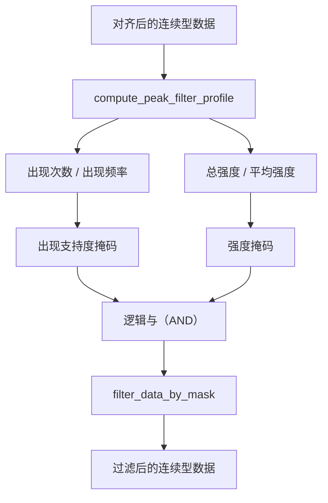

# 统计峰过滤

本文介绍 MassFlow 中的统计峰过滤模块，重点包括：

- 流水线级入口 `Preprocessor.filter_peaks_by_stats`
- 可复用统计对象 `PeakFilterProfile`
- 出现次数、出现频率、平均/总强度过滤条件
- 统一共享 m/z 掩码的流式写回

## 概述

统计峰过滤在整个数据集上统计每个共享 m/z 位置的出现次数和聚合强度，然后构建一个全局保留掩码 `keep_mask`，将相同的筛选结果应用到所有谱图。

- 输入必须是峰对齐后的**连续型共享 m/z** 数据。
- 该操作是数据集级任务，需要先扫描完整数据集计算统计量，再扫描一次应用掩码并写出结果。
- 出现次数/频率条件与强度条件使用逻辑与（AND）组合。
- 输出仍为连续型数据，但共享 m/z 轴和每条谱的强度向量都会同步缩短。

### 流程图



## 核心 API

### Preprocessor.filter_peaks_by_stats（流水线级）

```python
massflow.preprocess.api.PreprocessorAPI.filter_peaks_by_stats(
    *,
    min_count: int | None = None,
    min_frequency: float | None = None,
    intensity_method: Literal["mean", "sum"] = "mean",
    min_intensity: float | None = None,
    intensity_quantile: float | None = 0.01,
    output_path: str | None = None,
) -> Self
```

- 描述：根据峰出现支持度和聚合强度过滤共享 m/z 轴。
- 任务类型：数据集级任务。
- 输入：必须为 `continuous=True` 且具有共享 m/z 轴的数据。
- 批处理：统计扫描和写回扫描均使用 `Preprocessor.batch_size`。
- 临时文件：使用 `Preprocessor.temp_dir`。
- 参数：
  - `min_count`：一个 m/z 位置至少在多少条谱中具有正强度。
  - `min_frequency`：出现频率下限，范围 `[0, 1]`；频率为 `counts / spectrum_count`。
  - `intensity_method`：使用平均强度 `"mean"` 或总强度 `"sum"`。
  - `min_intensity`：聚合强度绝对下限。
  - `intensity_quantile`：聚合强度分位数阈值，范围 `(0, 1)`。
  - `output_path`：该数据集级过滤阶段的 imZML 输出路径；通常也可以在 `Preprocessor(..., output_path=...)` 中统一指定最终路径。

默认 `intensity_quantile=0.01`，因此即使不传其他阈值，流水线也会删除聚合强度不高于第 1 百分位阈值的 m/z 位置。若只想使用出现次数/频率条件，应显式设置：

```python
intensity_quantile=None
```

示例：

```python
from massflow.data_manager import MSDataManagerImzML
from massflow.preprocess import Preprocessor

dm = MSDataManagerImzML(filepath="data/example.imzML")
dm.load_head_data()

filtered = (
    Preprocessor(
        dm,
        batch_size=512,
        temp_dir="temp/preprocess",
        output_path="data/stat_filtered.imzML",
    )
    .peak_pick()
    .peak_align()
    .filter_peaks_by_stats(
        min_frequency=0.01,
        intensity_quantile=0.05,
        intensity_method="mean",
    )
    .start()
)

filtered.close()
dm.close()
```

### PeakFilterProfile（统计结果）

```python
@dataclass(frozen=True)
class PeakFilterProfile:
    counts: np.ndarray
    summed_intensity: np.ndarray
    spectrum_count: int
    mz_axis: np.ndarray
```

派生属性：

- `frequencies = counts / spectrum_count`
- `mean_intensity = summed_intensity / spectrum_count`
- `intensity("mean")` 返回平均强度。
- `intensity("sum")` 返回总强度。

平均强度的分母是总谱数，因此未出现峰的位置以零强度参与平均。

### compute_peak_filter_profile（统计扫描）

```python
preprocess.helper.stat_filter_helper.compute_peak_filter_profile(
    data_manager: MSDataManagerImzML,
    *,
    batch_size: int = 256,
) -> PeakFilterProfile
```

- 对每个共享 m/z 位置统计强度大于零的谱数。
- 同时累加强度总和，避免为出现次数和强度分别扫描数据集。
- 返回的统计对象可以在直接调用辅助函数时复用，避免重复计算。

### filter_peaks_by_stats（辅助函数级）

```python
preprocess.helper.stat_filter_helper.filter_peaks_by_stats(
    data_manager: MSDataManagerImzML,
    *,
    profile: PeakFilterProfile | None = None,
    min_count: int | None = None,
    min_frequency: float | None = None,
    intensity_method: Literal["mean", "sum"] = "mean",
    min_intensity: float | None = None,
    intensity_quantile: float | None = None,
    output_path: str | Path | None = None,
    temp_dir: str | Path | None = None,
    batch_size: int = 256,
) -> MSDataManagerImzML
```

- `profile=None` 时自动计算统计结果。
- 传入 `profile` 时会验证数组形状、谱数量以及 m/z 轴是否与当前数据管理器完全一致。
- 至少需要启用 `min_count`、`min_frequency`、`min_intensity`、`intensity_quantile` 中的一个条件。

## 掩码语义

每类条件先构建自己的布尔掩码，最终使用逻辑与：

```text
keep = count_mask AND intensity_mask
```

具体比较规则：

| 条件 | 保留规则 |
|------|----------|
| `min_count` | `counts >= min_count` |
| `min_frequency` | `frequencies >= min_frequency` |
| `min_intensity` | `intensity >= min_intensity` |
| `intensity_quantile` | `intensity > quantile(intensity, q)` |

注意分位数条件使用严格大于号，因此等于分位数阈值的 m/z 位置也会被删除。

## 过滤前预览

可以使用 `plot_peak_filter_histogram` 查看出现次数/频率和聚合强度分布：

```python
from massflow.tools.plot_peak_filter import plot_peak_filter_histogram

profile = plot_peak_filter_histogram(
    aligned_dm,
    count_display="frequency",
    intensity_method="mean",
    min_frequency=0.01,
    quantile=0.05,
    output_path="figures/peak_filter_preview.png",
    show=False,
)
```

该函数返回可复用的 `PeakFilterProfile`，但流水线 API 当前不会接收外部 `profile`；需要复用时应直接调用辅助函数。

## 参数说明与调参建议

- `min_count` 适合谱数量固定、不同数据集之间不需要直接比较阈值的场景。
- `min_frequency` 更适合谱数量不同的数据集；例如 `0.01` 表示至少在 1% 的谱中出现。
- `mean` 会把缺失位置按零计入总谱数平均，更强调跨像素整体信号。
- `sum` 会随谱数量变化，跨数据集比较阈值时需要谨慎。
- `intensity_quantile` 是相对阈值，适合先删除全局最弱的一部分 m/z 位置。
- 多个条件同时设置时是逻辑与（AND），而不是逻辑或（OR）；阈值组合可能明显缩短共享 m/z 轴。

## 错误处理

- 非连续型数据会抛出 `ValueError`；应先运行 `peak_align`。
- 所有阈值均为 `None` 时抛出 `ValueError`。
- `min_count` 必须是正整数。
- `min_frequency` 必须位于 `[0, 1]`。
- `intensity_method` 必须为 `"mean"` 或 `"sum"`。
- `min_intensity` 必须是有限非负数。
- `intensity_quantile` 必须位于 `(0, 1)`。
- 空数据或与当前 m/z 轴不匹配的 `profile` 会被拒绝。

## 参考

- `preprocess/helper/stat_filter_helper.py`：统计对象、掩码和公共过滤操作
- `preprocess/numba/stat_filter_numba.py`：统计聚合与共享掩码写回内核
- `tools/plot_peak_filter.py`：阈值分布预览
- `preprocess/api.py`：`PreprocessorAPI.filter_peaks_by_stats`
- `preprocess/pipeline/planner.py`：数据集级任务顺序和最终输出路由
