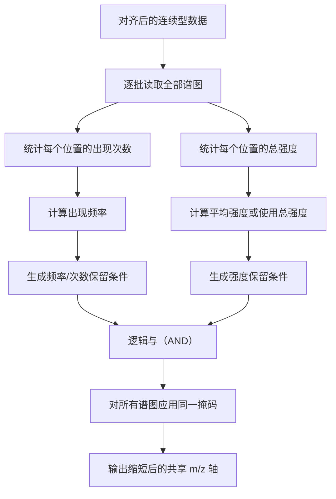

# 统计峰过滤

本文介绍 MassFlow 中的统计峰过滤模块


想在线体验质谱成像数据处理，或查找感兴趣的质谱成像数据，可访问 https://sxo.bionet.pro 免费注册体验。


## 概述

峰对齐后，所有像素共享同一条 m/z 轴，其中可能包含只在极少数像素出现的随机峰，或总体强度很低的峰。统计峰过滤在整个数据集上统计每个共享 *m/z* 位置的出现次数和聚合强度，然后构建一个全局保留掩码 `keep_mask`，将相同的筛选结果应用到所有谱图。

- 输入必须是峰对齐后的连续型共享 *m/z* 数据即`continuous=True`。
- 该操作是数据集级任务，需要先扫描完整数据集计算统计量，再扫描一次应用掩码并写出结果。
- 出现次数/频率条件与强度条件使用逻辑与（AND）组合。
- 输出仍为连续型数据，但共享 *m/z* 轴和每条谱的强度向量都会同步缩短。


## 功能说明

### Preprocessor.filter_peaks_by_stats

```python
massflow.preprocess.api.PreprocessorAPI.filter_peaks_by_stats(
    *,
    min_count: int | None = None,
    min_frequency: float | None = None,
    intensity_method: Literal["mean", "sum"] = "mean",
    min_intensity: float | None = None,
    intensity_quantile: float | None = 0.01,
    output_path: str | None = None,
) -> Self
```

- 功能：根据峰出现支持度和聚合强度过滤共享 m/z 轴。

- 参数：
  - `min_count`：一个 m/z 位置至少在多少条谱中具有正强度。适合谱数量固定、不同数据集之间不需要直接比较阈值的场景。
  - `min_frequency`：出现频率下限，范围 `[0, 1]`；频率为 `counts / spectrum_count`。更适合谱数量不同的数据集；例如 `0.01` 表示至少在 1% 的谱中出现。
  - `intensity_method`：可选为平均强度 `"mean"` 或总强度 `"sum"`。
    - `mean` 会把缺失位置按零计入总谱数平均，更强调跨像素整体信号。
    - `sum` 会随谱数量变化，跨数据集比较阈值时需要谨慎。
  - `min_intensity`：聚合强度绝对下限。
  - `intensity_quantile`：按整批峰的强度分布删除最低部分。范围 `(0, 1)`。 是相对阈值，适合先删除全局最弱的一部分 m/z 位置。若只想使用出现次数/频率条件，应设置为:`intensity_quantile=None`
  - `output_path`：该数据集过滤阶段的 imZML 输出路径；通常也可以在 `Preprocessor(..., output_path=...)` 中统一指定最终路径。
  
  输出：
  
  - 过滤之后的.imZML文件以及与之配套的.ibd文件

示例：

```python
from massflow.data_manager import MSDataManagerImzML
from massflow.preprocess import Preprocessor

dm = MSDataManagerImzML(filepath="data/example.imzML")
dm.load_head_data()

filtered = (
    Preprocessor(
        dm,
        batch_size=512,
        temp_dir="temp/preprocess",
        output_path="data/stat_filtered.imzML",
    )
    .peak_pick()
    .peak_align()
    .filter_peaks_by_stats(
        min_frequency=0.01,
        intensity_quantile=0.05,
        intensity_method="mean",
    )
    .start()
)

filtered.close()
dm.close()
```

该示例依次完成：

1. 读取 imZML 数据；
2. 进行峰提取；
3. 完成峰对齐；
4. 进行统计峰过滤。

过滤前后对比结果展示:


### plot_peak_filter_histogram

```python
from massflow.tools.plot_peak_filter import plot_peak_filter_histogram

#使用前需要先完成峰对齐

profile = plot_peak_filter_histogram(
    aligned_dm,
    count_display="frequency",
    intensity_method="mean",
    min_frequency=0.01,
    quantile=0.05,
    output_path="figures/peak_filter_preview.png",
    show=False,
)
```

- 功能：计算统计结果，并绘制峰出现频率与强度分布及阈值线。可用于查看出现次数/频率和聚合强度分布

- 特点：不会删除峰，返回的 `profile` 可复用于正式过滤。

  


### filter_peaks_by_stats

```python
preprocess.helper.stat_filter_helper.filter_peaks_by_stats(
    data_manager: MSDataManagerImzML,
    *,
    profile: PeakFilterProfile | None = None,
    min_count: int | None = None,
    min_frequency: float | None = None,
    intensity_method: Literal["mean", "sum"] = "mean",
    min_intensity: float | None = None,
    intensity_quantile: float | None = None,
    output_path: str | Path | None = None,
    temp_dir: str | Path | None = None,
    batch_size: int = 256,
) -> MSDataManagerImzML
```

- 功能：使用已经检查过的预览统计结果正式删除峰。
- 要求：`profile` 应来自当前这份数据及当前读取区域。代码会检查共享 m/z 轴是否完全相同，但不会验证统计值是否确实来自同一批像素。
- 至少需要启用 `min_count`、`min_frequency`、`min_intensity`、`intensity_quantile` 中的一个条件。

## 先预览后应用流程

可使用`plot_peak_filter_histogram`先预览峰出现频率与强度分布结果，经过人工检查后，可决定使用`filter_peaks_by_stats`应用统计结果生成数据。

示例：

```python
from massflow.preprocess.helper.stat_filter_helper import filter_peaks_by_stats
from massflow.tools.plot_peak_filter import plot_peak_filter_histogram

#使用该步骤前需要先完成峰对齐
profile = plot_peak_filter_histogram(
    aligned_dm,
    count_display="frequency",
    intensity_method="mean",
    min_frequency=0.05,
    quantile=0.01,
    output_path="figures/stat_filter_preview.png",
    show=False,
)

filtered_dm = filter_peaks_by_stats(
    aligned_dm,
    profile=profile,
    min_frequency=0.05,
    intensity_method="mean",
    intensity_quantile=0.01,
    output_path="data/stat_filtered.imzML",
)
```

该过程分为两步：

1. `plot_peak_filter_histogram` 扫描当前读取区域中的全部谱图，绘图并返回可复用的统计结果；
2. `filter_peaks_by_stats` 使用同一统计结果生成保留条件并写出新数据。


## 总体工作流程图




## 掩码语义

每类条件先构建自己的布尔掩码，最终使用逻辑与（AND）：

```text
keep = count_mask AND intensity_mask
```

具体比较规则：

| 条件 | 保留规则 |
|------|----------|
| `min_count` | `counts >= min_count` |
| `min_frequency` | `frequencies >= min_frequency` |
| `min_intensity` | `intensity >= min_intensity` |
| `intensity_quantile` | `intensity > quantile(intensity, q)` |

注意分位数条件使用严格大于号，因此等于分位数阈值的 *m/z* 位置也会被删除。当大量峰恰好等于分位数阈值时，实际删除比例可能超过设定值。


## 错误处理

- 非连续型数据会抛出 `ValueError`；应先运行 `peak_align`。
- 所有阈值均为 `None` 时抛出 `ValueError`。
- `intensity_method` 必须为 `"mean"` 或 `"sum"`。
- 空数据或与当前 m/z 轴不匹配的 `profile` 会被拒绝。

## 参考

- [`preprocess/helper/stat_filter_helper.py`](https://github.com/NeoNexusX/MassFlow/blob/main/src/massflow/preprocess/helper/stat_filter_helper.py)：统计对象、掩码和公共过滤操作
- [`preprocess/numba/stat_filter_numba.py`](https://github.com/NeoNexusX/MassFlow/blob/main/src/massflow/preprocess/numba/stat_filter_numba.py)：统计聚合与共享掩码写回内核
- [`tools/plot_peak_filter.py`](https://github.com/NeoNexusX/MassFlow/blob/main/src/massflow/tools/plot_peak_filter.py)：阈值分布预览
- [`preprocess/api.py`](https://github.com/NeoNexusX/MassFlow/blob/main/src/massflow/preprocess/api.py)：`PreprocessorAPI.filter_peaks_by_stats`：统计峰过滤功能的调用入口
- [`preprocess/pipeline/planner.py`](https://github.com/NeoNexusX/MassFlow/blob/main/src/massflow/preprocess/pipeline/planner.py)：数据集级任务顺序和最终输出路由


作者：董乐强，董京伟
