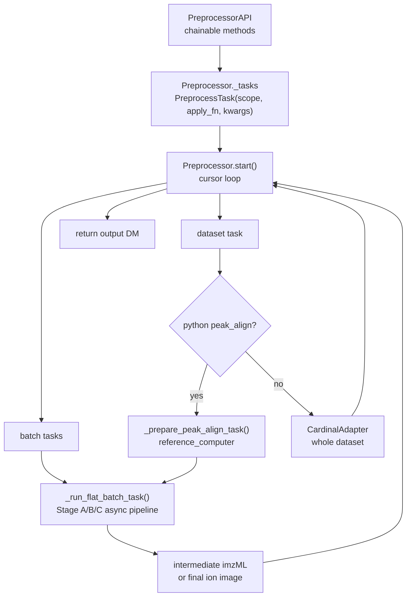
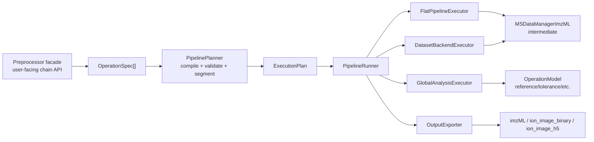
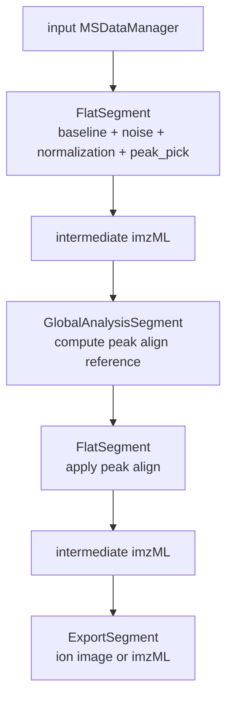
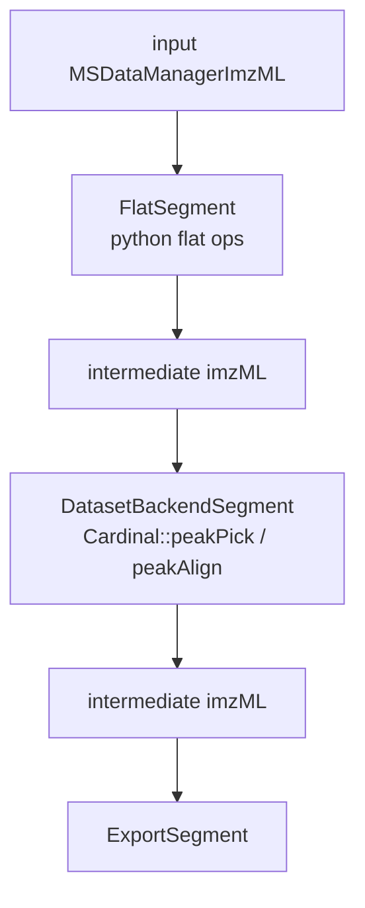
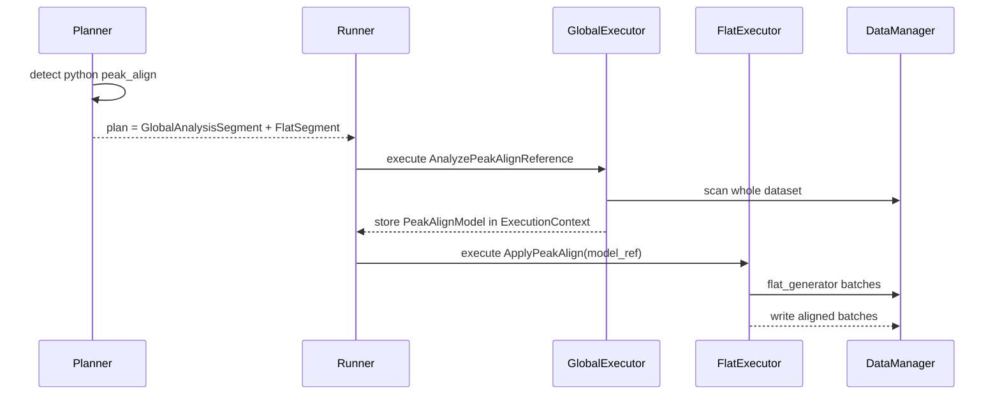
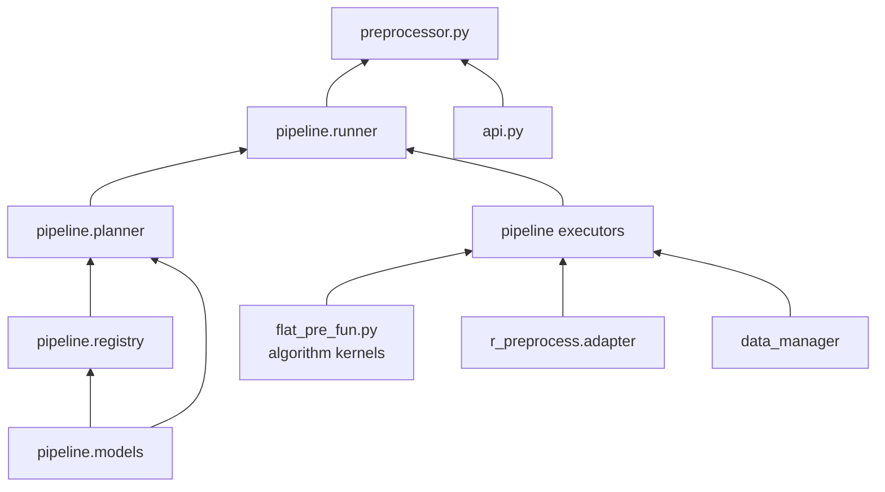
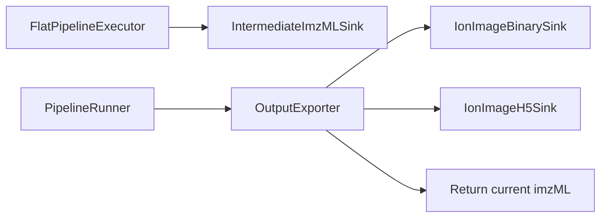

# Preprocessor 重构计划

## 范围

本计划只处理 `src/massflow/preprocess/preprocessor.py` 的架构重构、职责拆分、pipeline 表达和论文叙述友好性。正确性细节、线程安全、性能调优、算法数值行为暂不纳入本轮。

## 当前问题

`Preprocessor` 现在是一个“总控类”，同时承担 API task 存储、任务排序、spectrum type 推断、A/B/C batch pipeline、dataset backend 调度、peak align 参数准备、临时 imzML 落盘、最终 ion image 导出等职责。核心耦合集中在：

- `PreprocessTask` 只有 `scope=batch/dataset`，但这个 scope 同时表达“需要什么数据视野”和“用什么执行器跑”，语义不够。
- `_run_dataset_task()` 中的 python `peak_align` 被注册为 `dataset`，但实际又调用 `_prepare_peak_align_task()` 后回到 `_run_flat_batch_task()`。也就是说，全数据分析需求被误建模成 dataset 任务，导致 dataset 层反向调用 flat A/B/C 流程。
- `start()` 用游标在 batch segment 与 dataset task 之间手动切换，同时夹带最终输出格式判断，执行计划不可显式检查。
- Stage C sink 同时处理中间 imzML 和最终 ion image 输出；输出格式策略泄漏到了 batch executor。
- `api.py` 直接绑定 `FlatPreprocess` 和 `CardinalAdapter`，用户 API、backend 选择和执行实现没有中间抽象层。

当前结构可以概括为：



这里最不清晰的一点是：`peak_align` 的“需要全数据计算 reference”与“可以逐 batch apply alignment”被合并成了一个 `dataset` task。论文中很难解释为稳定的 pipeline，因为执行图不是单向的，而是 dataset 分支回流到 flat A/B/C。

## 目标架构

重构目标不是改变算法，而是把 pipeline 表达成稳定的两层结构：

1. **Logical layer**：用户注册的是 operation spec；planner 把 spec 编译成显式 logical plan。
2. **Execution layer**：executor 只执行 plan segment；flat executor 不知道 dataset executor，dataset executor 也不回调 flat executor。

关键语义拆分：

- **data view**：某一步需要 `chunk`、`full_dataset` 还是 `global_summary`。
- **execution mode**：某一步用 flat Python、Cardinal R、output exporter 还是 metadata-only。
- **materialization policy**：什么时候必须落盘成中间 data manager，什么时候可以直接写最终输出。

目标结构：



重构后的 `Preprocessor` 应该只剩下三个职责：

- 保存用户传入的配置和 operation specs。
- 调用 planner 生成 plan。
- 调用 runner 执行 plan 并返回最终 data manager。

## 核心模型

### 1. OperationSpec

替代当前 `PreprocessTask` 作为用户 API 注册结果。它只描述“用户想做什么”，不直接保存可执行函数。

```python
@dataclass(slots=True)
class OperationSpec:
    name: str
    backend: Literal["python", "cardinal"]
    params: dict[str, Any]
```

API 层只产生 spec：


### 2. OperationDescriptor

由 registry 提供，描述每个 operation 的能力边界。

```python
@dataclass(slots=True)
class OperationDescriptor:
    name: str
    backend: str
    order: int
    input_spectrum: set[SpectrumType]
    output_spectrum_rule: Callable[[SpectrumType], SpectrumType]
    planning_kind: Literal["flat", "global_then_flat", "dataset_backend"]
```

这样 `scope` 不再承担多重含义：

| 当前字段 | 问题 | 新字段 |
|---|---|---|
| `scope=batch` | 只能说明逐 batch apply，不能说明是否依赖全局参数 | `planning_kind=flat` |
| `scope=dataset` | 混淆“全数据分析”和“全数据执行” | `global_then_flat` 或 `dataset_backend` |
| `apply_fn` | API 层提前绑定实现函数 | registry/executor 内部绑定 |

### 3. PlanSegment

planner 输出显式 segment，而不是让 `start()` 用游标临时判断。

```python
@dataclass(slots=True)
class FlatSegment:
    operations: list[FlatOperation]
    output_spectrum_type: SpectrumType

@dataclass(slots=True)
class GlobalAnalysisSegment:
    operation: GlobalAnalysisOperation
    produces: str

@dataclass(slots=True)
class DatasetBackendSegment:
    operation: DatasetBackendOperation
    output_spectrum_type: SpectrumType

@dataclass(slots=True)
class ExportSegment:
    output_format: str
```

执行图例：



Cardinal backend 则是另一条清晰路径：



## peak align 的重构方式

当前 `peak_align` 的问题不是“它需要全数据”，而是把“全数据 reference 估计”和“逐 batch alignment apply”混成了一个 dataset task。

重构后应拆成两步：



建议模型：

```python
@dataclass(slots=True)
class PeakAlignModel:
    reference: np.ndarray
    tolerance: float
    units: str
```

对应 plan：

```text
python peak_align(reference=None)
  -> GlobalAnalysisSegment(AnalyzePeakAlignReference, produces="peak_align_model")
  -> FlatSegment(ApplyPeakAlign(model_ref="peak_align_model"))
```

如果用户已经传入 `reference` 和 `tolerance`，则 planner 可以直接生成：

```text
python peak_align(reference=..., tolerance=...)
  -> FlatSegment(ApplyPeakAlign)
```

这样 dataset 分支不会再调用 flat A/B/C，peak align 在论文中也可以写成标准的 two-pass operation：

1. first pass estimates a global alignment reference from the dataset;
2. second pass applies reference-based alignment independently to each spectral batch.

## 建议文件结构

新建正确拼写的 `pipeline` 包；旧的 `piepeline` 目录不继续扩展，后续可保留兼容导入或删除。

```text
src/massflow/preprocess/
  api.py                         # 用户链式 API，只注册 OperationSpec
  preprocessor.py                # facade: config -> planner -> runner
  flat_pre_fun.py                # 保留算法函数，逐步改名为 flat_ops.py

  pipeline/
    __init__.py
    models.py                    # OperationSpec, descriptors, segments, Chunk
    registry.py                  # operation/backend registry
    planner.py                   # OperationSpec[] -> ExecutionPlan
    runner.py                    # 顺序执行 PlanSegment[]
    flat_executor.py             # A/B/C batch pipeline
    global_executor.py           # reference/model 估计
    dataset_executor.py          # Cardinal 等 whole-dataset backend
    sinks.py                     # imzML sink, ion image sink, sink factory
    output.py                    # final export policy
```

拆分后的依赖方向：



实际代码中应避免 `api.py` 直接 import `FlatPreprocess` 和 `CardinalAdapter`。API 只记录 `OperationSpec(name="peak_pick", backend="python", params=...)`，具体函数由 registry 和 executor 决定。

## 执行计划设计

### Planner 输入

- `OperationSpec[]`
- input spectrum type
- output format
- preprocessor config：`batch_size`、`temp_dir`、输出 path、worker 配置等

### Planner 输出

- `ExecutionPlan(segments=[...], final_output_format=...)`
- 每个 segment 都有明确输入输出 data manager 类型预期。
- planner 负责合并连续 flat operations。

示例：

```text
baseline -> noise -> normalization -> peak_pick -> peak_align(python) -> ion_image_h5
```

编译为：

```text
FlatSegment([baseline, noise, normalization, peak_pick], output=centroid)
GlobalAnalysisSegment(AnalyzePeakAlignReference)
FlatSegment([ApplyPeakAlign], output=centroid)
ExportSegment(output_format=ion_image_h5)
```

另一个示例：

```text
baseline -> peak_pick(cardinal) -> peak_align(cardinal) -> imzml
```

编译为：

```text
FlatSegment([baseline], output=profile)
DatasetBackendSegment(CardinalPeakPick, output=centroid)
DatasetBackendSegment(CardinalPeakAlign, output=centroid)
ExportSegment(output_format=imzml)
```

## 输出层重构

当前 `StageCSink` 同时负责中间 imzML 和最终 ion image。建议拆成：

- `IntermediateImzMLSink`：只用于 flat segment 的中间结果。
- `IonImageSink`：只用于最终导出。
- `SinkFactory`：根据 segment 目标创建 sink。
- `OutputExporter`：负责最终从 current data manager 导出目标格式。



规则建议：

- Flat segment 默认产生中间 `MSDataManagerImzML`。
- 只有最后一步是 flat segment 且 output format 是 ion image 时，planner 可选择 direct final sink；这是优化策略，不应写在 executor 主逻辑里。
- 初版重构可以全部先落中间 imzML，再统一 export，保证结构最清晰。

## 分阶段任务

### Phase 1：抽出模型层

- 新建 `src/massflow/preprocess/pipeline/models.py`。
- 移动或复制 `FlatChunk`、`PreprocessTask` 的替代模型。
- 引入 `OperationSpec`、`FlatOperation`、`GlobalAnalysisOperation`、`DatasetBackendOperation`、`PlanSegment`、`ExecutionPlan`。
- 暂时保留旧 `PreprocessTask`，避免一次性大改。

验收标准：

- `preprocessor.py` 中 dataclass 数量明显减少。
- 新模型不依赖 `Preprocessor` 实例。

### Phase 2：API 层改为注册 spec

- 修改 `api.py`，链式方法不再绑定 `FlatPreprocess` 或 `CardinalAdapter`。
- `_register_task()` 改名或新增 `_register_operation()`。
- `backend` 成为 spec 的显式字段。

验收标准：

- `api.py` 不再 import `FlatPreprocess` 和 `CardinalAdapter`。
- 用户调用方式保持不变。

### Phase 3：建立 registry 和 planner

- 新建 `registry.py`，集中维护 operation order、profile-only rule、backend 能力和 output spectrum rule。
- 新建 `planner.py`，把 `OperationSpec[]` 编译成 `ExecutionPlan`。
- `peak_align(python)` 在 planner 中拆成 `GlobalAnalysisSegment + FlatSegment`。

验收标准：

- `Preprocessor._arrange_tasks()`、`_resolve_output_spectrum_type()` 的逻辑迁移到 planner/registry。
- `start()` 不再手写 task cursor 分段。

### Phase 4：抽出 flat executor

- 将 `_stage_a_reader()`、`_stage_b_processor()`、`_stage_c_writer()`、`_run_flat_batch_task()` 移入 `flat_executor.py`。
- executor 接收 `FlatSegment` 和 `ExecutionContext`，返回新的 data manager。
- `apply_numba_runtime()` 归属 flat executor。

验收标准：

- `Preprocessor` 不再 import `Queue`、`Thread`、`Event`、`Lock`。
- A/B/C pipeline 成为可独立测试的类或函数。

### Phase 5：抽出 global executor

- 将 `_prepare_peak_align_task()` 拆为 `AnalyzePeakAlignReference`。
- `reference_computer()` 只在 `global_executor.py` 或 peak-align planner helper 中使用。
- `ApplyPeakAlign` 是普通 flat operation，持有 `PeakAlignModel`。

验收标准：

- dataset executor 不再调用 flat executor。
- python peak align 的执行路径在 plan 中可见。

### Phase 6：抽出 dataset executor

- 将 Cardinal backend 调度移入 `dataset_executor.py`。
- dataset executor 只处理真正 whole-dataset backend，例如 `CardinalAdapter.peak_pick`、`CardinalAdapter.peak_align`。
- 输出 spectrum type metadata 的设置由 runner 或 executor 统一处理。

验收标准：

- `_run_dataset_task()` 从 `preprocessor.py` 消失。
- `FlatPreprocess.peak_align_flat` 不再被注册成 dataset task。

### Phase 7：抽出 output/export

- 新建 `sinks.py` 与 `output.py`。
- 移动 `_make_ion_image_dm()`、`_export_ion_image()`、`_write_through_generator()`。
- 明确中间结果和最终结果的写入策略。

验收标准：

- flat executor 不包含 output format 分支。
- final export 由 `ExportSegment` 或 `OutputExporter` 统一处理。

### Phase 8：收缩 facade

最终 `Preprocessor.start()` 应接近：

```python
def start(self) -> Any:
    context = ExecutionContext.from_preprocessor(self)
    input_type = resolve_spectrum_type(self.data_manager)
    plan = PipelinePlanner(registry=DEFAULT_REGISTRY).compile(
        specs=self._operations,
        input_spectrum_type=input_type,
        output_format=self.output_format,
    )
    return PipelineRunner(context).run(self.data_manager, plan)
```

验收标准：

- `preprocessor.py` 控制在较小规模，主要是 facade 和配置校验。
- pipeline 可以通过打印/序列化 `ExecutionPlan` 解释给论文或日志。

## 迁移顺序建议

```mermaid
gantt
    title Refactor Milestones
    dateFormat  X
    axisFormat  %s
    section Model
    Extract models              :1, 1
    API registers specs         :2, 1
    section Planning
    Registry                    :3, 1
    Planner                     :4, 1
    section Execution
    Flat executor               :5, 1
    Global executor             :6, 1
    Dataset executor            :7, 1
    Output exporter             :8, 1
    section Cleanup
    Shrink facade               :9, 1
    Remove old task plumbing    :10, 1
```



推荐先引入新结构并让旧 `Preprocessor` 通过新模块执行，而不是直接删除旧逻辑。这样每个阶段都可以保持用户 API 不变。

## 论文中的表达方式

重构后可以把 preprocessing 写成下面的抽象流程：


文字表述可以是：

> The preprocessing workflow is represented as a logical execution plan. Local spectral operations are fused into batch-wise flat-array segments. Operations requiring dataset-level context are decomposed into an explicit global model estimation pass followed by a batch-wise application pass. External whole-dataset backends, such as Cardinal, are represented as separate dataset backend segments. This separation keeps the pipeline acyclic and makes each preprocessing stage independently materializable and inspectable.

这比当前“dataset task 内部再调用 flat A/B/C”更容易解释，也更适合放进方法章节。

## 非目标

本轮不处理：

- 算法数值正确性变更。
- 线程安全和异常传播策略。
- numba kernel 优化。
- Cardinal 参数语义对齐。
- ion image 文件格式性能优化。
- 大规模测试矩阵补齐。

这些可以在架构稳定后单独开计划。
